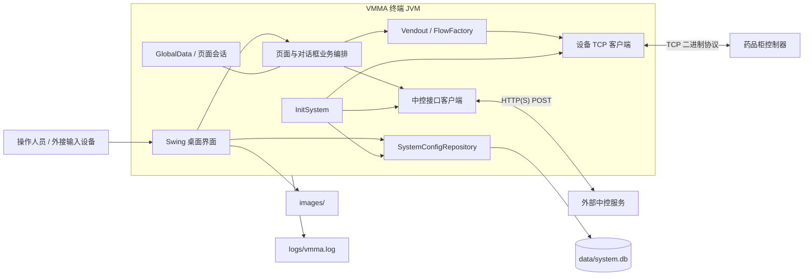
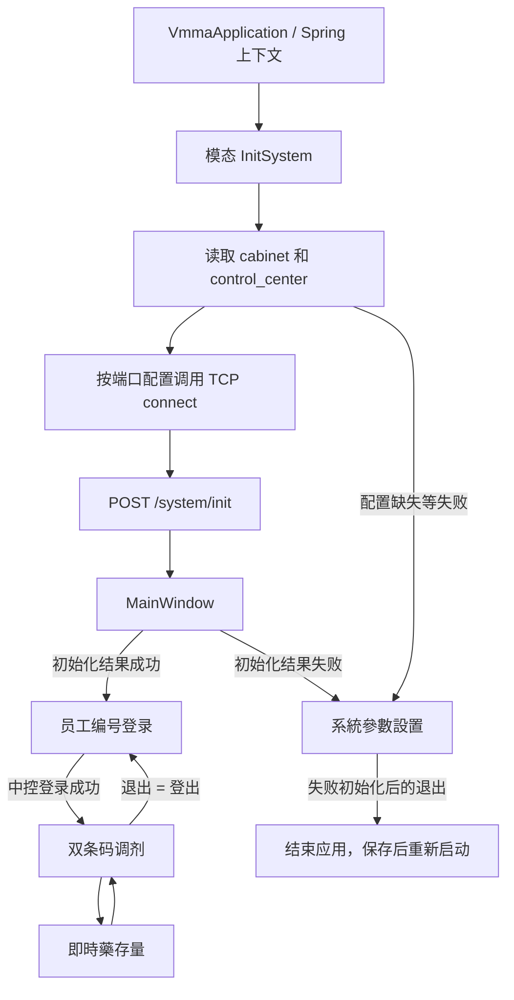
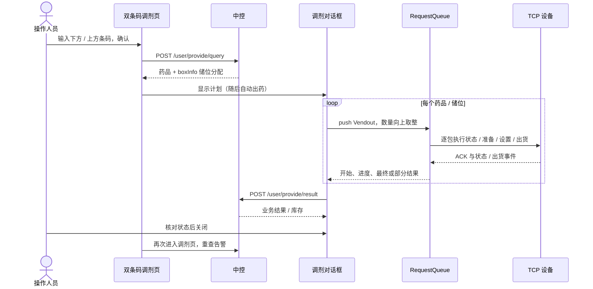
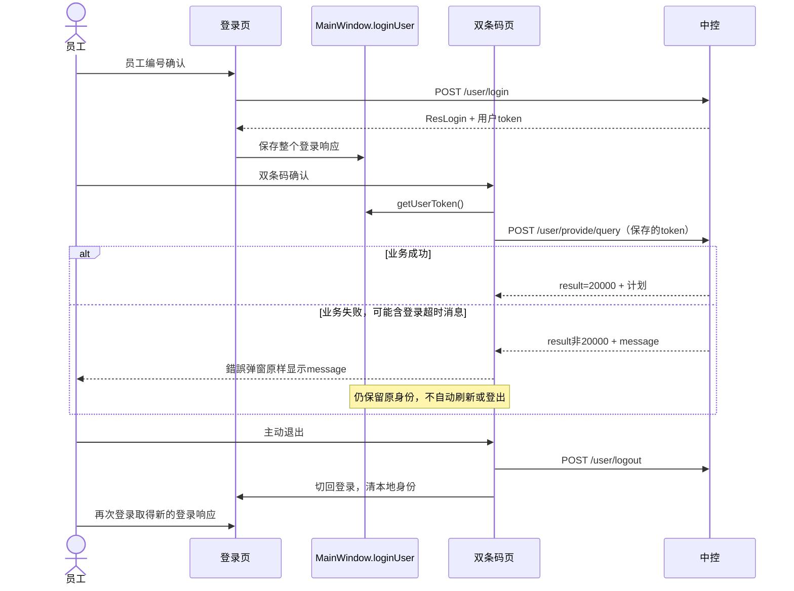
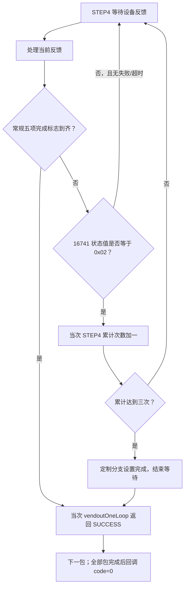

# 项目架构

> 基线：`mj2` / `b8e9ebe`，2026-10-10。阅读入口：[文档目录](README.md)。

## 阅读导航

| 主题 | 章节 |
| --- | --- |
| 系统边界、技术与模块 | 1–3 |
| 网络、数据责任与发布 | 4–6 |
| 身份、启动、页面及调剂 | 7–10 |
| 组件依赖、线程与状态 | 11 |
| 登录超时与三个完成层面 | 12 |
| 新设备定制与部署证据 | 13 |

源码职责以类和方法为依据，图中的外部服务/控制器不表示仓库包含它们的实现。本文记录当前结构，字段与分支细节见详细设计，现场步骤见操作手册。

## 1. 系统定位与边界

VMMA 是运行在药品柜终端上的桌面客户端。Spring Boot 管理组件、数据库和网络客户端；Swing 展示登录、调剂、库存和配置页面。

应用入口 `VmmaApplication` 显式使用 `headless(false)` 和 `WebApplicationType.NONE`。本项目不提供 Web 页面、内嵌 HTTP 服务或中控服务端；`server.title` 只是桌面窗口配置，不表示监听端口。

中控负责身份认证、药品与处方数据、库存分配和结果接收。设备控制器负责实际机械动作与状态反馈。客户端本地数据库用于系统配置，不是处方、库存或结果的权威业务数据库。

## 2. 技术栈

| 层面 | 当前实现 |
| --- | --- |
| 语言与构建 | Java 8、Maven Wrapper 3.6.3，单 Maven 模块 |
| 容器与桌面 | Spring Boot 2.4.3、Java Swing/AWT |
| HTTP | Spring `RestTemplate`、Apache HttpClient 连接池 |
| 设备通信 | Apache MINA 2.1.4、TCP、自定义二进制协议 |
| 本地持久化 | Spring Data JPA、SQLite JDBC、SQLite 方言 |
| 数据转换 | Lombok、Jackson、Fastjson 1.2.75、Gson、Base64 工具 |
| 发布 | Spring Boot JAR、Assembly JAR、Allatori 混淆步骤 |

## 3. 模块与源码入口

| 目录（相对 `src/main/java/com/mmh/vmma/`） | 职责 |
| --- | --- |
| `VmmaApplication.java` | 创建 Spring 上下文，显示初始化窗口和主窗口 |
| `ui/frames`、`ui/dialogs`、`ui/panels` | 桌面页面、模态对话框及业务编排 |
| `ui/templates`、`ui/common` | 公共控件、键盘、页面/结果常量与全局数据 |
| `controlcenter`、`controlcenter/model` | 中控接口客户端及请求/响应 DTO |
| `restful/client` | HTTP 连接池、超时、连接清理和调度器 |
| `mina/socket/signage` | 设备 TCP 客户端、编解码、心跳和重连 |
| `mina/socket/signage/flow`、`queue` | 出药动作流程及请求/响应队列 |
| `mina/socket/message/signage` | 协议头、数据块及具体消息 |
| `jpa`、`systemvalue` | 配置表、Repository 和配置对象 |
| `utils` | JSON、日期、地址、字节转换、图片与摘要工具 |
| `hibernate/dialect` | 保留的空方言类；运行配置实际使用第三方方言 |

详细接口和数据结构见 [详细设计](DETAILED_DESIGN.md)。

## 4. 逻辑拓扑



每个终端以配置的 terminalId 向中控注册和发起业务请求。中控接口代码是请求客户端，仓库不包含中控部署、数据库迁移或服务端库存扣减算法。

当前设备连接是**单一共享客户端与队列**：初始化遍历端口但不创建独立实例，发送又要求唯一会话。多端口配置不是多柜隔离支持，部署时不能假设按柜分别路由任务。

业务流程直接分布在 Swing 页面、模态对话框与出药类中，没有独立的统一业务 Service 层。Spring 单例依赖和页面状态在多个页面间共享，因此不能把页面实例或连接当作彼此隔离的用户会话。

## 5. 数据责任与一致性

| 数据 | 权威来源 / 客户端处理 |
| --- | --- |
| 终端与连接参数 | 本地 SQLite 配置；启动时读取 |
| 系统 token | 初始化接口返回，保存在内存 |
| 用户与菜单 | 登录接口返回，供页面显示和操作判断 |
| 药品、处方、储位库存 | 中控返回；客户端展示、展开或筛选 |
| 机械动作结果 | 设备请求响应和事件；客户端转换为取药结果 |
| 取药业务记录 | 客户端 POST 给中控，服务端处理细节不在仓库 |
| 图片 | 外部 `images/` 图标或接口返回的药品图片 |
| 运行诊断 | 本地滚动日志，不等同于完整业务审计 |

一次调剂横跨中控查询、设备物理动作和中控结果回传，三者没有统一数据库事务。设备已经出药而 HTTP 回传失败时，本地没有可用于自动补偿的持久化业务队列。备份或恢复 `system.db` 不能恢复处方状态、撤销出药或回滚中控库存。

## 6. 运行与发布视图

运行实例需要 Java 8 图形环境、可读的图片/配置和可写的数据库/日志路径。默认数据库与图片均使用相对路径，因此 **Working directory 是部署配置的一部分**。

| 文件/目录 | 运行或发布意义 |
| --- | --- |
| `src/main/resources/application.yaml` | 打包内默认参数；允许外部配置覆盖 |
| `data/system.db` | 当前配置库，必须与终端环境一致 |
| `images/` | 文件系统加载的桌面图标，不能只部署 JAR |
| `logs/` | 运行诊断与故障材料，需访问控制和脱敏 |
| `target/` | 本地构建产物，不受版本控制 |
| `lib/allatori.jar` | 混淆构建工具，不受 Git 跟踪 |
| `lib/imdc-face-lib.jar` | 历史库；当前 POM 没有接入为依赖 |
| `VMMA.cmd` | 历史 Windows 拨号/启动脚本，不是通用发布入口 |
| `data/` 中其他数据库与脚本 | 历史资料，不能据文件存在推断当前读写这些表 |

### 6.1 构建流水线与产物

```text
Maven clean
  → resources / compile / testCompile
  → Surefire（当前 POM 跳过测试）
  → jar
  → Spring Boot repackage
  → Assembly single
  → copy/filter allatori.xml
  → exec java -jar lib/allatori.jar（可用 exec.skip 跳过）
```

Spring Boot 重打包先于 Assembly；两者产物结构不能按文件大小互相替代。

| 产物 | 类布局与入口 | 发布定位 |
| --- | --- | --- |
| `MMH-VMMA-1.0.jar` | 应用位于 `BOOT-INF/classes`，依赖位于 `BOOT-INF/lib`；`JarLauncher` 加载 `Start-Class` | 常规 Windows/JDK 8 部署包 |
| `MMH-VMMA-1.0-jar-with-dependencies.jar` | 保留 Boot 布局又合并依赖，清单主类却是根路径的 `VmmaApplication`；已观察到根路径无该类 | 当前不作为直接 `java -jar` 部署入口 |
| `obf-MMH-VMMA-1.0.jar` | Allatori 对输入 Boot 包生成的另一产物 | 需正式授权并单独确认发布；本地已观察到 DEMO 禁止商用 |

一般构建可通过 `-Dexec.skip=true` 跳过最后的混淆执行；不会取消前面的 Boot/Assembly 打包。授权混淆构建需具备正式工具，核对 Allatori 配置中的输入输出文件和本地 classpath。`Log file is not set` 是混淆日志未配置的提示，不等同于 classpath 故障。

### 6.2 工作目录与平台分工

编译机生成 Java 类和包含依赖的 JAR，Windows 终端提供 JVM、桌面会话、字体、键盘输入、文件权限和可访问的中控/设备网络。JAR 不包含现场的配置数据库和外部 `images/`，也不会自动建立拨号连接。

当前 `VMMA.cmd` 带固定目录、旧 JAR 名称、`wmic` 和 `rasdial`；不同 Windows 11 安装不一定提供这些历史条件。它不是新版启动架构的必要部分。

默认 SQLite JDBC 包含 Windows x86/x86_64 原生库；不需要为跨平台构建手工把仓库中的 `data/sqlite3.dll` 复制进 JAR。加载 JNI 的临时目录、运行账号权限和现场软件策略仍属于部署条件。

## 7. 安全与维护边界

系统与用户 token 是不同用途的内存字段；本地配置 JSON BLOB 不加密。摘要工具依赖源码中的固定共享值，但当前员工编号登录的密码字段为空；配置页没有管理员密码验证，不能视作完整权限系统。

网络层支持 HTTP 和 HTTPS，但现场需要自行管理可信服务地址、证书、终端权限和日志访问。设备 TCP 协议不能被当成对任意网络开放的安全接口。

当前测试目录以手工示例为主，且 POM 默认跳过测试。中控联调、设备兼容、图形桌面、掉线与部分出药场景需要在授权测试环境中确认；本项目没有可据此宣称的全自动端到端验证流水线。

## 8. 启动与页面生命周期



`InitSystem` 后台线程依次读取配置、发起设备连接、注册终端，窗口关闭后主程序显示 `MainWindow`。缺少柜体或中控配置时显示红色提示并返回失败结果，主窗口随后转配置页。

初始化的“成功”不等于完整健康检查：连接等待主要检查是否仍为 CONNECTING，中控初始化未完整校验业务成功码；串口和 TCP Server 仅有“正在建设中”日志。配置解析等异常也可能令初始化窗口一直停留。

主窗口实际注册 `PAGE_MANAGE`、`PAGE_LOGIN`、`PAGE_MKGENERAL_DRUG`、`PAGE_MKDRUGS_STATUS` 和临时空白卡片。`JPFunctions` 没有注册，不能据其按钮定义推断功能菜单可用。

主窗口无边框、不可调整大小，最终固定为 1280×800，并非真正自适应全屏。各页通过先切临时卡片再切目标卡片触发显示事件：登录页清身份，调剂页清条码并重查告警，库存页重新查询库存。详情窗口每次新建；一般出药对话框是复用的 Spring 组件。

## 9. 核心调剂时序



当前操作以药袋双条码为入口，查询时病历号和医嘱号为空，由中控返回后供展示及结果回传。客户端不从病床列表选择处方，也不以 `IsProvided` 字段过滤旧版计划。

设备队列同步、串行执行储位任务。当前单包成功有常规完成条件和新设备定制两条路径，见第 13 章；单个任务失败终止该任务余下包数，但不会取消队列中的其他储位任务。全部储位有终结回调后才发起中控结果回传；关闭按钮可用本身不代表中控已记账。

## 10. 功能边界与扩展约束

| 状态 | 功能 / 限制 |
| --- | --- |
| 可达 | 员工编号登录、双条码调剂、告警列表、库存分页、只读药品详情 |
| 有条件可达 | 配置页：初始化失败时进入；正常登录后的管理菜单未接线 |
| 入口隐藏 | `DlgBatchProvide` 批次取药；库存搜索栏 |
| 页面未接线 | `JPFunctions` 的一般/紧急/临时取药、管理等菜单 |
| 通信未实现 | 串口、TCP Server、UDP；配置标签不能作为支持承诺 |
| 无完整流程 | 指纹/人脸/独立刷卡登录、密码修改、补药、盘点、退药、独立 QRCode |
| 无执行闭环 | 闲置自动登出、离线调剂、持久化回写重试、统一取消出药 |

正常登录实际只提交员工编号，密码字段为空；roles/menuItems 虽有模型，但核心页面没有完整本地角色限制。身份与业务授权必须由中控和现场制度确认，不能依赖未接线的菜单检查。

扩展功能前应先补齐页面注册、输入校验、鉴权、计划/设备参数映射、部分出药语义、结果对账和异常恢复，而不是仅把隐藏按钮设为可见。设计依据见 [详细设计](DETAILED_DESIGN.md)。

## 11. 组件依赖、线程与状态所有权

### 11.1 主要协作对象

| 对象 | 直接协作 / 数据 | 生命周期与责任 |
| --- | --- | --- |
| `VmmaApplication` | Spring 上下文、`InitSystem`、`MainWindow` | 进程入口，显示初始化和主窗口 |
| `InitSystem` | Repository、GlobalData、SignageIFClient、RestfulDeviceInit | 复用 Bean；一次窗口打开触发后台初始化 |
| `MainWindow` | 登录、配置、调剂、库存页面及 ResLogin | 维护卡片切换与当前用户身份 |
| `JPMKGeneralProvide` | 查询/库存/登出 HTTP 客户端、一般出药对话框 | 条码输入、计划获取及页面告警 |
| `DlgGeneralProviding` | 当前计划、请求队列、回调结果 Map、结果客户端 | 展示并自动编排每药品/储位任务 |
| `JPMKDrugsStatus` | 库存 HTTP 客户端、VMMedicine 列表、详情窗口 | 查询并展开储位视图 |
| `JPVMConfig` | 配置实体/模型、Repository | 编辑并分别保存两项本地配置 |
| `Restful*` | GlobalData、RestTemplate、请求/响应 DTO | 按固定接口执行同步 POST |
| `RequestQueue` | SignageIFClient、ResponseQueue、FlowFactory FIFO | 单工作线程同步执行出药任务 |
| `SignageIFClient` | MINA connector、过滤器、codec、ResponseQueue | TCP 传输和接收 ID 分派 |

它们不是“一个线程对应一层”的隔离架构：UI 直接调用网络和持久化，设备线程通过回调触及 UI 与 HTTP 结果回写。

### 11.2 线程视图

| 执行来源 | 当前工作 | 对系统行为的意义 |
| --- | --- | --- |
| main 线程 | Spring 启动、显示窗口 | 启动不经专门的 Swing 引导 Service |
| Swing 事件处理 | 输入、登录、查询、配置保存、页面切换 | 同步网络/数据库调用可让界面等待 |
| 初始化普通线程 | 读取配置、等待设备连接、注册中控、改进度 | 直接更新 Swing 控件 |
| 查询动画普通线程 | 周期追加点号到读取提示 | 是等待动画，不是秒数倒计时 |
| 请求队列线程 | `Vendout.start()`、设备等待、UI 回调与结果回写 | 回写的 HTTP 等待也占用该队列线程 |
| MINA 事件处理 | 字节接收/解码/分派、断线事件中的重连 | 不包含独立持久化事件审计 |
| TCP 连接 / 保活线程 | 连接重试、固定保活发送 | 与应用业务会话有效期没有等价关系 |
| Spring 调度线程 | HTTP 过期/闲置连接清理 | 不负责自动登出、库存刷新或 token 续期 |

线程/队列是进程内结构，重启会丢弃其内存状态。此处描述执行来源，不保证所有 Swing 更新已经在 EDT 上调度。

### 11.3 状态与标识

| 状态 / 标识 | 保存位置 | 使用范围 |
| --- | --- | --- |
| 客户、终端、中控 URL、系统 token | `GlobalData` | 当前进程全局 |
| 登录响应、用户 token | `MainWindow.loginUser` | 当前用户及业务请求 |
| 完整取药计划 | 一般出药对话框 | 当前模态流程，结束后清理/复用 |
| `medicineId-boxId` | 本次储位结果 Map / Vendout id | 本地关联开始回调，不发送给设备 |
| IndexID | Message 静态序号 | 设备命令确认匹配，不是中控订单号 |
| `count` / `loop` | Vendout 与 ResponseMessage | 任务计划包数及尝试/完成回调语义 |
| 库存行 / 页码 | 页面内存模型 | 展示与分页，不是库存权威来源 |

同一药品的多个储位可产生多个任务；单任务、单药品、整笔计划和当前登录会话是不同作用域，不能把其中一个计数当作其他作用域的完成状态。

## 12. 会话超时、异常显示与完成语义

### 12.1 客户端没有登录倒计时

`Settings.SIGNOUT_TIMEOUT=45`、`MainWindow.countSignoutTime/signoutCounter/resetCounter/stopCounter` 是保留定义；没有计数递增、达到阈值登出或屏幕剩余秒数更新。唯一重置调用在未注册的 `JPFunctions` 显示事件中。

系统 token 的初始化响应带 `expireddate`，用户登录响应模型则没有对应到期字段。客户端也没有读取到期时间执行刷新、按 token 内容计算倒计时或统一身份失效拦截器。

### 12.2 扫码错误为何可能要求重新登录



这个流程解释了“中控拒绝旧凭证、用户重新登录后恢复”的可能性，但没有现场的 result/message 不能断定一定是 token 到期、异地登录或服务端会话规则，更不能从客户端推算有效期分钟数。

### 12.3 异常分层

| 层面 | 观察入口 | 不应混淆的含义 |
| --- | --- | --- |
| 中控业务错误 | HTTP 响应的 `result/message` | 与 TCP 状态、HTTP 网络等待秒数不同 |
| HTTP 连接/读取异常 | RestTemplate 抛出，页面 catch 日志 | 不能凭超时断定服务端没有处理请求 |
| 设备流程失败 | `501/503` 回调及 STEP 日志 | 不是用户登录失效，也不是中控结果码 |
| 结果回写错误 | 出药窗口底部黄色消息 | 设备流程可能已结束，业务记录仍待核对 |
| 界面一直等待 | 队列、数据、回调、EDT 或初始化异常 | 无法仅据界面状态判断实物是否已出药 |

### 12.4 三个完成边界

1. **设备流程完成**：某个 Vendout 全部 count 包被程序判定完成，回调 `0/loop=count`。
2. **中控接受结果**：`/user/provide/result` 返回业务成功，客户端取得该响应。
3. **现场对账完成**：按医院规程核对实际药品、处方和中控记录；源码不实现该现场审批。

按钮启用、最后一条成功提示、TCP CONNECTED 或恢复本地配置库，都不能把这三个层面合并为一个事务。

## 13. 新设备定制与发布证据

### 13.1 当前 STEP4 的两条成功路径

`b8e9ebe` 按客户要求修改了 `Vendout`，下图仅说明代码执行，不评价该需求：



图中按概念归纳反馈判定；源码事件处理顺序和失败/超时分支详见 [详细设计](DETAILED_DESIGN.md)。

“三次”是**同一包 STEP4 中累计三次状态值恰好 `0x02`**，不要求连续；不是任意三个异常状态，不是所有四步重试三次，也不是用户重新扫码三次。计数在每次 `vendoutOneLoop` 的 STEP4 中重新建立。

该路径直接结束当前包等待并返回 SUCCESS，不要求当时已收齐常规五项标志。它没有 YAML 开关、按终端号选择或独立设备版本策略。UI 后续仍按任务成功回调归集数量/状态并回写，因此发布交接必须记录这一定制已包含在当前包中。

### 13.2 报文长度变更

`SignageIFDecoder` 对两个 length 字节分别执行 `& 0xFF`，再按小端组合。此修改作用于长度解析；不能扩展描述成所有消息字段、分片、校验或数值转换均已调整。

### 13.3 构建与运行证据的范围

2026-10-10 曾在本机使用 Oracle JDK `1.8.0_371`、Maven Wrapper `3.6.3` 完成构建；主源码 97 文件、测试源码 6 文件编译，Surefire 按 POM 跳过执行。普通包的应用/依赖非多版本字节码不高于 Java 8，包含 Windows SQLite x86/x86_64 DLL。

这些是构建和包结构证据，不是 Windows 11 客户现场运行记录。本次文档更新不启动程序，不连接真实中控或药柜；正式运行仍须使用批准的 Java 8 桌面环境、现场配置和匹配的设备/中控版本。

### 13.4 交接时固定的信息

| 信息 | 应固定的内容 |
| --- | --- |
| 版本 | Git 分支/提交、发布 JAR 文件名、SHA-256、是否混淆及工具授权 |
| 执行环境 | Windows 版本、Java 提供方/版本/位数、启动账号和 Working directory |
| 业务配置 | 受控终端编号、中控接口版本、设备地址/端口及储位映射 |
| 定制行为 | 三次 `0x02` 成功路径已启用且无运行开关；现场如何核对取药与回写 |
| 数据保护 | 配置库的来源/字符集/备份方式；脱敏日志与受控原件的保存范围 |
| 操作边界 | 主动登出、计划确认后自动出药、不能用重启或重复扫码代替对账 |
