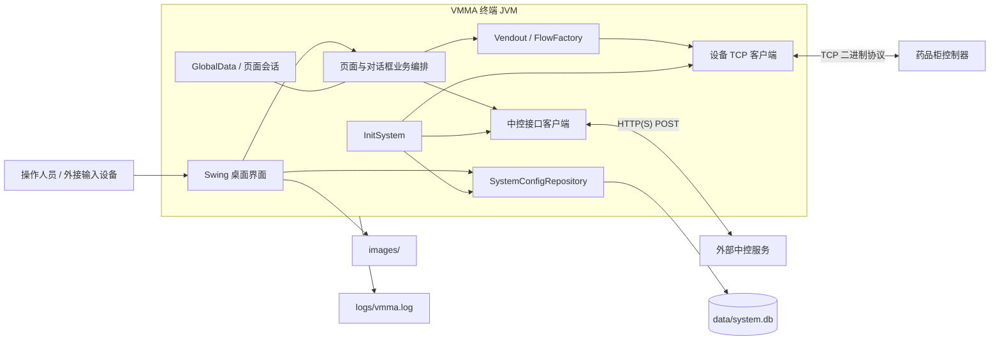
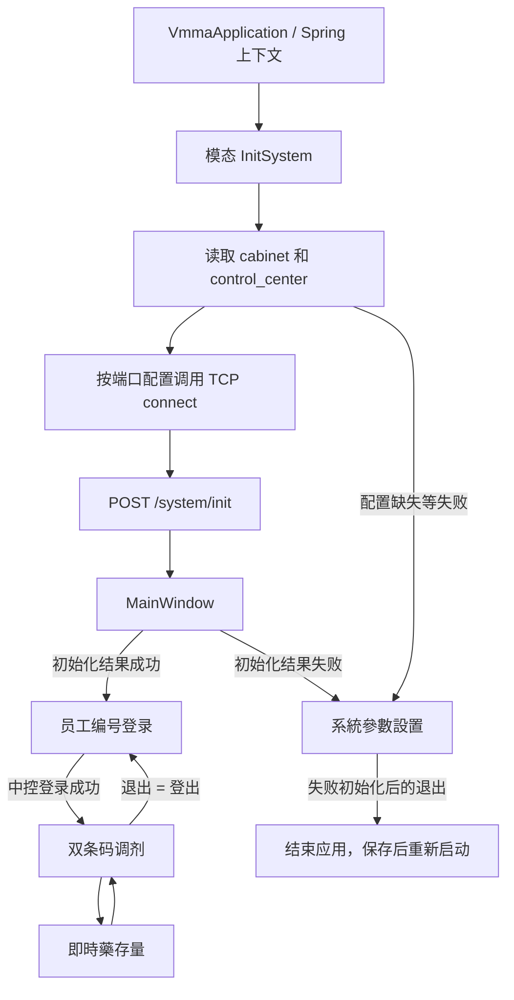
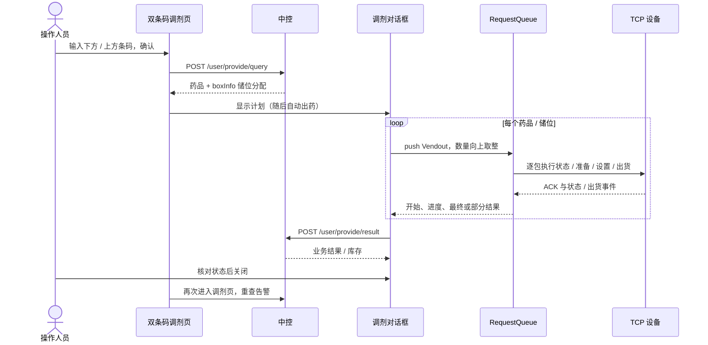

# 项目架构

> 基线：`mj2` / `bbf189c`，2026-10-10。阅读入口：[文档目录](README.md)。

## 1. 系统定位与边界

VMMA 是运行在药品柜终端上的桌面客户端。Spring Boot 管理组件、数据库和网络客户端；Swing 展示登录、调剂、库存和配置页面。

应用入口 `VmmaApplication` 显式使用 `headless(false)` 和 `WebApplicationType.NONE`。本项目不提供 Web 页面、内嵌 HTTP 服务或中控服务端；`server.title` 只是桌面窗口配置，不表示监听端口。

中控负责身份认证、药品与处方数据、库存分配和结果接收。设备控制器负责实际机械动作与状态反馈。客户端本地数据库用于系统配置，不是处方、库存或结果的权威业务数据库。

## 2. 技术栈

| 层面 | 当前实现 |
| --- | --- |
| 语言与构建 | Java 8、Maven Wrapper 3.6.3，单 Maven 模块 |
| 容器与桌面 | Spring Boot 2.4.3、Java Swing/AWT |
| HTTP | Spring `RestTemplate`、Apache HttpClient 连接池 |
| 设备通信 | Apache MINA 2.1.4、TCP、自定义二进制协议 |
| 本地持久化 | Spring Data JPA、SQLite JDBC、SQLite 方言 |
| 数据转换 | Lombok、Jackson、Fastjson 1.2.75、Gson、Base64 工具 |
| 发布 | Spring Boot JAR、Assembly JAR、Allatori 混淆步骤 |

## 3. 模块与源码入口

| 目录（相对 `src/main/java/com/mmh/vmma/`） | 职责 |
| --- | --- |
| `VmmaApplication.java` | 创建 Spring 上下文，显示初始化窗口和主窗口 |
| `ui/frames`、`ui/dialogs`、`ui/panels` | 桌面页面、模态对话框及业务编排 |
| `ui/templates`、`ui/common` | 公共控件、键盘、页面/结果常量与全局数据 |
| `controlcenter`、`controlcenter/model` | 中控接口客户端及请求/响应 DTO |
| `restful/client` | HTTP 连接池、超时、连接清理和调度器 |
| `mina/socket/signage` | 设备 TCP 客户端、编解码、心跳和重连 |
| `mina/socket/signage/flow`、`queue` | 出药动作流程及请求/响应队列 |
| `mina/socket/message/signage` | 协议头、数据块及具体消息 |
| `jpa`、`systemvalue` | 配置表、Repository 和配置对象 |
| `utils` | JSON、日期、地址、字节转换、图片与摘要工具 |
| `hibernate/dialect` | 保留的空方言类；运行配置实际使用第三方方言 |

详细接口和数据结构见 [详细设计](DETAILED_DESIGN.md)。

## 4. 逻辑拓扑

每个终端以配置的 terminalId 向中控注册和发起业务请求。中控接口代码是请求客户端，仓库不包含中控部署、数据库迁移或服务端库存扣减算法。

当前设备连接是**单一共享客户端与队列**：初始化遍历端口但不创建独立实例，发送又要求唯一会话。多端口配置不是多柜隔离支持，部署时不能假设按柜分别路由任务。

业务流程直接分布在 Swing 页面、模态对话框与出药类中，没有独立的统一业务 Service 层。Spring 单例依赖和页面状态在多个页面间共享，因此不能把页面实例或连接当作彼此隔离的用户会话。

## 5. 数据责任与一致性

| 数据 | 权威来源 / 客户端处理 |
| --- | --- |
| 终端与连接参数 | 本地 SQLite 配置；启动时读取 |
| 系统 token | 初始化接口返回，保存在内存 |
| 用户与菜单 | 登录接口返回，供页面显示和操作判断 |
| 药品、处方、储位库存 | 中控返回；客户端展示、展开或筛选 |
| 机械动作结果 | 设备请求响应和事件；客户端转换为取药结果 |
| 取药业务记录 | 客户端 POST 给中控，服务端处理细节不在仓库 |
| 图片 | 外部 `images/` 图标或接口返回的药品图片 |
| 运行诊断 | 本地滚动日志，不等同于完整业务审计 |

一次调剂横跨中控查询、设备物理动作和中控结果回传，三者没有统一数据库事务。设备已经出药而 HTTP 回传失败时，本地没有可用于自动补偿的持久化业务队列。备份或恢复 `system.db` 不能恢复处方状态、撤销出药或回滚中控库存。

## 6. 运行与发布视图

运行实例需要 Java 8 图形环境、可读的图片/配置和可写的数据库/日志路径。默认数据库与图片均使用相对路径，因此 **Working directory 是部署配置的一部分**。

| 文件/目录 | 运行或发布意义 |
| --- | --- |
| `src/main/resources/application.yaml` | 打包内默认参数；允许外部配置覆盖 |
| `data/system.db` | 当前配置库，必须与终端环境一致 |
| `images/` | 文件系统加载的桌面图标，不能只部署 JAR |
| `logs/` | 运行诊断与故障材料，需访问控制和脱敏 |
| `target/` | 本地构建产物，不受版本控制 |
| `lib/allatori.jar` | 混淆构建工具，不受 Git 跟踪 |
| `lib/imdc-face-lib.jar` | 历史库；当前 POM 没有接入为依赖 |
| `VMMA.cmd` | 历史 Windows 拨号/启动脚本，不是通用发布入口 |
| `data/` 中其他数据库与脚本 | 历史资料，不能据文件存在推断当前读写这些表 |

打包执行顺序包含 Spring Boot、Assembly、Allatori 配置拷贝及外部 Java 执行。一般构建可通过 `-Dexec.skip=true` 跳过最后的混淆执行；授权混淆构建需补齐本地工具及 Allatori classpath。具体命令见 [项目首页](../README.md)。

## 7. 安全与维护边界

系统与用户 token 是不同用途的内存字段；本地配置 JSON BLOB 不加密。摘要工具依赖源码中的固定共享值，但当前员工编号登录的密码字段为空；配置页没有管理员密码验证，不能视作完整权限系统。

网络层支持 HTTP 和 HTTPS，但现场需要自行管理可信服务地址、证书、终端权限和日志访问。设备 TCP 协议不能被当成对任意网络开放的安全接口。

当前测试目录以手工示例为主，且 POM 默认跳过测试。中控联调、设备兼容、图形桌面、掉线与部分出药场景需要在授权测试环境中确认；本项目没有可据此宣称的全自动端到端验证流水线。

## 8. 启动与页面生命周期

`InitSystem` 后台线程依次读取配置、发起设备连接、注册终端，窗口关闭后主程序显示 `MainWindow`。缺少柜体或中控配置时显示红色提示并返回失败结果，主窗口随后转配置页。

初始化的“成功”不等于完整健康检查：连接等待主要检查是否仍为 CONNECTING，中控初始化未完整校验业务成功码；串口和 TCP Server 仅有“正在建设中”日志。配置解析等异常也可能令初始化窗口一直停留。

主窗口实际注册 `PAGE_MANAGE`、`PAGE_LOGIN`、`PAGE_MKGENERAL_DRUG`、`PAGE_MKDRUGS_STATUS` 和临时空白卡片。`JPFunctions` 没有注册，不能据其按钮定义推断功能菜单可用。

主窗口无边框、不可调整大小，最终固定为 1280×800，并非真正自适应全屏。各页通过先切临时卡片再切目标卡片触发显示事件：登录页清身份，调剂页清条码并重查告警，库存页重新查询库存。详情窗口每次新建；一般出药对话框是复用的 Spring 组件。

## 9. 核心调剂时序

当前操作以药袋双条码为入口，查询时病历号和医嘱号为空，由中控返回后供展示及结果回传。客户端不从病床列表选择处方，也不以 `IsProvided` 字段过滤旧版计划。

设备队列同步、串行执行储位任务。单个任务失败终止该任务余下包数，但不会取消队列中的其他储位任务。全部储位有终结回调后才发起中控结果回传；关闭按钮可用本身不代表中控已记账。

## 10. 功能边界与扩展约束

| 状态 | 功能 / 限制 |
| --- | --- |
| 可达 | 员工编号登录、双条码调剂、告警列表、库存分页、只读药品详情 |
| 有条件可达 | 配置页：初始化失败时进入；正常登录后的管理菜单未接线 |
| 入口隐藏 | `DlgBatchProvide` 批次取药；库存搜索栏 |
| 页面未接线 | `JPFunctions` 的一般/紧急/临时取药、管理等菜单 |
| 通信未实现 | 串口、TCP Server、UDP；配置标签不能作为支持承诺 |
| 无完整流程 | 指纹/人脸/独立刷卡登录、密码修改、补药、盘点、退药、独立 QRCode |
| 无执行闭环 | 闲置自动登出、离线调剂、持久化回写重试、统一取消出药 |

正常登录实际只提交员工编号，密码字段为空；roles/menuItems 虽有模型，但核心页面没有完整本地角色限制。身份与业务授权必须由中控和现场制度确认，不能依赖未接线的菜单检查。

扩展功能前应先补齐页面注册、输入校验、鉴权、计划/设备参数映射、部分出药语义、结果对账和异常恢复，而不是仅把隐藏按钮设为可见。设计依据见 [详细设计](DETAILED_DESIGN.md)。
