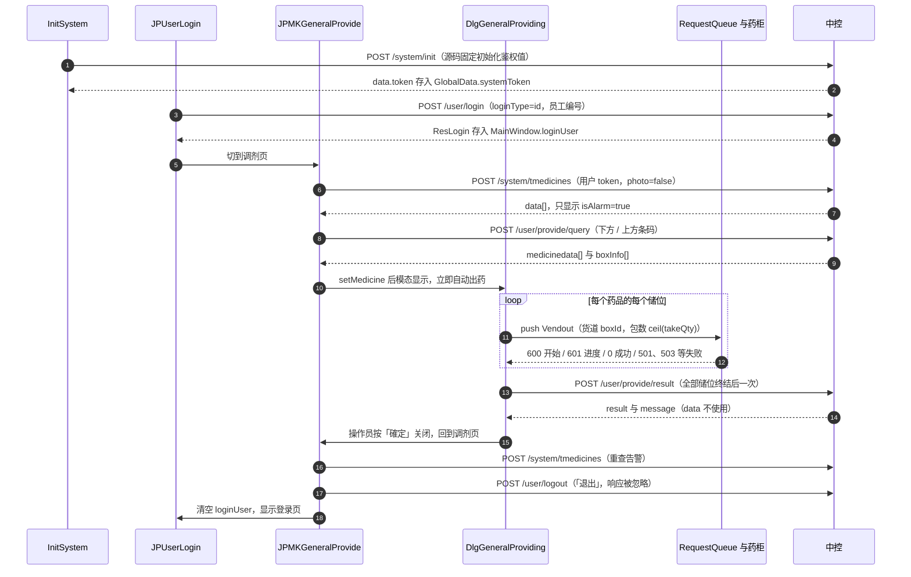

# 中控接口说明

> 基线：`mj2` / `b8e9ebe`（代码），整理日期 2026-11-19。阅读入口：[文档目录](README.md)。

本文是终端（本仓库的 Swing 客户端）调用外部中控 HTTP 接口的逐接口参考：每个接口的路径、调用方与触发时机、请求/响应字段、**经真实序列化器验证的请求示例**、示意响应示例，以及客户端对成功、业务失败和异常的界面处理。中控服务端不在仓库，本文只说明**客户端实际发送什么、能够解析什么**；字段业务含义、服务端校验、token 有效期等凡未在客户端代码中体现的，均标注“服务端契约不在仓库”。背景设计见 [详细设计](DETAILED_DESIGN.md) 第 2–3 章、[架构](ARCHITECTURE.md) 第 5、12 章和 [barcode-dispensing 规格](../openspec/specs/barcode-dispensing/spec.md)。

## 阅读导航

| 主题 | 章节 |
| --- | --- |
| 接口清单、状态词汇、保留与未接线对象 | 1 |
| URL、请求头、报文外层与默认值、时间、token、结果码、序列化/解析、HTTP 传输与异常 | 2 |
| 终端注册 `/system/init` | 3 |
| 员工登录 `/user/login` | 4 |
| 药品库存与告警 `/system/tmedicines`（含 `VMMedicine` 映射） | 5 |
| 调剂计划查询 `/user/provide/query`（含隐藏的批次变体） | 6 |
| 取药结果回写 `/user/provide/result` | 7 |
| 员工登出 `/user/logout` | 8 |
| 行为记录 `/user/action`（保留） | 9 |
| 典型调用时序 | 10 |
| 已知限制 | 11 |
| 源码索引 | 12 |

**示例约定**：示例只使用占位值——基础 URL `https://cc.example.local/vmma`、终端编号 `TERM-0001`、`<system-token>`、`<user-token>`、员工编号 `EMP-0001`、`<lower-barcode>`/`<upper-barcode>`、药品 `MED-0001`、储位 `"3"`/`"5"` 等。请求示例是真实序列化输出（验证方法见 2.12）；响应示例均为**示意：字段名来自客户端 DTO，服务端契约不在仓库**。源码位置写作 `类名:行` 或 `类名:起–止`，路径相对 `src/main/java/com/mmh/vmma/`。

## 1. 总览

### 1.1 接口清单

| # | 路径 | 客户端类 | 调用方（类:行） | 触发时机 | 请求 token | 响应解析 | 状态 |
| --- | --- | --- | --- | --- | --- | --- | --- |
| 1 | `/system/init` | `RestfulDeviceInit` | `InitSystem.initSetting():270–279` | 启动初始化窗口的后台线程，在读取配置与 TCP 连接步骤之后 | 源码内置固定值（不在文档中列出） | Jackson → `ResDeviceInit` | 在用 |
| 2 | `/user/login` | `RestfulLogin` | `JPUserLogin.userIDLogin():320–333` | 登录页员工编号按 Enter 或「確認」 | 无 token 字段 | Jackson → `ResLogin` | 在用 |
| 3 | `/system/tmedicines` | `RestfulTMMedicines` | `JPMKGeneralProvide.getAlarmDrugsList():673–679`（`photo=false`）；`JPMKDrugsStatus.getMedicineList():521–526`（`photo=true`） | 调剂页每次显示；「即時藥存量」库存页每次显示 | 用户 token（调用方显式设置；为 null 时回落系统 token） | String → Fastjson → `ResTMedicines` | 在用 |
| 4 | `/user/provide/query` | `RestfulProvideQuery` | `JPMKGeneralProvide.getDrugInfo():616–624`；批次：`DlgBatchProvide.getDrugInfo():375–390` | 上方条码按 Enter 或「確認」；批次为隐藏的「批次取藥」 | 用户 token | String → Fastjson → `ResProvideQuery` | 在用；批次变体隐藏 |
| 5 | `/user/provide/result` | `RestfulProvideResult` | `DlgGeneralProviding.updateProvidedResult():490–511`；批次：`DlgBatchProvide.updateProvidedResult():458–479` | 本次计划的全部储位任务都收到终结回调后，发送一次 | 用户 token | String → Fastjson → `ResProvideResult` | 在用；批次变体隐藏 |
| 6 | `/user/logout` | `RestfulLogout` | `JPMKGeneralProvide.logout():795–798`；`MainWindow.userLogout():309–312` | 调剂页「退出」；`MainWindow` 路径在常规导航下不可达 | 用户 token | Jackson → `ResLogout` | 在用；`MainWindow` 路径未接线 |
| 7 | `/user/action` | `RestfulActions` | 无 | — | 不自动补（字段注释为 user token） | Jackson → `ResActions` | 保留 |

源码注释中出现两个中控接口编号：`ReqTMedicines` 的 `SYS015_tmedicines`（`ReqTMedicines:15`）和 `CONSTANTS` 的 `USR005_ProvideResult`（`CONSTANTS:11`）；其余接口没有编号注释。全部接口都是 HTTP POST + JSON 请求体，没有 GET、查询参数或文件上传。

### 1.2 状态词汇

| 状态 | 本文中的含义 |
| --- | --- |
| 在用（常规可达） | 正常导航（启动 → 登录 → 调剂 / 库存 → 退出）会调用 |
| 隐藏或未接线 | 代码可执行，但入口按钮隐藏或页面未注册，常规导航到达不了 |
| 保留 | 代码存在，仓库内没有调用方 |
| 待现场确认 | 取决于中控服务端实现或现场环境，仓库内无法证明 |

### 1.3 保留、未接线与仅保存的对象

| 对象 | 状态 | 依据 |
| --- | --- | --- |
| `RestfulClient`（通用 `postForEntity`） | 保留 | `@Component`（`RestfulClient:14–23`），全仓库没有注入或调用 |
| `IRestfulClient` | 接口 | 只声明 `doPost(String, Object, Class)`（`IRestfulClient:10–12`），7 个业务客户端实现它，业务调用走各自的 `doPost(ReqXxx)` |
| `RestfulActions` / `ReqActions` / `ResActions` | 保留 | 全仓库无引用，见第 9 章 |
| `controlcenter/model/SqlEntity` | 保留（未使用） | 字段 `userid/datetime/terminalid/action/token`（`SqlEntity:12–19`），全仓库无引用，也不是 JPA 实体 |
| `MainWindow.userLogout()` | 未接线 | 只被 `exitSystem()`（`loginUser` 非空时）和未注册的 `JPFunctions:146` 调用；登录页显示时 `JPUserLogin.resetAttributes():287` 已把 `loginUser` 置空，因此登录页「退出」不会走登出请求 |
| `DlgBatchProvide` 的查询与回写 | 隐藏 | 唯一入口「批次取藥」在 `JPMKDrugsStatus:333` 被 `setVisible(false)` |
| `CONSTANTS.ERR_NOTENOUGH(2)` / `ERR_DRUGWRONG(3)` | 保留 | 客户端从不赋值，见 2.7 |
| `ResponseCode` 中除 `OK` 外的常量 | 保留 | 客户端只与 `OK` 比较，没有按码分支，见 2.6 |
| `GlobalData.deviceInit` | 仅保存 | `InitSystem:279` 写入初始化响应，无读取方 |
| `VMMedicine` | 在用（界面模型） | 由 `/system/tmedicines` 响应按储位展开，见 5.10 |

## 2. 通用约定

### 2.1 URL 组成

基础地址来自配置库 `control_center` 记录的 `CenterControl.address`，初始化时写入 `GlobalData.ccBaseUrl`（`InitSystem:265–266`），之后不热更新。每个客户端用同一段逻辑拼接固定路径（如 `RestfulLogin:32–34`）：

```text
url = ccBaseUrl.endsWith("/") ? ccBaseUrl + "user/login" : ccBaseUrl + "/user/login"
```

| `control_center.address`（示例） | 拼接结果 |
| --- | --- |
| `https://cc.example.local/vmma` | `https://cc.example.local/vmma/user/login` |
| `https://cc.example.local/vmma/` | `https://cc.example.local/vmma/user/login` |
| `https://cc.example.local` | `https://cc.example.local/user/login` |
| `https://cc.example.local/vmma//` | 字符串为 `…/vmma//user/login`；HttpClient 默认 URI 规范化（`normalizeUri=true`）发送时折叠空路径段，harness 实测请求行仍为 `/vmma/user/login` |

只处理一个末尾 `/`；没有按接口切换服务器、没有统一 URL 前缀配置。

### 2.2 HTTP 请求格式

下表是用真实客户端类向本机桩服务发送后抓到的请求头（验证方法见 2.12）：

| 项 | 实际值 |
| --- | --- |
| 方法 | 全部 `POST`（各客户端 `restTemplate.postForObject(url, request, cls)`） |
| `Content-Type` | `application/json`（无 charset 参数；Spring 按 UTF-8 写出 JSON） |
| `Accept` | Jackson 直接解析的 4 个接口：`application/json, application/*+json`；先收字符串的 3 个接口：`text/plain, application/json, application/*+json, */*` |
| 鉴权 | 只有 JSON 体内的 `token` 字段；**不发送 `Authorization` 头** |
| 其他头 | `Content-Length`、`Host`、`Connection: Keep-Alive`、`Accept-Encoding: gzip,deflate`、`User-Agent: Apache-HttpClient/4.5.13 (Java/<版本>)` |
| Cookie | 应用代码不读写 Cookie；但 HttpClient 默认 Cookie 管理未关闭，服务端若下发 `Set-Cookie`，同一进程后续请求会自动回送（harness 已验证），当前业务不依赖它 |

### 2.3 报文外层与默认值

调用方只设置 `data`，以及初始化、登录以外接口的 `token`；外层其余字段由各客户端 `doPost(ReqXxx)` 补齐。`Optional.ofNullable(...).orElse(...)` 只判断 null，**空字符串会原样保留**。

| 接口 | 外层字段（实际序列化顺序） | `clientId` / 顶层 `terminalId` | `datetime` | `token` |
| --- | --- | --- | --- | --- |
| `/system/init` | `clientId, datetime, token, data` | 每次设为 `data.terminalId`，其为 null 才取 `GlobalData.terminalId`（`RestfulDeviceInit:36`） | null 才补当前时间（:38） | 每次覆盖为源码内置固定值（:24、:37，不在文档中列出） |
| `/user/login` | `clientId, datetime, data` | 每次覆盖为 `GlobalData.terminalId`（`RestfulLogin:35`） | null 才补（:36） | DTO 无此字段 |
| `/system/tmedicines` | `clientId, datetime, token, data` | null 才补全局终端（`RestfulTMMedicines:36`） | null 才补（:37） | null 才补 `GlobalData.systemToken`（:38） |
| `/user/provide/query` | `clientId, datetime, token, data` | null 才补（`RestfulProvideQuery:36`） | null 才补（:37） | 不补 |
| `/user/provide/result` | `clientId, datetime, token, data` | null 才补（`RestfulProvideResult:36`） | null 才补（:37） | 不补 |
| `/user/logout` | `clientId, datetime, token` | 每次覆盖为全局终端（`RestfulLogout:35`） | **每次覆盖**为当前时间（:36） | 不补 |
| `/user/action` | `terminalId, datetime, token, data` | 顶层是 `terminalId`，null 才补；**没有 `clientId`**（`RestfulActions:35`） | null 才补（:36） | 不补 |

当前调用方都不设置 `clientId`/`datetime`，所以实际值总是“全局终端编号 + 发送时刻”。`data.terminalId` 由调用方用 `GlobalData.terminalId` 显式填写，`doPost` 不会补它。`/user/action` 的 `data` 是数组，其余接口的 `data` 是对象（登出无 `data`）。

### 2.4 时间格式

| 用途 | 格式 / 示例 | 来源 |
| --- | --- | --- |
| 请求 `datetime` | `yyyy-MM-dd'T'HH:mm:ss.SSSZ`，如 `2026-11-19T10:00:00.000+0800`；JVM 默认时区，偏移不带冒号 | `CommonUtils.getDateTime():60–63` |
| 批次查询的 `data.barcodeNo2` | `yyyyMMddHHmmss`，如 `20261119100000` | `DlgBatchProvide:375` |
| 响应 `scrn`、`expiredDate` 的显示 | `CommonUtils.LTZDTFormat()` 按 ISO 本地日期时间 + 可选偏移（`+HH:MM`/`+HHMM`/`+HH`）解析，转为本机时区 `yyyy-MM-dd HH:mm:ss`；解析失败显示原文 | `CommonUtils:205–247` |

请求 `datetime` 是字符串，不是秒/毫秒时间戳；服务端是否校验时钟偏差：服务端契约不在仓库。

### 2.5 三种鉴权值

| 鉴权值 | 获取 | 保存位置 | 使用 |
| --- | --- | --- | --- |
| 初始化鉴权值 | 源码内置固定值（`RestfulDeviceInit:24`，不在文档中列出） | 常量 | 仅 `/system/init` 的 `token` |
| 系统 token | `/system/init` 响应 `data.token`（`InitSystem:278`） | `GlobalData.systemToken`，仅内存，不写配置库 | 只作 `/system/tmedicines` 在调用方 token 为 null 时的回落值；常规页面总是显式传用户 token |
| 用户 token | `/user/login` 响应 `data.token` | 整个 `ResLogin` 存于 `MainWindow.loginUser`（`JPUserLogin:333`），`getUserToken():300–302` 读取 | `/system/tmedicines`、`/user/provide/query`、`/user/provide/result`、`/user/logout` |

- 客户端不读取任何到期字段（`ResDeviceInit.data.expireddate` 不读，`ResLogin` 无到期字段），没有刷新、续期或统一失效拦截；见 [架构 §12.1–12.2](ARCHITECTURE.md)。
- 调剂页「退出」或登录页显示都会清空 `loginUser`（`MainWindow:216–217`、`JPUserLogin:287`）；重新登录得到的新响应替换旧身份。
- 若登录响应的 `data.token` 为 null，查询/回写/登出会发送 `"token" : null`，而库存接口会回落为系统 token（harness 已验证该回落）。

### 2.6 业务结果码

所有响应 DTO 继承 `ResEntity`（`result:int`、`message:String`，`ResEntity:12–16`）。**业务成功是 `result == 20000`（`ResponseCode.OK`），与 HTTP 状态码无关**；HTTP 200 而 `result≠20000` 属于业务失败。

| 常量 | 值 | 按常量名的含义 | 客户端是否单独处理 |
| --- | --- | --- | --- |
| `OK` | `20000` | 成功 | 是，唯一被比较的业务码 |
| `ERR_MISSPARAM` | `40000` | 缺少参数 | 否 |
| `ERR_NOAUTH` | `40100` | 未授权 | 否 |
| `ERR_NOACCOUNT` | `40101` | 无账号 | 否 |
| `ERR_NOPASSWORD` / `ERR_NOTERMID` | `40102` | 密码错误 / 终端编号错误（两常量同值，须看 `message`） | 否 |
| `ERR_NOAPI` | `40400` | 接口不存在 | 否 |
| `ERR_API` | `42200` | 接口错误 | 否 |
| `ERR_TOKEN` | `50008` | token 错误 | 否，没有重新登录或刷新分支 |
| `ERR_SYSTEM` | `50000` | 系统错误 | 否 |
| `ERR_UNIQUE` | `20001` | 唯一性错误 | 否（注意不是成功） |
| `ERR_NOTABLE` | `20002` | 表不存在 | 否 |
| `ERR_INSERT` | `20003` | 写入错误 | 否 |
| `ERR_QUERY` / `ERR_SQL` | `20004` | 查询 / SQL 错误（同值） | 否 |

`ResponseCode` 没有注释，含义按常量名推断；各码的触发条件：服务端契约不在仓库。比较 `OK` 的位置：`JPUserLogin:327`、`JPMKGeneralProvide:628/680`、`JPMKDrugsStatus:527`、`DlgGeneralProviding:513`、`DlgBatchProvide:394/481`、`MainWindow:313`。`/system/init` 只把 `result` 写日志（`InitSystem:277`），调剂页登出完全不读响应。

### 2.7 取药状态码（回写 `status`）

| 常量 | 值 | 源码注释 | 客户端使用 |
| --- | --- | --- | --- |
| `CONSTANTS.SUCCESS` | `0` | 成功 | 储位任务最终回调 `code=0` 时（`DlgGeneralProviding:584`） |
| `CONSTANTS.ERR_PROVIDE` | `1` | 取藥異常 | 储位任务以失败码终结时（`DlgGeneralProviding:574`） |
| `CONSTANTS.ERR_NOTENOUGH` | `2` | 藥品數量不足 | 保留，从不赋值 |
| `CONSTANTS.ERR_DRUGWRONG` | `3` | 藥品信息錯誤 | 保留，从不赋值 |
| （初始值） | `-1` | `MedicineResult.status` 默认值 | 正常归集后被 0/1 覆盖；个别异常边界下会原样回写（7.9） |

### 2.8 请求序列化（Jackson）

`RestTemplateConfig:25–36` 用 `new RestTemplate(HttpComponentsClientHttpRequestFactory)` 创建实例，使用 Spring 默认消息转换器（harness 列出：ByteArray、String、Resource、Source、AllEncompassingForm、Jaxb2RootElement、MappingJackson2）。请求 DTO 由 `MappingJackson2HttpMessageConverter` 写出，其 ObjectMapper 等同 `Jackson2ObjectMapperBuilder.json().build()`（jackson-databind 2.11.4）：`FAIL_ON_UNKNOWN_PROPERTIES=false`，默认包含 null 字段，无命名策略。DTO 没有 `@JsonProperty`/`@JSONField`，JSON 名由 Lombok getter 推导：

| Java 字段 | getter | 请求 JSON 名 | 位置 |
| --- | --- | --- | --- |
| `ReqProvideQuery.DataField.PhrOrderNo` | `getPhrOrderNo()` | `phrOrderNo` | 查询请求 `data` 的最后一个键 |
| `ReqProvideResult.DataField.ChartNo` / `PhrOrderNo` | `getChartNo()` / `getPhrOrderNo()` | `chartNo` / `phrOrderNo` | 回写请求 `data` 的最后两个键 |
| `ReqActions.DataField.ActionId` / `ActionResult` | `getActionId()` / `getActionResult()` | `actionId` / `actionResult` | 行为请求 `data[]` |
| `ReqTMedicines.DataField.photo`（boolean） | `isPhoto()` | `photo` | 库存请求 `data` |

- Java 字段名与 getter 推导名不同的属性被 Jackson 排到最后，所以 `phrOrderNo`、`chartNo` 的位置与源码声明顺序不同；JSON 语义不受影响，逐字比对报文时须注意。
- `double` 写成 `2.0`，`int` 写成 `0`；null 字段写成 `null`（例如未设 token 的行为请求是 `"token" : null`）。
- 懒加载 getter（`getData()`、`getMedicinedata()`）保证 `data` 总是对象、`medicinedata` 总是数组（未添加元素时为 `[]`），不会写成 null。

### 2.9 响应解析：Jackson 与 Fastjson

| 项 | Jackson：init、login、logout、action | String + Fastjson 1.2.75：tmedicines、provide/query、provide/result |
| --- | --- | --- |
| 调用方式 | `postForObject(url, req, ResXxx.class)` | `postForObject(url, req, String.class)` 后 `JSONArray.parseObject(str, ResXxx.class)`（即静态 `JSON.parseObject`） |
| 键名匹配 | 大小写敏感：`Result`、`Token` 不会填入 `result`、`token`；`result` 保持 0，按业务失败处理 | 宽松：忽略大小写及 `_`、`-`（`Result`、`ChartNo`、`phr_order_no`、`box-id`、`TAKEQTY` 均能匹配）；`isAlarm` 可写作 `isAlarm`/`alarm`/`is_alarm`，但 `IsAlarm` 不匹配 |
| 未知键 | 忽略 | 忽略 |
| 类型转换 | 数字字符串可转数值（`"20000"` → 20000）；非数字字符串转 `long` 抛异常 | 数字与字符串互转；`"abc"` 转 `double` 抛 `JSONException` |
| 响应 `Content-Type` | 必须兼容 `application/json` 或 `application/*+json`（有无 charset 均可）；`text/plain`、`text/html` 或缺失时抛 `UnknownContentTypeException` | 任何类型都按字符串读：带 charset 用该字符集；`application/json` 无 charset 用 UTF-8；`text/plain` 无 charset 或缺失 `Content-Type` 时用 ISO-8859-1，**响应中的中文（`message`、药名、患者名等）全部变乱码** |
| 缺少 `data` | `ResDeviceInit`、`ResLogin` 的 `data` 为 null（无懒加载） | `getData()` 懒加载为空对象 / 空列表 |
| 非静态内部类 | `ResDeviceInit.data`、`ResLogin.data` 可解析；`ResLogin.data.menuItems[]` 的元素类型 `MenuItems` 是非静态内部类，**数组非空时抛 `InvalidDefinitionException`** | `ResTMedicines.data[]`（非静态内部类列表）可正常解析 |

上表各行均由 harness 实测；涉及具体接口的影响写在各章“注意事项”。

### 2.10 HTTP 传输设置

| 项 | 值 | 源码 |
| --- | --- | --- |
| 建连超时 | 30 s | `HttpClientConfig:50、113` |
| 从连接池取连接超时 | 30 s | `HttpClientConfig:53、112` |
| 读取（socket）超时 | 60 s，是两次收到数据之间的最长间隔，不是整次请求的总时限 | `HttpClientConfig:56、114` |
| 连接池总上限 | 50 | `HttpClientConfig:58、84` |
| 每路由上限 | 未设置，取 HttpClient 默认 2（harness 读出 `defaultMaxPerRoute=2`）；全部请求发往同一中控主机，同时最多 2 个连接 | — |
| Keep-Alive | 响应带 `Keep-Alive: timeout=N` 时保持 N 秒，否则 20 s | `HttpClientConfig:59、88–107` |
| 空闲清理 | `@Scheduled(fixedDelay = 10000)`：关闭过期连接和空闲超过 30 s 的连接，每次写一条 INFO 日志 | `HttpClientConfig:60、123–142` |
| 调度线程池 | `ThreadPoolTaskScheduler`，50 线程，前缀 `poolScheduler` | `RestTemplateConfig:38–44` |
| 自动重试 | 应用层没有。HttpClient 默认 `DefaultHttpRequestRetryHandler`（harness 读出 retryCount=3、requestSentRetryEnabled=false）：POST 只在请求尚未完整发出时重试，超时、拒绝连接、未知主机、SSL 异常不重试 | `HttpClientConfig:116–120` 未关闭默认值 |
| 压缩 | 发送 `Accept-Encoding: gzip,deflate`，自动解压 | HttpClient 默认 |

**HTTPS**：`poolingConnectionManager()`（`HttpClientConfig:62–86`）以 `loadTrustMaterial(null, new TrustSelfSignedStrategy())` 构建 SSLContext——信任 JVM 默认 CA，**另外接受只含一张证书的任意证书链（即自签名证书，`TrustSelfSignedStrategy` 只检查链长为 1）**；主机名校验仍为 `DefaultHostnameVerifier`（harness 读出），证书主机名与 URL 不符仍会失败。这不是证书固定，不能视为端到端安全保障；内网信任策略须经院方安全评估。HTTP 与 HTTPS 由基础 URL 的 scheme 决定。

### 2.11 HTTP 层异常

| 情况（harness 实测） | `doPost` 的结果 |
| --- | --- |
| HTTP 4xx / 5xx | 抛 `HttpClientErrorException` / `HttpServerErrorException`；响应体里的 `message` 不会显示到界面 |
| 拒绝连接、超时等 I/O 错误 | 抛 `ResourceAccessException`（`I/O error on POST request …`） |
| Jackson 接口收到非 JSON `Content-Type` | 抛 `UnknownContentTypeException` |
| 响应 JSON 与 DTO 类型不符 | Jackson 抛 `HttpMessageConversionException` 等；Fastjson 抛 `JSONException` |
| HTTP 200 且响应体为空 | 返回 null，调用方随后读 `getResult()` 触发 `NullPointerException` |

所有调用方都用 `catch (Throwable)` 兜底，各接口的界面表现见各章“客户端处理”。HTTP 异常只说明客户端没有拿到可解析的成功响应，**不能证明服务端没有处理该请求**（[架构 §12.3](ARCHITECTURE.md)）。

### 2.12 示例的验证方法

- **请求示例**：在仓库外的独立 harness 中加载基线编译产物与依赖：① 按调用方相同的 setter 构造 DTO；② 交给真实的 `Restful*.doPost(ReqXxx)` 补默认值，经按 `HttpClientConfig`/`RestTemplateConfig` 原样构建的 `RestTemplate` 发到本机桩服务，抓取请求行、请求头和请求体；③ 另以手工镜像的默认值逻辑加 `Jackson2ObjectMapperBuilder.json().build()` 序列化同一 DTO，与抓包体做 JSON 树比较，11 个请求变体全部一致。文中示例是抓包体的 pretty print（Jackson 默认缩进 `"key" : value`），键顺序即实际报文顺序；只把 `datetime` 换成固定值 `2026-11-19T10:00:00.000+0800`、把初始化鉴权值换成 `<init-fixed-marker>`，MAC 等本机相关值在构造时已设为占位。
- **响应示例**：手写示意 JSON，经桩服务返回给真实 `doPost` 解析，并直接用 Fastjson `JSONArray.parseObject` 或上述 ObjectMapper 的 `readValue` 复核，确认字段按表填充；大小写、类型、`Content-Type`、HTTP 状态等边界行为也在同一 harness 中验证。
- 验证不连接真实中控或药柜，不能证明服务端接受这些报文。

## 3. `/system/init` 终端注册

### 3.1 用途与状态

启动时向中控登记本终端（终端编号、终端类型、MAC），并取得系统 token。状态：**在用**。中控如何校验终端编号与 MAC、`data.id` 和 `expireddate` 的含义：服务端契约不在仓库。

### 3.2 调用方与触发时机

| 项 | 内容 |
| --- | --- |
| 调用方 | `InitSystem.initSetting():264–279`（请求构造 270–274，调用 275） |
| 触发 | `VmmaApplication` 显示模态 `InitSystem` → `windowOpened` 启动后台线程 → `initSetting()`；位于读取两份配置、遍历端口并等待 TCP 连接之后 |
| 前置 | `GlobalData.terminalId`（`InitSystem:207`）和 `ccBaseUrl`（`InitSystem:266`）已从配置库写入 |
| 次数 | 每次进程启动一次；失败不重试，需重启应用 |

### 3.3 请求

| 项 | 内容 |
| --- | --- |
| URL | `{ccBaseUrl}/system/init`，例：`https://cc.example.local/vmma/system/init` |
| 方法 / 类型 | `POST`，`Content-Type: application/json` |
| 鉴权 | 体内 `token` = 源码内置固定值（`RestfulDeviceInit:24`，不在文档中列出），每次覆盖 |
| 响应接收 | Jackson 直接转 `ResDeviceInit`（`RestfulDeviceInit:39、43`） |

### 3.4 请求字段

| JSON 路径 | Java 类型 | 当前代码取值 / 默认值 | 说明 |
| --- | --- | --- | --- |
| `clientId` | String | `data.terminalId`；为 null 时取 `GlobalData.terminalId`（`RestfulDeviceInit:36`） | 当前与 `data.terminalId` 相同 |
| `datetime` | String | 当前时间（null 才补，`:38`） | 格式见 2.4 |
| `token` | String | 源码内置固定值（`:37`） | 不是系统 token，也不是用户 token |
| `data.terminalId` | String | `GlobalData.terminalId`，即配置 `cabinet.terminalid`（`InitSystem:271`） | 空字符串会原样发送 |
| `data.termType` | String | `"1"`，`CODES.TERM_TYPE_VM`（`InitSystem:272`） | 药柜终端；`TERM_TYPE_NORMAL="0"` 未使用 |
| `data.ipAddress` | String | `""`（`InitSystem:274`） | `CommonUtils.getIPAddress()` 存在但未调用 |
| `data.macAddress` | String | `CommonUtils.getMacAdd()`（`InitSystem:273`；实现 `CommonUtils:34–42`） | 本机主机名所解析地址对应网卡的 MAC，12 位大写十六进制、无分隔符 |

### 3.5 请求示例

`token` 处 `<init-fixed-marker>` 是占位，实际为源码内置固定值（不在文档中列出）；`macAddress` 以全零占位（格式与 `getMacAdd()` 一致，相当于 `00-00-00-00-00-00` 去掉分隔符）。

```json
{
  "clientId" : "TERM-0001",
  "datetime" : "2026-11-19T10:00:00.000+0800",
  "token" : "<init-fixed-marker>",
  "data" : {
    "terminalId" : "TERM-0001",
    "termType" : "1",
    "ipAddress" : "",
    "macAddress" : "000000000000"
  }
}
```

### 3.6 响应字段

解析器：Jackson（键名大小写敏感）。

| JSON 路径 | Java 类型 | 客户端使用 |
| --- | --- | --- |
| `result` | int | 只写日志（`InitSystem:277`），不与 20000 比较 |
| `message` | String | 不读取 |
| `reccount` | int | 不读取 |
| `data` | 对象（`ResDeviceInit.DataField`） | 无懒加载；缺失时为 null，见 3.8 |
| `data.id` | String | 不读取 |
| `data.token` | String | 写入 `GlobalData.systemToken`（`InitSystem:278`） |
| `data.expireddate` | long | 不读取；单位与含义：服务端契约不在仓库 |

整个响应对象另存入 `GlobalData.deviceInit`（`InitSystem:279`），但没有读取方。

### 3.7 响应示例

示意：字段名来自客户端 DTO，服务端契约不在仓库。经 Jackson 解析为 `result=20000`、`message=<message>`、`ResDeviceInit(reccount=0, data=ResDeviceInit.DataField(id=<terminal-record-id>, token=<system-token>, expireddate=0))`。

```json
{
  "result": 20000,
  "message": "<message>",
  "reccount": 0,
  "data": {
    "id": "<terminal-record-id>",
    "token": "<system-token>",
    "expireddate": 0
  }
}
```

### 3.8 客户端处理

| 情况 | 处理 | 界面 |
| --- | --- | --- |
| 响应含 `data`（**不论 `result` 是否为 20000**） | 保存 `data.token` 和整个响应，继续初始化 | 「系統啟動成功！」；若设备连接等步骤也成功，主窗口进入登录页 |
| 响应不含 `data`（例如只返回 `result`/`message` 的业务失败） | `getData().getToken()` 抛 NPE，进入 `catch (Throwable)`（`InitSystem:281–291`） | 初始化窗口红字「註冊終端[<终端编号>]錯誤！！」，结果码 `ERR_CONNECT_CENTER_CONTROL(4)`；该分支不等待即关闭初始化窗口，主窗口转系统参数页 |
| HTTP / 网络 / 解析异常，或取 MAC 失败 | 同上 `catch` | 同上 |

### 3.9 注意事项

- 业务成功码未校验：只要响应含 `data` 就按成功继续，即使 `result≠20000`、`data.token` 为 null。
- `expireddate` 必须是 JSON 数字或数字字符串；若为日期字符串（如 `"2026-11-20T00:00:00"`），Jackson 抛 `InvalidFormatException`，初始化失败（harness 验证）。
- Jackson 大小写敏感：`Data`、`Token` 等键不会被识别；响应 `Content-Type` 必须是 JSON 类型（2.9）。
- `getMacAdd()` 依赖 `InetAddress.getLocalHost()` 解析到有硬件地址的网卡；若解析为回环地址或无 MAC，代码会抛异常并按注册失败处理。现场主机名解析是否满足该前提：待现场确认。
- 系统 token 只在内存，重启后重新注册；没有续期逻辑。常规页面不使用系统 token（2.5）。

## 4. `/user/login` 员工登录

### 4.1 用途与状态

以员工编号登录，取得用户 token 和员工资料。状态：**在用**。只实现员工编号模式：`loginType="id"`、`encPassword` 为空字符串；`CODES.LOGIN_TYPE_CARD="card"`、人脸/指纹等只有常量，`AESUtils.getSha256` 未被登录调用（[详细设计 §2.3](DETAILED_DESIGN.md)）。中控如何仅凭员工编号认证、用户 token 的有效期：服务端契约不在仓库。

### 4.2 调用方与触发时机

| 项 | 内容 |
| --- | --- |
| 调用方 | `JPUserLogin.userIDLogin():296–344`（请求构造 320–323，调用 326） |
| 触发 | 员工编号框按 Enter（非空时，`JPUserLogin:203–212`）或「確認」按钮（`JPUserLogin:252–254`） |
| 本地检查 | 输入为空：Enter 只保持焦点；「確認」显示红字「用戶名不能為空」，不发请求 |
| 不发请求的分支 | 源码内置固定口令分支直接返回成功、不建立 `ResLogin`（口令不在文档中列出；见 [详细设计 §3.1](DETAILED_DESIGN.md)） |
| 成功后 | `checkOptions(OPTION_MKGENERAL_DRUG)` 切到调剂页，触发 `/system/tmedicines`（第 5 章） |

### 4.3 请求

| 项 | 内容 |
| --- | --- |
| URL | `{ccBaseUrl}/user/login`，例：`https://cc.example.local/vmma/user/login` |
| 方法 / 类型 | `POST`，`Content-Type: application/json` |
| 鉴权 | 无：`ReqLogin` 没有 `token` 属性 |
| 响应接收 | Jackson 直接转 `ResLogin`（`RestfulLogin:37、42`） |

### 4.4 请求字段

| JSON 路径 | Java 类型 | 当前代码取值 / 默认值 | 说明 |
| --- | --- | --- | --- |
| `clientId` | String | 每次覆盖为 `GlobalData.terminalId`（`RestfulLogin:35`） | |
| `datetime` | String | 当前时间（null 才补，`:36`） | |
| `data.loginType` | String | `"id"`，`CODES.LOGIN_TYPE_MK`（`JPUserLogin:323`） | `LOGIN_TYPE_ID` 同为 `"id"` |
| `data.userName` | String | 输入框原文（`JPUserLogin:321`） | 不 trim；首尾空格原样发送 |
| `data.encPassword` | String | `""`（`JPUserLogin:322`） | 当前不发送任何密码或摘要 |

### 4.5 请求示例

```json
{
  "clientId" : "TERM-0001",
  "datetime" : "2026-11-19T10:00:00.000+0800",
  "data" : {
    "loginType" : "id",
    "userName" : "EMP-0001",
    "encPassword" : ""
  }
}
```

### 4.6 响应字段

解析器：Jackson（键名大小写敏感）。

| JSON 路径 | Java 类型 | 客户端使用 |
| --- | --- | --- |
| `result` | int | 与 20000 比较（`JPUserLogin:327`） |
| `message` | String | 业务失败时显示在提示标签 |
| `data` | 对象（`ResLogin.DataField`） | 成功时整个 `ResLogin` 存入 `MainWindow.loginUser`（`JPUserLogin:333`）；无懒加载 |
| `data.token` | String | 用户 token，供后续业务请求使用（2.5） |
| `data.userId` | String | 调剂页标题「員工號: …」（`MainWindow.getUserId()` 带 trim，null 时抛 NPE） |
| `data.userName` | String | 调剂页标题「員工名: …」（null 安全） |
| `data.roles[]` | List&lt;String&gt; | 不读取；getter 在 null 时建空列表 |
| `data.department` / `userInfo` / `introduction` / `avatar` / `email` | String | 不读取 |
| `data.menuItems[]` | List&lt;MenuItems&gt; | 不读取；**非空时无法解析**，见 4.9 |
| `menuItems[].appid` / `icon` / `title` / `active` / `subItems[]` | String / List | 不读取 |
| `subItems[].appid` / `icon` / `title` / `active` / `url` | String | 不读取 |

### 4.7 响应示例

示意：字段名来自客户端 DTO，服务端契约不在仓库。经 Jackson 解析为 `result=20000`、`message=<message>`、`ResLogin(data=ResLogin.DataField(token=<user-token>, roles=[<role>], userId=EMP-0001, userName=<user-name>, …, menuItems=[]))`。`menuItems` 必须为空数组、null 或省略，原因见 4.9。

```json
{
  "result": 20000,
  "message": "<message>",
  "data": {
    "token": "<user-token>",
    "roles": ["<role>"],
    "userId": "EMP-0001",
    "userName": "<user-name>",
    "department": "<department>",
    "userInfo": "<user-info>",
    "introduction": "<introduction>",
    "avatar": "<avatar>",
    "email": "<email>",
    "menuItems": []
  }
}
```

### 4.8 客户端处理

| 情况 | 处理 | 界面 |
| --- | --- | --- |
| `result == 20000` | 保存整个 `ResLogin`，切调剂页 | 调剂页显示员工号/员工名，并查询告警（第 5 章） |
| `result ≠ 20000` | 写日志，返回 false（`JPUserLogin:327–332`） | 提示标签以红字显示中控 `message`，停留登录页，焦点回输入框并全选 |
| HTTP / 网络 / 解析异常、空响应 | 只写日志「用戶名密碼登錄錯誤，userName: [...]！」（`JPUserLogin:335–338`） | **没有错误文字或弹窗**：标签只恢复为黑色、保留原文字，焦点回输入框 |

### 4.9 注意事项

- **`menuItems` 非空会导致登录失败**：`MenuItems` 是 `ResLogin` 的非静态内部类，Jackson 无法在数组里实例化它，抛 `InvalidDefinitionException`（经 RestTemplate 包装为 `HttpMessageConversionException`），走异常分支且界面无提示（harness 验证；`subItems` 同理）。`menuItems` 为 `[]`、null 或省略时正常。现场能正常登录，推断当前中控返回空数组或不返回该字段：待现场确认。
- 成功分支不校验 `data`、`data.token` 非空：`data` 为 null 时，切到调剂页的显示事件读取 `getUserId()` 会抛 NPE；`token` 为 null 的影响见 2.5。
- Jackson 键名大小写敏感，`Token`、`UserId` 等不会被识别；响应 `Content-Type` 必须是 JSON 类型（2.9）。
- 登录响应没有到期字段，客户端不续期；重新登录以新响应替换旧身份（[架构 §12.1–12.2](ARCHITECTURE.md)）。

## 5. `/system/tmedicines` 药品库存与告警

### 5.1 用途与状态

查询本终端的药品及各储位库存，含告警标记和可选的 Base64 药品图片。状态：**在用**（两个页面）。源码注释接口编号 `SYS015_tmedicines`（`ReqTMedicines:15`）。`photo=false` 时服务端是否省略图片、`medicineId` 是否用于筛选：服务端契约不在仓库。返回的是中控库存快照，不是客户端测得的机械库存。

### 5.2 调用方与触发时机

| 调用方 | `photo` | 触发 | 用途 |
| --- | --- | --- | --- |
| `JPMKGeneralProvide.getAlarmDrugsList():669–710`（请求 673–677，调用 679） | `false` | 调剂页 `componentShown`（`JPMKGeneralProvide:167`）：登录成功后、调剂对话框关闭后回到调剂页（`:336/373`）、库存页「返回」 | 只列出 `isAlarm=true` 的药品 |
| `JPMKDrugsStatus.getMedicineList():519–604`（请求 521–525，调用 526） | `true` | 库存页 `componentShown`（`JPMKDrugsStatus:141`），即调剂页「即時藥存量」；隐藏的批次对话框关闭后（`:351`） | 按储位展开为 `VMMedicine` 行（5.10） |

两处都在 Swing 事件线程同步执行，请求期间界面等待；没有定时轮询。

### 5.3 请求

| 项 | 内容 |
| --- | --- |
| URL | `{ccBaseUrl}/system/tmedicines`，例：`https://cc.example.local/vmma/system/tmedicines` |
| 方法 / 类型 | `POST`，`Content-Type: application/json` |
| 鉴权 | `token` = 用户 token（`JPMKGeneralProvide:674`、`JPMKDrugsStatus:522` 显式设置）；为 null 时 `doPost` 补系统 token（`RestfulTMMedicines:38`） |
| 响应接收 | 先收 String，再 Fastjson 转 `ResTMedicines`（`RestfulTMMedicines:39–40`） |

### 5.4 请求字段

| JSON 路径 | Java 类型 | 当前代码取值 / 默认值 | 说明 |
| --- | --- | --- | --- |
| `clientId` | String | null 才补 `GlobalData.terminalId`（`RestfulTMMedicines:36`） | |
| `datetime` | String | 当前时间（null 才补，`:37`） | |
| `token` | String | `mainWindow.getUserToken()`；null 时补 `GlobalData.systemToken`（`:38`） | 字段注释为 user token |
| `data.terminalId` | String | `GlobalData.terminalId` | 调用方设置 |
| `data.medicineId` | String | `""` | DTO 支持单药品查询，当前两处都发空字符串 |
| `data.photo` | boolean | 告警 `false` / 库存 `true` | Java getter 为 `isPhoto()`，JSON 名 `photo` |

### 5.5 请求示例

调剂页告警（`photo=false`）：

```json
{
  "clientId" : "TERM-0001",
  "datetime" : "2026-11-19T10:00:00.000+0800",
  "token" : "<user-token>",
  "data" : {
    "terminalId" : "TERM-0001",
    "medicineId" : "",
    "photo" : false
  }
}
```

库存页（`photo=true`）：

```json
{
  "clientId" : "TERM-0001",
  "datetime" : "2026-11-19T10:00:00.000+0800",
  "token" : "<user-token>",
  "data" : {
    "terminalId" : "TERM-0001",
    "medicineId" : "",
    "photo" : true
  }
}
```

若调用方 token 为 null，同一请求的 `token` 变为 `"<system-token>"`（harness 验证）。

### 5.6 响应字段

解析器：Fastjson（键名宽松匹配，2.9）。“告警页 / 库存页”列说明各页面是否读取。

| JSON 路径 | Java 类型 | 告警页 | 库存页 / 详情 |
| --- | --- | --- | --- |
| `result` / `message` | int / String | 比较 20000；`message` 只写日志 | 同左 |
| `reccount` | int | 不读 | 赋值后被展开行数覆盖，实际不用 |
| `data[]` | List&lt;DataField&gt; | 遍历 | 遍历；getter 在 null 时建空列表 |
| `data[].medicineId` | String | 「藥物編號」 | 「藥物編號」；`trim()`，null 时走异常分支 |
| `data[].medicineName` | String | 「藥物名稱」 | 「藥名」 |
| `data[].scienceName` | String | 不读 | 未映射，详情「藥品學名」恒为空 |
| `data[].alarmQty` | double | 「警示量」 | 映射，不显示 |
| `data[].isAlarm` | boolean | 筛选条件，告警行红底 | 排序（告警优先）与详情红色提示 |
| `data[].quantity` | double | 「現存總量」 | 每个储位行的「現存總藥量」（药品级总量重复显示） |
| `data[].maxQuantity` | double | 隐藏列 | 映射为 `totalMaxQuantity`，不显示 |
| `data[].type` | int | 不读 | 详情「管制類藥」原值显示 |
| `data[].doseUnit` / `doseRoute` / `packageType` | String | 不读 | 详情「藥物單位」/「藥品劑型」/「包裝類型」 |
| `data[].photo`（Java 字段 `Photo`） | String | 不读 | Base64 图片，详情页解码显示；空时显示 `images/nopic.png` |
| `data[].barcode` / `lot` | String | 不读 | 映射为 `barcode`、`brandCode` / `pno`，不显示 |
| `data[].rfid` / `efficiency` / `manufacturer` / `expiredDate` / `description` / `emergencyDrug` / `ncku9` / `control` | String | 不读 | 映射，不显示 |
| `data[].brandCode` | String | 不读 | **不使用**（`VMMedicine.brandCode` 取自 `barcode`，`JPMKDrugsStatus:560`） |
| `data[].boxInfo[]` | List&lt;BoxInfoField&gt; | 不读 | 每个储位展开为一行 |
| `boxInfo[].boxId` | String | — | 「儲位號」；排序用 `Integer.valueOf()` |
| `boxInfo[].quantity` | double | — | 「儲位現存量」 |
| `boxInfo[].maxQuantity` | double | — | 「最大量」（储位级） |

### 5.7 响应示例

示意：字段名来自客户端 DTO，服务端契约不在仓库。经 Fastjson 解析为 `result=20000`、`reccount=1`，`data[0]` 各字段及两个 `boxInfo` 均按表填充（`isAlarm=true`、`Photo=<base64-image>`）。告警请求的响应结构相同，`photo` 可为空字符串。

```json
{
  "result": 20000,
  "message": "<message>",
  "reccount": 1,
  "data": [
    {
      "medicineId": "MED-0001",
      "medicineName": "<medicine-name>",
      "scienceName": "<science-name>",
      "alarmQty": 5.0,
      "isAlarm": true,
      "quantity": 4.0,
      "maxQuantity": 40.0,
      "rfid": "<rfid>",
      "efficiency": "<efficiency>",
      "type": 2,
      "manufacturer": "<manufacturer>",
      "expiredDate": "2027-12-31T00:00:00.000+0800",
      "doseUnit": "<dose-unit>",
      "doseRoute": "<dose-route>",
      "description": "<description>",
      "packageType": "<package-type>",
      "emergencyDrug": "<emergency-drug>",
      "brandCode": "<brand-code>",
      "ncku9": "<ncku9>",
      "photo": "<base64-image>",
      "barcode": "<barcode>",
      "lot": "<lot>",
      "control": "<control>",
      "boxInfo": [
        {"boxId": "3", "maxQuantity": 20.0, "quantity": 1.0},
        {"boxId": "5", "maxQuantity": 20.0, "quantity": 3.0}
      ]
    }
  ]
}
```

### 5.8 客户端处理

| 情况 | 调剂页告警（`getAlarmDrugsList`） | 库存页（`getMedicineList`） |
| --- | --- | --- |
| `result == 20000` | 筛出 `isAlarm=true`，分页显示，告警行红底白字 | 按储位展开、排序（告警优先，再按储位号数值）、分页 |
| `result ≠ 20000` | 写日志，弹窗「讀取藥品列表錯誤，請聯繫管理員！！」（标题「錯誤」，不显示中控 `message`） | 同左 |
| 异常（HTTP、解析、空响应、数据不合要求） | 只写日志「讀取藥品列表錯誤!」，告警表保持为空，无提示 | 只写日志，列表为空，无提示 |

### 5.9 注意事项

- `isAlarm` 键可写作 `isAlarm`、`alarm` 或 `is_alarm`；若中控返回 `IsAlarm`，Fastjson 不匹配，所有药品都按非告警处理（harness 验证）。
- 库存页要求 `medicineId` 非 null、`boxInfo[].boxId` 是可 `Integer.valueOf()` 的整数字符串，否则整页走异常分支、列表为空。告警页不做这些转换。
- `photo=true` 时图片随所有药品一并返回，报文大小取决于中控；读取超时按两包数据间隔 60 s 计算（2.10）。
- 告警按药品级 `isAlarm` 复制到每个储位行，不按储位重新比较阈值（[详细设计 §3.8](DETAILED_DESIGN.md)）。
- 响应若以 `text/plain` 无 charset 返回，药名等中文会乱码（2.9）。

### 5.10 `VMMedicine` 映射（界面模型）

`controlcenter/model/VMMedicine`（`VMMedicine:12–41`）不是接口 DTO，而是库存页把一个 `ResTMedicines.DataField` 按 `boxInfo[]` 展开后的行模型（`JPMKDrugsStatus:541–571`，排序 `:572–586`）：

| `VMMedicine` 字段 | 来源 | 显示位置 |
| --- | --- | --- |
| `medicineId` / `medicineName` | `medicineId.trim()` / `medicineName`（null 为空串） | 列表「藥物編號」「藥名」，详情 |
| `alarmQty` / `isAlarm` | `alarmQty` / `isAlarm` | `isAlarm` 用于排序、隐藏列和详情提示 |
| `totalQuantity` / `totalMaxQuantity` | `quantity` / `maxQuantity` | 列表「現存總藥量」/ 不显示 |
| `boxId` / `boxQuantity` / `boxMaxQuantity` | `boxInfo[].boxId` / `quantity` / `maxQuantity` | 列表「儲位號」「儲位現存量」「最大量」，详情 |
| `type` / `doseUnit` / `doseRoute` / `packageType` / `Photo` | 同名字段 | 详情「管制類藥」「藥物單位」「藥品劑型」「包裝類型」、图片 |
| `brandCode` / `barcode` | 都取 `barcode` | 不显示 |
| `pno` | `lot` | 不显示 |
| `rfid` / `efficiency` / `manufacturer` / `expiredDate` / `description` / `emergencyDrug` / `ncku9` / `control` | 同名字段 | 不显示 |
| `scienceName` | 未赋值 | 详情「藥品學名」恒为空 |

## 6. `/user/provide/query` 调剂计划查询

### 6.1 用途与状态

用药袋的两段条码向中控查询待调剂计划：药品、处方展示信息及每个储位的计划出药量。状态：**在用**；批次变体（指定药品和数量、由中控分配储位）**隐藏**。中控如何由条码定位处方、如何选择储位、是否预占库存：服务端契约不在仓库。业务规则见 [barcode-dispensing 规格](../openspec/specs/barcode-dispensing/spec.md)“调剂计划查询”。

### 6.2 调用方与触发时机

| 变体 | 调用方 | 触发 | 状态 |
| --- | --- | --- | --- |
| 双条码（常规） | `JPMKGeneralProvide.getDrugInfo():612–640`（请求 616–623，调用 624），由 `provideDrug():560–608` 调用 | 上方条码框非空时按 Enter（`:326–336`，不检查下方框）；或「確認」（两框都非空，`:351–373`） | 在用 |
| 批次 | `DlgBatchProvide.getDrugInfo():372–412`（请求 375–388，调用 390） | 库存页选中药品 →「批次取藥」（`JPMKDrugsStatus:329–364`，`:333` 设为不可见）→ 输入数量 →「確定」（`DlgBatchProvide:289–306`） | 隐藏 |

常规查询在 Swing 事件线程同步执行，期间只有页头点号动画（`provideDrug():565–584`）。

### 6.3 请求

| 项 | 内容 |
| --- | --- |
| URL | `{ccBaseUrl}/user/provide/query`，例：`https://cc.example.local/vmma/user/provide/query` |
| 方法 / 类型 | `POST`，`Content-Type: application/json` |
| 鉴权 | `token` = 用户 token（`JPMKGeneralProvide:617`、`DlgBatchProvide:377`）；`doPost` 不补 |
| 响应接收 | 先收 String，再 Fastjson 转 `ResProvideQuery`（`RestfulProvideQuery:38–39`） |

### 6.4 请求字段

| JSON 路径 | Java 类型（Java 字段） | 常规双条码 | 批次变体 | 说明 |
| --- | --- | --- | --- | --- |
| `clientId` | String | null 才补全局终端（`RestfulProvideQuery:36`） | 同左 | |
| `datetime` | String | 当前时间（`:37`） | 同左 | |
| `token` | String | 用户 token | 同左 | |
| `data.terminalId` | String | `GlobalData.terminalId` | 同左 | |
| `data.chartNo` | String | `""` | `""` | 病历号；由中控在响应中返回 |
| `data.phrOrderNo` | String（`PhrOrderNo`） | `""` | `""` | 医嘱号；JSON 名为小驼峰，排在 `data` 最后 |
| `data.barcodeNo1` | String | 下方条码框原文 | 固定业务标记 `DlgBatchProvide.BARCODENO1`（`:68`），文档以 `<batch-marker>` 表示 | 不做格式、长度或校验位检查，不 trim |
| `data.barcodeNo2` | String | 上方条码框原文 | 当前时间 `yyyyMMddHHmmss` | 同上 |
| `data.medicinedata[]` | List&lt;MedicineData&gt; | `[]` | 1 项 | 指定药品请求 |
| `medicinedata[].boxId` | String | — | `""` | 储位由中控分配 |
| `medicinedata[].medicineId` | String | — | 库存页选中的药品编号 | |
| `medicinedata[].takeQty` | double | — | 输入的整数数量，序列化为 `2.0` 形式 | 来自 `Integer.valueOf(文本)`，见 6.9 |

批次标记是源码固定常量；它是否被中控用来识别批次请求、能否绕过处方校验：服务端契约不在仓库，因此本文不列出其值。

### 6.5 请求示例

常规双条码：

```json
{
  "clientId" : "TERM-0001",
  "datetime" : "2026-11-19T10:00:00.000+0800",
  "token" : "<user-token>",
  "data" : {
    "terminalId" : "TERM-0001",
    "chartNo" : "",
    "barcodeNo1" : "<lower-barcode>",
    "barcodeNo2" : "<upper-barcode>",
    "medicinedata" : [ ],
    "phrOrderNo" : ""
  }
}
```

批次变体（隐藏入口；`barcodeNo2` 与固定 `datetime` 对应同一时刻）：

```json
{
  "clientId" : "TERM-0001",
  "datetime" : "2026-11-19T10:00:00.000+0800",
  "token" : "<user-token>",
  "data" : {
    "terminalId" : "TERM-0001",
    "chartNo" : "",
    "barcodeNo1" : "<batch-marker>",
    "barcodeNo2" : "20261119100000",
    "medicinedata" : [ {
      "boxId" : "",
      "medicineId" : "MED-0001",
      "takeQty" : 2.0
    } ],
    "phrOrderNo" : ""
  }
}
```

### 6.6 响应字段

解析器：Fastjson（键名宽松匹配，2.9）。“常规对话框使用”指 `DlgGeneralProviding`；批次对话框只用 `medicineId`、`medicineName`、`photo` 和 `boxInfo[]`，并同样回传 `data` 的四个标识字段。

| JSON 路径 | Java 类型 | 常规对话框使用 |
| --- | --- | --- |
| `result` / `message` | int / String | 比较 20000；失败时弹窗显示 `message` |
| `data` | 对象 | 缺失时 `getData()` 懒加载为空对象 |
| `data.terminalId` | String | 不读 |
| `data.chartNo` | String | 显示「病 歷 號」；回写时 `trim()` 后原样回传（必须非 null，见 6.9） |
| `data.phrOrderNo` | String | 不显示；回写时 `trim()` 后回传（必须非 null） |
| `data.barcodeNo1` / `barcodeNo2` | String | 显示「條 碼 1」「條 碼 2」；回写时 `trim()` 后回传（必须非 null） |
| `data.medicinedata[]` | List&lt;MedicineData&gt; | 为空时不出药，提示「沒有待取藥物列表。」 |
| `medicinedata[].medicineId` | String | 显示「藥物編號」；储位任务 id 为 `medicineId-boxId`；回写回传 |
| `medicinedata[].medicineName` | String | 显示「藥物名稱」 |
| `medicinedata[].qty` | String | 不读（处方数量文本） |
| `medicinedata[].doseUnit` | String | 显示「藥物單位」 |
| `medicinedata[].takeQty` | double | 不决定出药次数（药品级计划量，仅存入 `planQty`） |
| `medicinedata[].takeUnit` / `control` / `confirmType` | String | 不读 |
| `medicinedata[].fq` | String | 显示「頻    次」 |
| `medicinedata[].photo` | String | Base64 图片；**始终显示第一个药品的图片**，空时用 `images/nopic.png` |
| `medicinedata[].patientName` / `medNo` | String | 显示「病患姓名」「領 藥 號」 |
| `medicinedata[].scrn` / `expiredDate` | String | 经 `LTZDTFormat` 显示「處方日期」「效    期」（2.4） |
| `medicinedata[].lot` | String | 显示「批    號」 |
| `medicinedata[].boxInfo[]` | List&lt;BoxInfo&gt; | 每项提交一个出药任务 |
| `boxInfo[].boxId` | String | 显示「儲位編號」；货道号 `Integer.valueOf(boxId)`；回写回传 |
| `boxInfo[].stockQty` | double | 显示「現存藥量」；小于计划量时黄字提示但**不阻止出药** |
| `boxInfo[].takeQty` | double | 显示「領 藥 量」；出药包数 `ceil(takeQty)` |

### 6.7 响应示例

示意：字段名来自客户端 DTO，服务端契约不在仓库。经 Fastjson 解析后 `data` 及 `medicinedata[0]` 全部字段、两个 `boxInfo` 均按表填充。按此计划，客户端依次提交两个任务：储位 3 出 2 包、储位 5 出 2 包（`ceil(1.5)`）。批次变体的响应结构相同，储位由中控分配。

```json
{
  "result": 20000,
  "message": "<message>",
  "data": {
    "terminalId": "TERM-0001",
    "chartNo": "<chart-no>",
    "phrOrderNo": "<phr-order-no>",
    "barcodeNo1": "<lower-barcode>",
    "barcodeNo2": "<upper-barcode>",
    "medicinedata": [
      {
        "medicineId": "MED-0001",
        "medicineName": "<medicine-name>",
        "qty": "<qty-text>",
        "doseUnit": "<dose-unit>",
        "takeQty": 3.5,
        "takeUnit": "<take-unit>",
        "fq": "<frequency>",
        "control": "<control>",
        "photo": "",
        "patientName": "<patient-name>",
        "medNo": "<med-no>",
        "scrn": "2026-11-19T09:30:00.000+0800",
        "lot": "<lot>",
        "expiredDate": "2027-12-31T00:00:00.000+0800",
        "confirmType": "<confirm-type>",
        "boxInfo": [
          {"boxId": "3", "stockQty": 10.0, "takeQty": 2.0},
          {"boxId": "5", "stockQty": 4.0, "takeQty": 1.5}
        ]
      }
    ]
  }
}
```

### 6.8 客户端处理

常规双条码（`provideDrug():586–607`、`getDrugInfo():628–639`）：

| 情况 | 处理 | 界面 |
| --- | --- | --- |
| `result == 20000` 且 `medicinedata` 非空 | 清空两个条码框，`setMedicine(data)` 后模态显示对话框；显示即自动出药，全部储位终结后回写（第 7 章）；对话框关闭后回到调剂页并重查告警（第 5 章） | 页头「調劑 - 準備取藥......」，随后显示「調劑操作確認」对话框 |
| `result == 20000` 但 `medicinedata` 为空或缺 `data` | 不出药 | 页头「調劑 - 沒有待取藥物列表。」，条码保留，焦点回下方条码框 |
| `result ≠ 20000` | 写日志 | 「錯誤」弹窗原样显示中控 `message`；关闭后页头「調劑 - 讀取取藥訊息錯誤。」，焦点回下方条码框 |
| 异常（HTTP、解析、空响应） | 写日志「讀取藥品列表錯誤!」 | 页头「調劑 - 讀取取藥訊息錯誤。」，无弹窗 |

批次变体（隐藏，`DlgBatchProvide:289–306、390–411`）：成功则保存计划并立即为每个储位提交任务；`result ≠ 20000` 时对话框底部黄底显示「讀取藥品列表錯誤, 原因: 」+ `message`；异常时显示「讀取藥品列表錯誤!」；两种失败都恢复「確定」「返回」。计划为空时不提交任务，两个按钮保持禁用。

### 6.9 注意事项

响应数据的客户端隐含要求（由代码推断；除注明外未在真实界面复现）：

| 要求 | 不满足时 |
| --- | --- |
| 第一个药品的 `boxInfo` 非空，且其 `medicineId`、`boxId` 非 null | `setMedicine()` 内的 `setPageItems(0, 0)` 抛出未被捕获的 `IndexOutOfBoundsException` / NPE（只捕获 `ParseException`），对话框不显示，页头停在「調劑 - 準備取藥......」，条码框已清空 |
| 每个 `boxInfo[].boxId` 是不含空白的十进制整数字符串 | 提交任务时 `Integer.valueOf()` 抛异常并中止后续提交：之前已提交的任务照常执行，结束后照常回写，该储位以初始值 `takeQty=0.0`、`status=-1` 出现在回写中，其后的储位既不出药也不回写；若首个储位就不是整数，则没有任何任务，「確定」保持禁用，窗口无法正常结束（参见 [详细设计 §3.4](DETAILED_DESIGN.md)） |
| 其他药品的 `boxInfo` 非空 | 该药品不产生任务，也不会出现在回写里 |
| `data.chartNo`、`phrOrderNo`、`barcodeNo1`、`barcodeNo2` 非 null（可为空串） | 回写构造请求时 `trim()` 抛 NPE，**回写请求不会发出**，界面显示「回寫取藥結果錯誤時系統錯誤, 請聯繫系統管理員！」（第 7 章） |
| `boxInfo[].takeQty` 为正数 | 客户端不校验零或负数，包数直接取 `ceil(takeQty)`；设备侧行为见 [详细设计 §5](DETAILED_DESIGN.md) |
| `boxInfo[].stockQty ≥ takeQty` | 仅黄字提示「計劃領藥數據量大於藥盒現有數量，無法繼續領藥!」，不阻止出药（[详细设计 §3.3](DETAILED_DESIGN.md)） |

- Fastjson 宽松解析：`ChartNo`、`phr_order_no`、`BoxInfo` 等键都能匹配；数字 `boxId`（如 `3`）会转成字符串 `"3"`，数字字符串 `takeQty`（如 `"2"`）会转成 2.0；非数字文本使解析抛 `JSONException`，按异常处理（harness 验证）。
- 业务失败弹窗原样显示中控 `message`，例如会话失效类文字；客户端不据此重新登录或刷新 token（[操作手册 §6.1.1](OPERATIONS.md#dispensing)、[架构 §12.2](ARCHITECTURE.md)）。
- 响应若以 `text/plain` 无 charset 返回，药名、患者名等中文会乱码（2.9）。
- 常规查询的 `medicinedata` 是空数组，界面也没有病历号/医嘱号输入；这两项完全依赖中控在响应中返回，再由回写原样带回。
- 批次变体：数量输入框允许键入小数点，但「確定」用 `Integer.valueOf()` 解析，输入小数会抛出未捕获异常、不发请求；`barcodeNo2` 是秒级时间而非条码。

## 7. `/user/provide/result` 取药结果回写

### 7.1 用途与状态

一次调剂计划的全部储位任务终结后，把每个储位的程序判定包数与状态回写中控，成功与失败的储位都包含在内。状态：**在用**；批次变体**隐藏**。源码注释接口编号 `USR005_ProvideResult`（`CONSTANTS:11`）。中控如何记账、扣减库存、处理部分失败：服务端契约不在仓库。业务规则见 [barcode-dispensing 规格](../openspec/specs/barcode-dispensing/spec.md)“结果回写中控”。

### 7.2 调用方与触发时机

| 变体 | 调用方 | 触发 |
| --- | --- | --- |
| 常规 | `DlgGeneralProviding.updateProvidedResult():487–527`（请求 490–508，调用 511） | `update()` 收到的终结回调数达到储位任务数（`takedTimes >= planTakeTimes`，`:600–603`）：先启用「確定」，再同步回写；运行在设备请求队列线程 |
| 批次（隐藏） | `DlgBatchProvide.updateProvidedResult():455–495`（请求 458–476，调用 479） | 同一条件（`:563–569`），回写后立即 `closeWindow()` |

每个计划只回写一次；`601` 进度回调不触发回写，也不改变结果（[详细设计 §3.4](DETAILED_DESIGN.md)）。

### 7.3 请求

| 项 | 内容 |
| --- | --- |
| URL | `{ccBaseUrl}/user/provide/result`，例：`https://cc.example.local/vmma/user/provide/result` |
| 方法 / 类型 | `POST`，`Content-Type: application/json` |
| 鉴权 | `token` = 用户 token（`DlgGeneralProviding:491`）；`doPost` 不补 |
| 响应接收 | 先收 String，再 Fastjson 转 `ResProvideResult`（`RestfulProvideResult:38–39`） |

### 7.4 请求字段

| JSON 路径 | Java 类型（Java 字段） | 当前代码取值 | 说明 |
| --- | --- | --- | --- |
| `clientId` | String | null 才补全局终端（`RestfulProvideResult:36`） | |
| `datetime` | String | 当前时间（`:37`） | |
| `token` | String | 用户 token | |
| `data.terminalId` | String | `GlobalData.terminalId`（`DlgGeneralProviding:492`） | |
| `data.chartNo` | String（`ChartNo`） | 查询响应 `data.chartNo.trim()`（`:493`） | JSON 名小驼峰，排在 `data` 末尾 |
| `data.phrOrderNo` | String（`PhrOrderNo`） | 查询响应 `data.phrOrderNo.trim()`（`:494`） | 同上 |
| `data.barcodeNo1` / `barcodeNo2` | String | 查询响应同名字段 `.trim()`（`:495–496`） | 取自中控响应，不是输入框 |
| `data.medicinedata[]` | List&lt;MedicineData&gt; | 每个储位一项，遍历 `HashMap.values()`（`:500–508`） | 顺序不保证与计划一致 |
| `medicinedata[].boxId` | String | 计划 `boxInfo[].boxId.trim()` | |
| `medicinedata[].medicineId` | String | 计划 `medicineId.trim()` | |
| `medicinedata[].takeQty` | double | 成功：回调 `loop`；失败：`loop - 1`（`update():571、585`） | 软件判定完成的包数，含客户定制路径判完成的包，不是实物测量 |
| `medicinedata[].status` | int | `0` 成功 / `1` 取药异常（`:574、584`） | 见 2.7；`2`、`3` 不会出现，个别异常边界下可能为初始值 `-1`（7.9） |

### 7.5 请求示例

对应 6.7 的计划：储位 3 以 `code=0, loop=2` 成功，储位 5 在第 2 包以失败码终结（`loop=2`），因此分别回写 `2.0/0` 和 `1.0/1`。病历号、医嘱号和条码以占位表示，实际为查询响应中的值。

```json
{
  "clientId" : "TERM-0001",
  "datetime" : "2026-11-19T10:00:00.000+0800",
  "token" : "<user-token>",
  "data" : {
    "terminalId" : "TERM-0001",
    "barcodeNo1" : "<lower-barcode>",
    "barcodeNo2" : "<upper-barcode>",
    "medicinedata" : [ {
      "boxId" : "3",
      "medicineId" : "MED-0001",
      "takeQty" : 2.0,
      "status" : 0
    }, {
      "boxId" : "5",
      "medicineId" : "MED-0001",
      "takeQty" : 1.0,
      "status" : 1
    } ],
    "chartNo" : "<chart-no>",
    "phrOrderNo" : "<phr-order-no>"
  }
}
```

### 7.6 响应字段

解析器：Fastjson。客户端只读 `result`、`message`；整个响应仅在 DEBUG 日志中以 `toString()` 输出（`DlgGeneralProviding:512`）。

| JSON 路径 | Java 类型（Java 字段） | 客户端使用 |
| --- | --- | --- |
| `result` / `message` | int / String | 比较 20000；失败时显示 `message` |
| `data.terminalId` / `chartNo` / `phrOrderNo`（`PhrOrderNo`） / `barcodeNo1` / `barcodeNo2` | String | 不读 |
| `data.medicinedata[].medicineId` | String | 不读 |
| `data.medicinedata[].stockQty` | double | 不读 |
| `data.medicinedata[].isAlarm` | boolean | 不读 |
| `medicinedata[].boxInfo[].boxId`（`BoxId`） | String | 不读 |
| `medicinedata[].boxInfo[].stockQty`（`StockQty`） | double | 不读 |
| `medicinedata[].boxInfo[].takeQty` | **boolean** | 不读；与请求中的 double 类型不同，见 7.9 |

### 7.7 响应示例

示意：字段名来自客户端 DTO，服务端契约不在仓库。`boxInfo[].takeQty` 按 DTO 声明写成布尔值。经 Fastjson 解析为 `result=20000`、`message=<message>`，`data` 填充为 `ResProvideResult.DataField(terminalId=TERM-0001, chartNo=<chart-no>, PhrOrderNo=<phr-order-no>, …, medicinedata=[MedicineData(medicineId=MED-0001, stockQty=11.0, isAlarm=false, boxInfo=[BoxInfo(BoxId=3, StockQty=8.0, takeQty=true), …])])`。

```json
{
  "result": 20000,
  "message": "<message>",
  "data": {
    "terminalId": "TERM-0001",
    "chartNo": "<chart-no>",
    "phrOrderNo": "<phr-order-no>",
    "barcodeNo1": "<lower-barcode>",
    "barcodeNo2": "<upper-barcode>",
    "medicinedata": [
      {
        "medicineId": "MED-0001",
        "stockQty": 11.0,
        "isAlarm": false,
        "boxInfo": [
          {"boxId": "3", "stockQty": 8.0, "takeQty": true},
          {"boxId": "5", "stockQty": 3.0, "takeQty": true}
        ]
      }
    ]
  }
}
```

### 7.8 客户端处理

| 情况 | 常规对话框（`DlgGeneralProviding:511–525`） | 批次对话框（隐藏） |
| --- | --- | --- |
| `result == 20000` | 不额外提示；底部保留最后一条出药回调提示（如「調劑成功 - 取藥數量:[N]」或「調劑 - 」+ 设备失败信息） | 回写后立即关闭对话框，库存页重查 |
| `result ≠ 20000` | 底部黄底「回寫取藥結果錯誤, 原因:」+ 中控 `message` | 同样设置该文字，但对话框随即关闭，**操作员看不到**，只留日志 |
| 异常（含构造请求时的 NPE、HTTP、解析、空响应） | 底部黄底「回寫取藥結果錯誤時系統錯誤, 請聯繫系統管理員！」 | 同上，随即关闭，只留日志 |

三种情况都不自动重试、不在本地保存待补传记录；「確定」在回写前已经启用（`DlgGeneralProviding:601`），关闭窗口后没有重发入口。按钮可用不代表已记账，须以底部消息和现场对账为准（[规格](../openspec/specs/barcode-dispensing/spec.md)“「確定」可用不代表已记账”、[架构 §12.4](ARCHITECTURE.md)）。

### 7.9 注意事项

- **响应 `boxInfo[].takeQty` 是 boolean**。Fastjson 对不同取值的实测结果如下；客户端不读它，但**解析异常会让已被中控接收的回写显示为系统错误**：

  | 响应中的 `takeQty` | 解析结果 |
  | --- | --- |
  | `true` / `false` / `"true"` | 对应布尔值 |
  | `1`、`1.0`、`1.5` | `true`（按整数部分是否等于 1） |
  | `0`、`2`、`2.0`、`-1`、`null` | `false` |
  | 数字字符串如 `"2"` | 抛 `JSONException`，界面显示「回寫取藥結果錯誤時系統錯誤, 請聯繫系統管理員！」 |

- 回写依赖查询响应中的 `chartNo`、`phrOrderNo`、`barcodeNo1`、`barcodeNo2` 非 null；任何一个为 null 时请求根本不发出（6.9）。
- HTTP 异常（如 60 s 读取超时）只表示客户端未拿到成功响应，中控可能已经记账；禁止据此重新出药，按现场规程核对实物与中控记录（[架构 §12.3](ARCHITECTURE.md)）。
- **日志含敏感数据**：`DlgGeneralProviding:510、512`（批次 `DlgBatchProvide:478、480`）以 DEBUG 级别输出请求与响应的 Lombok `toString()`，内容含用户 token、条码、`ChartNo`、`PhrOrderNo`；默认 `logging.level.com.mmh.vmma=TRACE`，这些内容会写入 `logs/vmma.log`，日志须按 [架构 §6–7](ARCHITECTURE.md) 控制访问并脱敏。
- 回写在设备请求队列线程上同步执行，最长等待约 30 s 建连 + 60 s 读取间隔（2.10，[架构 §11.2](ARCHITECTURE.md)）。
- 由代码推断的边界：同一 `medicineId-boxId` 在计划中出现两次时，结果 Map 只保留一项而任务数按两次计；若某储位因非整数 `boxId` 中止提交（6.9），或回调归属异常（储位识别依赖界面标签，[详细设计 §3.8](DETAILED_DESIGN.md)）导致某储位未被归集，该储位会以初始值 `takeQty=0.0`、`status=-1` 回写；「確定」先于请求构造启用，若操作员在构造前关闭窗口，`medicines` 被置空会使回写抛 NPE。

## 8. `/user/logout` 员工登出

### 8.1 用途与状态

通知中控当前员工登出。状态：**在用**（调剂页「退出」）；`MainWindow.userLogout()` 路径**未接线**（1.3）。中控收到后是否使 token 失效：服务端契约不在仓库。

### 8.2 调用方与触发时机

| 调用方 | 触发 | 状态 |
| --- | --- | --- |
| `JPMKGeneralProvide.logout():793–806`（请求 795–796，调用 798） | 调剂页「退出」按钮（`JPMKGeneralProvide:221–225`）：先同步发登出请求，再 `checkOptions(OPTION_LOGIN)` 切回登录页 | 在用 |
| `MainWindow.userLogout():304–322`（请求 309–310，调用 312） | 仅 `exitSystem()` 在 `loginUser` 非空时、以及未注册的 `JPFunctions:146` | 未接线 |

库存页没有登出入口；关闭进程（登录页右上角退出）时 `loginUser` 已为空，不发登出请求。

### 8.3 请求

| 项 | 内容 |
| --- | --- |
| URL | `{ccBaseUrl}/user/logout`，例：`https://cc.example.local/vmma/user/logout` |
| 方法 / 类型 | `POST`，`Content-Type: application/json` |
| 鉴权 | `token` = 用户 token（`JPMKGeneralProvide:796`）；`doPost` 不补 |
| 响应接收 | Jackson 直接转 `ResLogout`（`RestfulLogout:37、41`） |

### 8.4 请求字段

| JSON 路径 | Java 类型 | 当前代码取值 / 默认值 | 说明 |
| --- | --- | --- | --- |
| `clientId` | String | 每次覆盖为 `GlobalData.terminalId`（`RestfulLogout:35`） | |
| `datetime` | String | **每次覆盖**为当前时间（`:36`） | 与其他接口“null 才补”不同 |
| `token` | String | `mainWindow.getUserToken()` | 没有 `data` 字段 |

### 8.5 请求示例

```json
{
  "clientId" : "TERM-0001",
  "datetime" : "2026-11-19T10:00:00.000+0800",
  "token" : "<user-token>"
}
```

### 8.6 响应字段

解析器：Jackson。

| JSON 路径 | Java 类型 | 客户端使用 |
| --- | --- | --- |
| `result` | int | 调剂页路径不读取；`MainWindow` 路径与 20000 比较，失败只写日志 |
| `message` | String | 调剂页路径不读取；`MainWindow` 路径写日志 |

### 8.7 响应示例

示意：字段名来自客户端 DTO，服务端契约不在仓库。经 Jackson 解析为 `ResLogout`，`result=20000`、`message=<message>`。

```json
{
  "result": 20000,
  "message": "<message>"
}
```

### 8.8 客户端处理

| 情况 | 调剂页「退出」 |
| --- | --- |
| 任意响应（含业务失败） | 返回值被丢弃，不提示 |
| 异常（HTTP、网络、解析、`loginUser` 为空） | 写日志「登出錯誤!」，不提示 |
| 之后 | 一律 `checkOptions(OPTION_LOGIN)`：清空 `loginUser`、显示登录页（`MainWindow:216–220`） |

### 8.9 注意事项

- 登出请求在 Swing 事件线程同步执行且先于切页；中控不可达时界面最长等待约 30 s 建连或 60 s 读取间隔后才回到登录页（2.10）。
- 本地会话总会被清空，但中控是否已注销无法从界面得知；不能把回到登录页当成中控已登出的证据。
- Jackson 路径要求响应 `Content-Type` 为 JSON 类型；即便不是，异常也只写日志（2.9）。

## 9. `/user/action` 行为记录（保留）

### 9.1 用途与状态

客户端保留了一个向中控提交“行为编号 + 行为结果”列表的接口。状态：**保留**——全仓库没有 `RestfulActions`、`ReqActions`、`ResActions` 的调用方。行为编号的取值和用途：服务端契约不在仓库。

### 9.2 调用方与触发时机

无调用方，没有触发时机。启用前须补齐调用页面、token 来源、结果处理和服务端契约。

### 9.3 请求

| 项 | 内容 |
| --- | --- |
| URL | `{ccBaseUrl}/user/action`，例：`https://cc.example.local/vmma/user/action` |
| 方法 / 类型 | `POST`，`Content-Type: application/json` |
| 鉴权 | `token`，字段注释为 user token（`ReqActions:19`）；`doPost` 不补，未设置时发送 `null` |
| 响应接收 | Jackson 直接转 `ResActions`（`RestfulActions:37、41`） |

### 9.4 请求字段

| JSON 路径 | Java 类型（Java 字段） | 当前代码取值 / 默认值 | 说明 |
| --- | --- | --- | --- |
| `terminalId` | String | null 才补 `GlobalData.terminalId`（`RestfulActions:35`） | 外层**没有** `clientId` |
| `datetime` | String | 当前时间（null 才补，`:36`） | |
| `token` | String | 由调用方设置；未设置为 `null` | |
| `data[]` | List&lt;DataField&gt; | getter 在 null 时建空列表 | 数组，不是对象 |
| `data[].actionId` | String（`ActionId`） | 调用方设置 | JSON 名小驼峰 |
| `data[].actionResult` | String（`ActionResult`） | 调用方设置 | 同上 |

### 9.5 请求示例

没有调用方，以下仅演示序列化形状：harness 设置了用户 token 和一项 `DataField`（`ReqActions.DataField` 是非静态内部类，须以 `req.new DataField()` 构造）。不设 token 时该字段为 `"token" : null`。

```json
{
  "terminalId" : "TERM-0001",
  "datetime" : "2026-11-19T10:00:00.000+0800",
  "token" : "<user-token>",
  "data" : [ {
    "actionId" : "<action-id>",
    "actionResult" : "<action-result>"
  } ]
}
```

### 9.6 响应字段

解析器：Jackson。`ResActions` 只继承 `ResEntity` 的 `result`（int）和 `message`（String），没有 `data`。

### 9.7 响应示例

示意：字段名来自客户端 DTO，服务端契约不在仓库。经 Jackson 解析为 `ResActions`，`result=20000`、`message=<message>`。

```json
{
  "result": 20000,
  "message": "<message>"
}
```

### 9.8 客户端处理

无调用方，未定义成功、业务失败或异常的界面处理。

### 9.9 注意事项

- 与其他接口不同，外层用 `terminalId` 而不是 `clientId`；Java 字段 `ActionId`/`ActionResult` 在 JSON 中是 `actionId`/`actionResult`（2.8）。[详细设计 §2.2](DETAILED_DESIGN.md) 记录的是 Java 字段名。
- 不能把保留接口当成已有行为审计；当前没有任何页面产生行为记录。

## 10. 典型调用时序

下图是一次常规会话的接口顺序：初始化每个进程一次；调剂页每次显示都会重查告警；进入「即時藥存量」库存页时另发一次 `photo=true` 的 `/system/tmedicines`（图中略）。



设备流程完成、中控接受回写、现场对账完成是三个独立层面（[架构 §12.4](ARCHITECTURE.md)）；时序中的任何一步 HTTP 成功都不代表其他层面已经完成。设备侧的回调码与包数语义见 [详细设计 §5](DETAILED_DESIGN.md)。

## 11. 已知限制

| 限制 | 影响 | 参考 |
| --- | --- | --- |
| 回写没有重试和持久化补传 | 回写业务失败或异常只显示黄色消息；关闭窗口后无从重发，须人工与中控对账 | 7.8；[架构 §5](ARCHITECTURE.md)、[详细设计 §3.4](DETAILED_DESIGN.md) |
| HTTP 异常不等于服务端未处理 | 读取超时、断连时中控可能已处理查询或回写；请求体没有请求 ID 或幂等键，客户端无法判断是否重复 | 2.11；[架构 §12.3](ARCHITECTURE.md) |
| 没有 token 刷新与到期管理 | 只比较 `20000`，`50008` 等没有分支；会话失效只能看中控 `message` 后人工登出再登录 | 2.5–2.6；[架构 §12.1–12.2](ARCHITECTURE.md) |
| 初始化不校验 `result` | 响应有 `data` 即按成功继续，无 `data` 才失败 | 3.8 |
| 同步阻塞 | 登录、查询、库存、登出在 Swing 事件线程执行，回写在设备队列线程执行；网络异常时最长等待约 30 s 建连或 60 s 读取间隔 | 2.10；[架构 §11.2](ARCHITECTURE.md) |
| 两种解析器 | Jackson 接口键名大小写敏感、要求 JSON `Content-Type`；Fastjson 接口键名宽松但中文解码依赖 charset | 2.9 |
| `menuItems` 非空无法解析 | 登录走异常分支且界面无提示 | 4.9 |
| 回写响应 `takeQty` 为 boolean | 数字字符串使已接收的回写显示为系统错误 | 7.9 |
| 计划数据的隐含约束 | null 标识、非整数储位、空 `boxInfo` 会使窗口卡住或回写不发出 | 6.9 |
| 批次流程不完整 | 入口隐藏；回写结果对操作员不可见；小数数量和空计划处理不完整 | 6.8–6.9、7.8；[详细设计 §3.6](DETAILED_DESIGN.md) |
| HTTPS 信任宽松 | 接受任意链长为 1 的自签名证书，不是证书固定 | 2.10 |
| 日志含 token 与条码 | 回写请求/响应的 DEBUG 日志写入 `logs/vmma.log` | 7.9；[架构 §6–7](ARCHITECTURE.md) |
| 每路由 2 个连接 | 当前调用基本串行，影响有限；若增加并发调用，可能排队等待连接（最长 30 s） | 2.10 |

## 12. 源码索引

路径相对 `src/main/java/com/mmh/vmma/`。

| 主题 | 文件 | 关键位置 |
| --- | --- | --- |
| 通用接口 / 保留客户端 | `controlcenter/IRestfulClient.java`、`controlcenter/RestfulClient.java` | `IRestfulClient:10–12`、`RestfulClient:14–23` |
| 终端注册 | `controlcenter/RestfulDeviceInit.java`、`model/request/ReqDeviceInit.java`、`model/response/ResDeviceInit.java` | `RestfulDeviceInit:21–46`、`ReqDeviceInit:12–32`、`ResDeviceInit:13–25` |
| 登录 | `RestfulLogin.java`、`ReqLogin.java`、`ResLogin.java` | `RestfulLogin:21–45`、`ReqLogin:12–29`、`ResLogin:16–74` |
| 库存 | `RestfulTMMedicines.java`、`ReqTMedicines.java`、`ResTMedicines.java`、`model/VMMedicine.java` | `RestfulTMMedicines:22–48`、`ReqTMedicines:18–39`、`ResTMedicines:16–71`、`VMMedicine:12–41` |
| 计划查询 | `RestfulProvideQuery.java`、`ReqProvideQuery.java`、`ResProvideQuery.java` | `RestfulProvideQuery:22–47`、`ReqProvideQuery:15–52`、`ResProvideQuery:16–78` |
| 结果回写 | `RestfulProvideResult.java`、`ReqProvideResult.java`、`ResProvideResult.java` | `RestfulProvideResult:22–47`、`ReqProvideResult:15–54`、`ResProvideResult:16–67` |
| 登出 | `RestfulLogout.java`、`ReqLogout.java`、`ResLogout.java` | `RestfulLogout:21–44`、`ReqLogout:12–17`、`ResLogout:13–17` |
| 行为（保留） | `RestfulActions.java`、`ReqActions.java`、`ResActions.java` | `RestfulActions:21–44`、`ReqActions:15–34`、`ResActions:13–17` |
| 结果码、状态码、响应基类 | `ResponseCode.java`、`CONSTANTS.java`、`ResEntity.java` | `ResponseCode:10–28`、`CONSTANTS:10–17`、`ResEntity:12–16` |
| 未使用模型 | `model/SqlEntity.java` | `SqlEntity:12–19` |
| HTTP 传输 | `restful/client/HttpClientConfig.java`、`restful/client/RestTemplateConfig.java` | `HttpClientConfig:43–143`、`RestTemplateConfig:19–45` |
| 全局状态、时间、MAC、常量 | `ui/common/GlobalData.java`、`utils/CommonUtils.java`、`ui/common/CODES.java` | `GlobalData:16–33`；`CommonUtils:34–42、60–63、205–247`；`CODES:30–41` |
| 初始化调用方 | `ui/dialogs/InitSystem.java` | `initSetting():153–304`，注册 `:264–292` |
| 登录调用方 | `ui/panels/JPUserLogin.java` | `resetAttributes():284–291`、`userIDLogin():296–344` |
| 调剂页调用方 | `ui/panels/JPMKGeneralProvide.java` | 显示事件 `:160–169`、「退出」`:221–225`、`provideDrug():560–608`、`getDrugInfo():612–640`、`getAlarmDrugsList():669–710`、`logout():793–806` |
| 调剂对话框 | `ui/dialogs/DlgGeneralProviding.java` | `setMedicine():336–369`、`providingMedicine():439–479`、`updateProvidedResult():487–527`、`update():530–604` |
| 库存页 | `ui/panels/JPMKDrugsStatus.java` | 显示事件 `:140–142`、「批次取藥」`:329–364`、`getMedicineList():519–604` |
| 批次对话框（隐藏） | `ui/dialogs/DlgBatchProvide.java` | `BARCODENO1:68`、「確定」`:289–306`、`getDrugInfo():372–412`、`updateProvidedResult():455–495`、`update():498–570` |
| 会话与登出 | `ui/frames/MainWindow.java` | `checkOptions` 登录分支 `:216–221`、`getUserToken():300–302`、`userLogout():304–322`、`exitSystem():324–334` |
