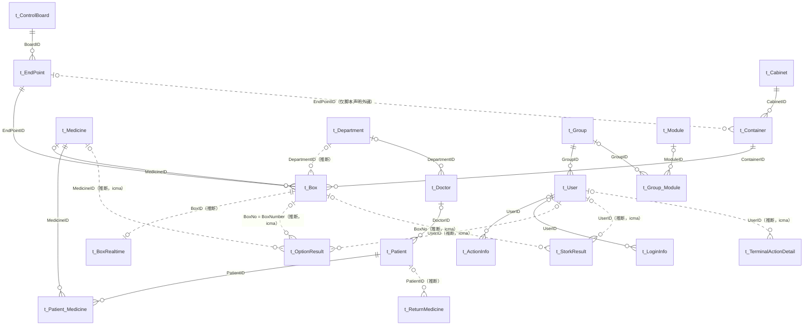

# 数据库结构与字段说明

> 基线：`mj2` / `b8e9ebe`（代码），整理日期 2026-11-19。阅读入口：[文档目录](README.md)。

本文是仓库内数据库的数据字典：当前终端唯一读写的配置库 `data/system.db`，以及 `data/` 中旧架构遗留的历史业务库、建表/清理脚本和导出文件，逐一说明表、视图、触发器与字段，并给出“没有存储过程”的检索依据。处方、库存和取药结果的权威数据在外部中控，其服务端数据库不在仓库，本文不推测其结构。结构信息以只读方式提取，未读取任何业务行内容；不能由源码或 DDL 证实的含义按 §1.2 的状态标记注明。

## 阅读导航

| 章节 | 内容 / 使用场景 |
| --- | --- |
| 1 | 文件清单、状态标记、提取方法与数据保护 |
| 2 | 当前配置库 `system.db`：表结构、JPA 映射、配置 key、JSON 字段、读写与生效、字符集与备份 |
| 3 | 历史库 `mcma.db.org`、`icma.db.me` 与 `create_tables.sql` 的差异和演进推断 |
| 4 | 历史表字段字典（按业务域）与推断关系图 |
| 5 | 视图定义与统计口径 |
| 6 | 触发器 |
| 7 | 存储过程：仓库内不存在；中控 / 医院侧不在范围 |
| 8 | 历史脚本、数据导出文件与 SQLite 工具 |
| 9 | 与当前代码的关系、风险与使用建议 |
| 10 | 源码与文件索引 |

## 1. 总览

### 1.1 文件清单

| 文件 | 类型 | 当前代码是否使用 | 对象数量（表/视图/触发器） | 行数概况 | 用途 / 状态 |
| --- | --- | --- | --- | --- | --- |
| `data/system.db` | SQLite 3，文本编码 UTF-8 | **是（在用）** | 1 / 0 / 0；另有 1 个主键自动索引 | `t_system_config` 2 行 | 终端配置库：`cabinet`、`control_center` 两项 JSON BLOB（§2） |
| `data/mcma.db.org` | SQLite 3，UTF-8 | 否（历史） | 20 / 6 / 0；含 `test`；15 个自动索引 | 数据快照：18 张表有行，`t_BoxRealtime`、`t_Medicine2` 为 0 行 | 旧架构本地业务库，较早一代（推断） |
| `data/icma.db.me` | SQLite 3，UTF-8 | 否（历史） | 25 / 18 / 2；含 `test` 与 3 张 `*_old`；17 个自动索引 | 数据快照：除 `t_BoxRealtime` 外均有行 | 旧架构本地业务库，较新一代，增加操作结果、盘点、HIS 交互与统计（推断） |
| `data/create_tables.sql` | DDL 脚本，393 行，CRLF | 否（历史） | 18 / 6 / 0 | — | 与 mcma 同代但不一致的建表脚本（§3.3） |
| `data/delete.sql` | SQL 脚本，3 条 `delete` | 否（历史） | — | — | 清空 icma 三张结果 / 日志表（§8.1） |
| `data/delete_result.cmd` | Windows 批处理，1 行 | 否（历史） | — | — | 用 `sqlite3.exe` 对 `icma.db` 执行 `delete.sql` |
| `data/mcma.sql` | 空文件，0 字节 | 否 | — | — | 无内容 |
| `data/*.txt`、`data/or3.csv` | 文本导出，**未打开** | 否（历史） | — | 见 §8.2 | 文件名与统计视图 / 表相近（推断） |
| `data/sqlite3.exe` 等 5 个文件 | Windows 版 SQLite 工具 | 否 | — | — | 历史维护工具，运行时不需要（§8.3） |

SQLite 文件头记录的最后写入版本：`system.db` 为 3.32.3，与当前依赖的 SQLite JDBC 3.32.3.3 一致；两份历史库为 3.21.0，说明由其他程序写入。仓库中没有任何服务端数据库（如 SQL Server、Oracle）的导出或连接配置。

### 1.2 状态标记与提取方法

| 标记 | 含义 |
| --- | --- |
| 在用 | 当前代码读写 |
| 历史 | 当前代码不读写；`src/` 中检索不到对应表、视图、触发器名称（§9.1） |
| 推断 | 含义由名称、视图 SQL 或脚本推断，未经业务方确认 |
| 待现场确认 | 需由业务方、旧系统维护方或现场数据确认 |

| 步骤 | 方法（可复核，均不读取行内容） |
| --- | --- |
| 结构 | `sqlite3 -readonly <文件>` 执行 `.schema`、`SELECT type,name,tbl_name,sql FROM sqlite_master`、`PRAGMA table_info / index_list / index_info / foreign_key_list` |
| 行数 | 仅 `SELECT COUNT(*)`，用于区分空模板与数据快照；未读取 `t_system_config.value` |
| 视图列 | `PRAGMA table_info(<视图名>)` 解析输出列，不执行视图查询 |
| 脚本 | 在内存库 `sqlite3 :memory:` 中执行 `create_tables.sql` 后用同样的 PRAGMA 比较，不产生文件 |
| 差异 | 用脚本逐列、逐 token（忽略空白和大小写）比较三份来源；统计视图的周 / 月 / 年版本与日版本逐一比对 |
| JSON | 用 JDK 1.8.0_371 调用 HEAD 编译类的 `FastJsonUtils.serialize()` 序列化占位值，原样贴出输出 |
| 命名 / DDL 默认值 | 直接调用 Spring Boot 2.4.3 的 `SpringPhysicalNamingStrategy`，并核对 `HibernateDefaultDdlAutoProvider` 字节码 |

### 1.3 数据保护

> **注意：** `data/` 下的 SQLite 文件与 TXT/CSV 导出文件均已提交到 Git（提交 `7f7feba`，之后未变更）。两份历史库是含数据的快照，包含用户（含 `Password` 列）、医师、患者、操作结果和 HIS 请求/响应报文类表；`system.db` 的 2 条记录可能是某一现场的真实终端编号、中控地址和药柜网络参数。这些文件可能含真实配置或业务数据，只能在授权环境中只读处理，复制、交接、脱敏和备份按[操作手册 §3](OPERATIONS.md#backup)与[§8.2–8.3](OPERATIONS.md#troubleshooting)执行。本文只记录结构、行数和占位示例，不记录其中任何值。

## 2. 当前配置库 `data/system.db`

状态：**在用**。本库只保存终端配置，不保存药品、处方、库存、用户或取药结果（[架构 §5](ARCHITECTURE.md)）。本章引用中省略类名的 `:行号` 均指 `JPVMConfig`。

### 2.1 连接、JPA 映射与建表方式

| 项目 | 当前实现 | 依据 |
| --- | --- | --- |
| 数据源 | `jdbc:sqlite:data/system.db`，相对**进程工作目录**；`type=org.sqlite.SQLiteDataSource`，`driver-class-name=org.sqlite.JDBC` | `application.yaml:21–25`；`application-return.yaml:17–21` 相同 |
| 方言 | `com.enigmabridge.hibernate.dialect.SQLiteDialect`（依赖 `hibernate4-sqlite-dialect` 0.1.2） | `application.yaml:27–29`；`pom.xml:49–53` |
| 项目内方言类 | `com.mmh.vmma.hibernate.dialect.SQLiteDialect` 是没有任何方法的空子类，配置未引用，属保留代码 | `SQLiteDialect:12–14` |
| 驱动 | SQLite JDBC 3.32.3.3（Spring Boot 依赖管理版本）；`spring-boot-starter-data-jpa` | `pom.xml:32–35`、`41–44` |
| 实体 | 唯一实体 `SystemConfig`，声明 `@Table(name="t_SystemConfig")` | `SystemConfig:20–37` |
| 物理表名 | 默认物理命名策略 `SpringPhysicalNamingStrategy` 把 `t_SystemConfig` 转为 `t_system_config`；列名 `key`、`value` 不变（已用该类实测） | Spring Boot 2.4.3 |
| 建表 / 迁移 | YAML 未设置 `spring.jpa.hibernate.ddl-auto`，`spring.jpa.generate-ddl` 默认 `false`。Spring Boot 2.4.3 只在嵌入式库（`EmbeddedDatabaseConnection` 仅含 H2、Derby、HSQLDB）时默认 `create-drop`，SQLite 不在其列，因此默认 `none`：Hibernate **不建表、不校验、不更新**。`src/main/resources` 也没有 `schema.sql` / `data.sql` | 置信度高：核对了 `HibernateDefaultDdlAutoProvider` 字节码与枚举值，未在应用运行时打印实际属性 |

由此可得：`t_system_config` 必须随交付的 `system.db` 一起存在，代码不会自动创建或修复。文件缺失时 SQLite JDBC 按默认打开模式可能在已存在的 `data/` 目录下创建空库，但不会建表（推断，未运行验证）；`InitSystem:160` 的首次 `findById` 会因缺表抛出异常，该线程没有捕获，可能停留在初始化窗口（与[架构 §8](ARCHITECTURE.md)一致）。

### 2.2 表 `t_system_config`

`.schema` 输出的原始 DDL（`vachar` 拼写照录）：

```sql
CREATE TABLE t_system_config(
key vachar(100) PRIMARY KEY NOT NULL,
value BLOB NOT NULL);
```

| 列 | 声明类型（SQLite 亲和性） | 约束 / 索引 | Java 映射 | 说明 |
| --- | --- | --- | --- | --- |
| `key` | `vachar(100)`：含 `CHAR`，按 TEXT 亲和性处理，长度不强制 | `PRIMARY KEY NOT NULL`；唯一自动索引 `sqlite_autoindex_t_system_config_1` | `SystemConfig.key`：`String`，`@Id`，无生成策略，由代码赋值 | 配置项名，取值见 §2.3 |
| `value` | `BLOB`（BLOB 亲和性） | `NOT NULL` | `SystemConfig.value`：`byte[]` | Fastjson 生成的 JSON 文本按 JVM 默认字符集编码后的字节；未加密、未压缩 |

| 其他属性 | 当前状态 |
| --- | --- |
| 外键、其他索引、视图、触发器 | 无 |
| 行数 | 2；与代码使用的 key 数量一致，未读取行内容核对 key 值 |
| 文件头 | 页大小 4096；425 页中 422 页为空闲页，约 1.7 MB 的文件实际只用 3 页，说明曾删除过较多内容且未 `VACUUM`（风险见 §9.2） |
| 伴随文件 | 仓库副本旁没有 `-journal` / `-wal` / `-shm` |

`SystemConfig.toString()` 会以字节数组形式输出 `value`（`SystemConfig:39–42`）；排障时不要把实体对象原样写入公开材料。

### 2.3 配置记录（key）

| key | 常量 | 存储模型 | 写入方 | 读取方 | 记录缺失时 |
| --- | --- | --- | --- | --- | --- |
| `cabinet` | `SystemConfig.SystemConfigId.cabinet` | `VMConfiguration` | 配置页「保存」/「刪除」：`JPVMConfig.saveVMConfig()`（`JPVMConfig:797–892`） | `InitSystem:160`、`205`；配置页回显 `JPVMConfig:983–997` | 初始化结果 `ERR_NO_CABINET`（1）（`InitSystem:164–177`），主窗口转配置页（`MainWindow:102–109`） |
| `control_center` | `SystemConfigId.control_center` | `CenterControl` | 配置页「保存」：`JPVMConfig.saveCCConfig()`（`JPVMConfig:942–979`） | `InitSystem:181`、`265`；`JPVMConfig:1000–1010` | `ERR_NO_CENTER_CONTROL`（3）（`InitSystem:185–198`），同上 |

- 枚举只有这两个值（`SystemConfig:30–32`），代码中没有其他 key，也没有删除记录的调用。
- key 名为 `cabinet`，存的却是 `VMConfiguration`，不是 `systemvalue.Cabinet`。`Cabinet`（`id`、`name`）在 `src/` 中没有任何引用，不对应 key 或表。
- 两条记录可以单独缺失：先检查 `cabinet`，再检查 `control_center`；任一缺失都不会继续连接设备或注册中控。

### 2.4 JSON 结构、实测输出与字段

序列化只经过 Fastjson 1.2.75（`pom.xml:79–83`）：`FastJsonUtils.serialize()` = `JSONObject.toJSONString(obj).getBytes()`，读取为 `JSONObject.parseObject(new String(bytes), cls)`（`FastJsonUtils:19–28`）。项目虽依赖 Jackson 与 Gson，但配置值不经过它们。

用 JDK 8 序列化占位值的实测结果（输出原样，未改排版）：

```json
{"customer":"DEMO-CUSTOMER","portModes":[{"address":"192.0.2.10","baudRate":"","dataBites":"","flowControl":"","mode":1,"name":"","parity":"","portNumber":"9000","startBits":"","stopBits":""}],"terminalid":"TERM-0001"}
```

```json
{"address":"https://cc.example.local/vmma"}
```

第一段是 `cabinet`（按配置页 TCP Client 写法填充 1 个端口），第二段是 `control_center`。按界面默认值保存的串口项序列化为：

```json
{"address":"","baudRate":"9600","dataBites":"5","flowControl":"None","mode":0,"name":"COM1","parity":"None","portNumber":"","startBits":"","stopBits":"1"}
```

| 实测特征 | 说明 |
| --- | --- |
| 格式 | 单行紧凑 JSON；属性按名称字母序输出，与 Java 字段声明顺序无关 |
| 空值 | `null` 属性省略；空字符串 `""` 保留 |
| `portModes` | 总会输出：getter 在 `null` 时创建空列表，空模型序列化为 `{"portModes":[]}`（`VMConfiguration:23–28`） |
| 容错读取 | 未知属性被忽略；缺少 `portModes` 时得到空列表；缺少 `mode` 时为 `0`（按串口处理，不会连接）；`portNumber` 写成 JSON 数字也会读成字符串 |

示例只用占位值，不是可直接导入的现场配置。

下列字段表中的界面项来自配置页 `JPVMConfig`：页面标题「--請設置連接端口訊息--」（`:195`）；上方为「終端設置」，中部为「連接端口」（左侧「端口屬性」编辑区内切换「串口設置」或「TCP/IP設置」，右侧端口表格，底部「*中央控管URL：」输入行），最下方为「保存」「刪除」「退出」按钮。该页只在初始化失败时由主窗口显示（`MainWindow:102–109`），正常登录后没有可达入口。

**`cabinet` → `VMConfiguration`**

| JSON 属性 | Java 类型 | 界面项（`JPVMConfig`） | 保存规则 / 校验 | 运行期使用 | 生效 |
| --- | --- | --- | --- | --- | --- |
| `customer` | `String` | 「*用戶名稱:」（`:220`） | trim 后非空，否则「客戶名稱不能為空！」（`:828–834`）；保存未 trim 的原文本（`:858`） | `InitSystem:206` 写入 `GlobalData.custoerName`（拼写照源码）；`src/` 中未发现其他读取方，只在配置页回显 | 下次启动读取 |
| `terminalid` | `String` | 「*終端編號:」（`:239`） | 同上，「終端編號不能為空！」（`:835–841`）；保存原文本（`:859`） | `InitSystem:207` → `GlobalData.terminalId`：`/system/init` 注册及各中控请求的 `clientId` / `terminalId` | 重启后生效；须与中控登记一致 |
| `portModes` | `List<PortMode>` | 「連接端口」表格与「端口屬性」编辑区 | 「新增端口：」打开 → 追加；关闭且有选中行 → 更新该行；「刪除」→ 移除选中行（`:861–883`） | `InitSystem:209–259` 逐项处理 | 重启后建立连接 |

**`portModes[]` → `PortMode`**

| JSON 属性 | Java 类型 | 界面项 / 列表列 | 取值与保存规则 | 运行期使用 |
| --- | --- | --- | --- | --- |
| `mode` | `int` | 「端口類型：」与「連接方式:」；列表「端口類型」显示「串口」「網路客戶端」「網路服務端」「錯誤連接口」（`:1026–1037`） | `0` 串口（「RS232C(串口)」）；`1` TCP Client（「TCP/UDP」+「TCP/UDP Client」）；`2` TCP Server（「TCP/UDP Server」）。网络项为「連接方式」索引 + 1（`:897`），串口项为 0（`:910`）；常量见 `Settings:14–16`；标签含 UDP，但没有 UDP 实现 | 只有 `1` 调用 `SignageIFClient.connect()`；`0`、`2` 只记“正在建設中”日志，其他值记错误（`InitSystem:211–257`） |
| `address` | `String` | 「服務IP:」；列表「服務端地址」 | 网络项取文本框原值，串口项为 `""`；新增 TCP Client 要求非空，格式错误只提示不阻止保存（`:801–817`）；选 Server 时输入框清空并禁用（`:522–526`） | TCP Client 连接主机 |
| `portNumber` | `String` | 「連接端口:」；列表「端口號」 | 只能键入数字（`:596–604`），新增时非空；无 1–65535 范围校验；串口项为 `""` | `Integer.valueOf()` 后作为端口（`InitSystem:218`），非数字会抛 `NumberFormatException` |
| `name` | `String` | 「串口編號：」；列表「串口名」 | COM1–COM9 或「TCP/UDP」；网络项为 `""` | 未使用（串口未实现） |
| `baudRate` | `String` | 「波特率：」 | 9600 / 19200 / 38400 / 57600 / 115200 | 未使用 |
| `dataBites` | `String`（拼写照源码） | 「數據位：」 | 5 / 6 / 7 / 8 | 未使用 |
| `parity` | `String` | 「校驗位：」；列表列名为「檢驗位」 | None / Even / Odd / Mark / Space | 未使用 |
| `startBits` | `String` | 无，「起始位」控件已注释 | 总是保存 `""`（`:904`、`:915`） | 未使用 |
| `stopBits` | `String` | 「停止位：」 | 1 / 1.5 / 2 | 未使用 |
| `flowControl` | `String` | 「流  控：」 | None / RTS/CTS / XON/XOFF | 未使用 |

网络项会把串口属性全部写成 `""`，串口项会把 `address`、`portNumber` 写成 `""`（`JPVMConfig:894–924`）。`PortMode:17` 的注释写着“串品設置 ﹣ mode = 1時有效”，与代码（串口为 `mode=0`）不符，以代码为准。启动时所有端口共用同一个 TCP 客户端单例，多条 `portModes` 不代表多柜隔离（[详细设计 §1.3](DETAILED_DESIGN.md)）。

**`control_center` → `CenterControl`**

| JSON 属性 | Java 类型 | 界面项 | 保存规则 / 校验 | 运行期使用 | 生效 |
| --- | --- | --- | --- | --- | --- |
| `address` | `String` | 「*中央控管URL：」（`JPVMConfig:707`） | trim 后非空；`new URI()` 可解析且 `getHost()` 非空，否则提示且不保存（`:944–965`）；保存 trim 后的值（`:975`）；不限制 scheme，不测试连通 | `InitSystem:266` → `GlobalData.ccBaseUrl`；各 `Restful*` 客户端将其与固定路径拼接，兼容末尾 `/`（如 `RestfulDeviceInit:33–35`） | 重启后生效 |

### 2.5 Repository 方法、保存顺序与生效时机

`SystemConfigRepository` 继承 `JpaRepository<SystemConfig, String>`，没有自定义方法（`SystemConfigRepository:15–18`）。当前代码只用到两个继承方法，也没有 JPQL、原生 SQL、`EntityManager` 或 `JdbcTemplate`。

| 方法 | 调用位置 | 行为 |
| --- | --- | --- |
| `findById(String)` | `InitSystem:160`、`181`；`JPVMConfig:845`、`967`、`983`、`1000` | 返回 `Optional<SystemConfig>`；代码外层再包 `Optional.ofNullable(...).orElse(null)`，效果等同直接使用返回值 |
| `saveAndFlush(S)` | `JPVMConfig:890`（`cabinet`）、`:978`（`control_center`） | 各自一个事务并立即 flush；实体主键已赋值，Spring Data 按非新实体走 `merge`：先按主键查询，再插入或更新（Spring Data JPA 默认行为，推断） |
| `findAll`、`delete*` 等 | 未调用 | 删除端口是修改 JSON 列表后整体保存，不删除表记录 |

| 场景 | 行为与生效 |
| --- | --- |
| 「保存」 | 先 `saveVMConfig()`，返回成功后才 `saveCCConfig()`（`JPVMConfig:738–758`）。两次 `saveAndFlush` 是独立事务，URL 校验失败时 `cabinet` 已落库，界面没有整体成功提示 |
| 「刪除」 | 确认后只更新 `cabinet`（`:761–772`、`:873–882`） |
| 排序后的表格 | 表格启用了排序（`:630`），但更新 / 删除直接用视图行号索引 `portModes`（`:870`、`:880`），排序后可能改错项（[详细设计 §1.5](DETAILED_DESIGN.md)） |
| 生效时机 | 保存不热更新 `GlobalData`，不重连设备；所有字段都在下次启动 `InitSystem` 时读取。初始化失败路径的「退出」提示「配置修改保存后，請重啟系統!」并结束进程（`:774–790`） |
| 重读 | 配置页尺寸变化（`componentResized`）会重读两条记录并重置端口输入区（`:177–187`） |

### 2.6 字符集、文件状态与备份

| 项目 | 说明 |
| --- | --- |
| JSON 字节编码 | `getBytes()` / `new String(bytes)` 未指定 Charset，使用运行 JVM 的 `file.encoding`（`FastJsonUtils:21`、`27`）。本次 Mac 上 JDK 8 实测为 UTF-8；Windows 现场取决于系统区域设置。含中文的 `customer` 跨默认字符集迁移可能乱码，ASCII 值不受影响（[详细设计 §1.7](DETAILED_DESIGN.md)） |
| SQLite 文本编码 | 文件头为 UTF-8，只作用于 TEXT 列 `key`；BLOB `value` 原样保存 Java 写入的字节，不经转码 |
| Git 跟踪 | `data/system.db` 自提交 `7f7feba` 起受 Git 跟踪，之后未变更；2 条记录是否为某现场真实配置待现场确认，不能直接当新终端模板部署 |
| 空闲页 | 422 / 425 页为空闲页。SQLite 默认不清零删除后的页面，旧内容可能残留在文件中（推断，未读取空闲页） |
| 备份 / 恢复 | 停机后整文件备份，存在伴随文件时按一致性方式处理，流程见[操作手册 §3](OPERATIONS.md#backup)；恢复配置不能恢复中控处方、库存或已出药实物 |
| 手工修改 | 不要直接编辑 BLOB，通过配置页维护；需要离线检查时只读打开副本。不要用 `create_tables.sql` 或历史清理脚本处理本库 |

## 3. 历史业务库概览与差异

状态：**历史**。以下三份来源都不被当前代码读写（§9.1）。它们代表旧架构“终端本地保存药柜拓扑、药品、医嘱、用户与操作记录”的设计，与当前“业务数据在中控、本地只存配置”的架构不同。

### 3.1 对象对比

| 对象 | `mcma.db.org` | `icma.db.me` | `create_tables.sql`（内存库加载后） |
| --- | --- | --- | --- |
| 表 | 20（含 `test`） | 25（含 `test` 与 3 张 `*_old`） | 18 |
| 视图 | 6 | 18 | 6 |
| 触发器 | 0 | 2 | 0 |
| 自动索引（主键产生） | 15 | 17 | 14 |
| 显式 `CREATE INDEX` | 0 | 0 | 0 |
| 声明外键 | 10 张表、14 条 | 11 张表、17 条 | 10 张表、15 条 |

| 表的分布 | 表名 |
| --- | --- |
| 三者共有（18） | `t_ActionInfo`、`t_Box`、`t_BoxRealtime`、`t_Cabinet`、`t_Container`、`t_ControlBoard`、`t_Department`、`t_Doctor`、`t_EndPoint`、`t_Group`、`t_Group_Module`、`t_LoginInfo`、`t_Medicine`、`t_Module`、`t_Patient`、`t_Patient_Medicine`、`t_ReturnMedicine`、`t_User` |
| 两库共有、脚本没有 | `test` |
| 仅 mcma | `t_Medicine2` |
| 仅 icma | `t_OptionResult`、`t_OptionResult_old`、`t_StorkResult`、`t_StorkResult_old`、`t_TerminalActionDetail`、`t_Box_old` |

三份来源合计 26 个不同表名。两库均无 `sqlite_sequence`（未使用 `AUTOINCREMENT`），没有 `WITHOUT ROWID` 表。外键虽有声明，但 SQLite 只在连接执行 `PRAGMA foreign_keys=ON` 时才强制，旧程序是否开启待现场确认。

### 3.2 列级差异

三份来源中 11 张共有表的列完全一致：`t_ActionInfo`、`t_BoxRealtime`、`t_Cabinet`、`t_ControlBoard`、`t_Department`、`t_EndPoint`、`t_Group`、`t_Group_Module`、`t_LoginInfo`、`t_ReturnMedicine`、`t_User`。其余差异如下：

| 对象 | mcma | icma | `create_tables.sql` |
| --- | --- | --- | --- |
| `t_Box` | `Quantity INTEGER`；`BoxNo` 在末尾 | `Quantity REAL`；`BoxNo` 在末尾 | `Quantity INTEGER`；`BoxNo int` 为第 2 列 |
| `t_Container` | `EndPointID` 在末尾，无外键 | 同 mcma | `EndPointID` 为第 4 列，并声明外键 → `t_EndPoint`（两个表级外键之间缺逗号，SQLite 语法允许） |
| `t_Doctor` | 有 `Grade`、`Deleted` | 同 mcma | 缺这两列 |
| `t_Medicine` | 有 `Photo` | 同 mcma | 缺 `Photo` |
| `t_Module` | 有 `ButtonIcon` | 同 mcma | 缺 `ButtonIcon` |
| `t_Patient` | 有 `Deleted` | 同 mcma | 缺 `Deleted` |
| `t_Patient_Medicine` | 有 `GetDate`、`ProvideDate`、`Around`、`IsProvided`、`ExpiredTime` | 同 mcma | 只有 `PatientID`、`MedicineID`、`Quantity` |
| `t_Box_old` | — | 与 icma `t_Box` 只差 `Quantity INTEGER` | — |
| `t_OptionResult_old` | — | 与 `t_OptionResult` 只差 `TakeQty integer`（新表为 `real`） | — |
| `t_StorkResult_old` | — | 与 `t_StorkResult` 只差 `MedicineRemainQty int`（新表为 `REAL`） | — |
| 视图 `v_MedicineBox` | 无 `BoxNo` | 多输出 `B.BoxNo AS BoxNo` | 同 mcma |

其余 5 个共有视图在三份来源中逐 token 相同（忽略空白与大小写）。

### 3.3 `create_tables.sql` 对应哪一个库

| 证据 | 结论 |
| --- | --- |
| 表集合是 mcma 的子集（缺 `t_Medicine2`、`test`）；6 个视图与 mcma 逐 token 相同；icma 特有的 12 个统计视图、2 个触发器和 6 张结果 / 旧表都不在脚本中 | 属于 mcma 这一代（推断） |
| 缺少两库中由 `ALTER TABLE ... ADD COLUMN` 追加的列，却已把 `BoxNo`、`t_Container.EndPointID` 写进建表语句 | 是手工维护的中间版本，不能重建 mcma |
| 内存库执行可建出 18 表、6 视图，但 `v_Providing`（`no such column: PM.ProvideDate`）、`v_EmgProvided`（`D.Grade`）、`v_MedicineBox`（`M.Photo`）在解析列时报错；只有 `v_Firmware`、`v_UserLoginInfo`、`v_UserActionInfo` 可用 | 脚本自身不一致 |
| 没有 `t_system_config` | 与当前配置库无关，不能用于初始化 `system.db` |

### 3.4 mcma → icma 的演进（推断）

1. **追加列。** `t_Medicine` 的 `, Photo varchar(255))`、`t_Module` 的 `, ButtonIcon varchar(500))` 紧贴右括号；`t_Doctor`、`t_Patient`、`t_Patient_Medicine`、`t_Box.BoxNo`、`t_Container.EndPointID` 位于最后一个列定义之后、表级约束之前。这与 SQLite 执行 `ALTER TABLE ... ADD COLUMN` 后改写建表语句的位置一致（已在内存库复现）。两库这些列相同，说明追加早于 mcma 快照。
2. **新增业务表。** icma 增加操作结果（`t_OptionResult`）、盘点结果（`t_StorkResult`）、终端与 HIS 交互明细（`t_TerminalActionDetail`），以及按日 / 周 / 月 / 年的 12 个统计视图和 180 天清理触发器。`t_OptionResult.DrName`、`t_TerminalActionDetail.HISHost` 也是追加列。
3. **数量改为小数。** `t_Box.Quantity`、`t_OptionResult.TakeQty`、`t_StorkResult.MedicineRemainQty` 从整数改为 REAL，并保留 `*_old`。`"t_Box_old"` 这类带引号的表名和触发器 `ON "t_OptionResult"` 都是 `ALTER TABLE ... RENAME` 改写的痕迹（已在内存库复现）。新 `t_Box` 的建表语句排版与其他表不同，像是重新创建；`t_Box` 与 `t_Box_old` 各 30 行，数据可能已复制；`t_OptionResult`（151）/ `_old`（17）与 `t_StorkResult`（40）/ `_old`（1248）行数不同，迁移方式待现场确认。
4. **试验表。** mcma 的 `t_Medicine2` 为 0 行，列名在每个大写字母前加 `_`（如 `Medicine_I_D`），像是 ORM 命名策略试验产物，icma 中已不存在。
5. **文件名。** `delete_result.cmd` 操作的是 `icma.db`，仓库文件为 `icma.db.me`；`.org`、`.me` 后缀推断为复制归档时追加。文件系统时间（仅供参考）：`create_tables.sql` 2018-05，`mcma.db.org` 2018-06，`icma.db.me` 2019-12。
6. **归属。** `mcma` / `icma` 分别对应哪一产品、医院或测试环境，待现场确认。

## 4. 表结构（按业务域）

阅读约定：

- 类型、`NOT NULL`、默认值、主键和外键来自 `PRAGMA table_info` / `foreign_key_list`，是事实；“说明（推断）”列是依据列名、默认值、视图 SQL 和脚本得出的**推断**，未经业务方确认，标“待现场确认”的尤其不确定。
- 行数格式为“mcma / icma”，`—` 表示该库没有此表；“脚本”指 `create_tables.sql` 是否含此表。
- 所有 `Deleted` 列都是逻辑删除标记，默认 `'N'` 表示有效；`v_Firmware`、`v_EmgProvided` 用 `Deleted = 'N'` 过滤。
- SQLite 不强制 `varchar(n)` 长度；`datetime` / `DateTime` 列按 NUMERIC 亲和性保存，实际格式取决于写入程序。

### 4.1 药柜、控制板与储位

**`t_ControlBoard` 控制板及通信参数**：1 / 1 行；脚本有；主键 `BoardID`。

| 列 | 类型 | 约束 / 默认 | 说明（推断） |
| --- | --- | --- | --- |
| `BoardID` | varchar(50) | PK，NOT NULL | 控制板编号 |
| `BoardName` | varchar(100) | | 控制板名称 |
| `CANBus` | INTEGER | 默认 0 | CAN 总线数量或编号 |
| `PortType` | INTEGER | 默认 0 | 与上位机的连接方式；列组与当前 `PortMode` 相似，取值是否同为 0 串口 / 1 TCP Client / 2 TCP Server 待现场确认 |
| `ServerIP`、`Port` | varchar(50)、varchar(20) | | 网络连接地址与端口 |
| `BaudRate`、`DataBits`、`Parity`、`StopBits`、`FlowControl` | varchar(10)、(5)、(20)、(5)、(20) | | 串口参数 |
| `Deleted`、`Description` | varchar(1)、VARCHAR(255) | `Deleted` 默认 'N' | 逻辑删除、备注 |

**`t_EndPoint` 控制板下的节点**：40 / 10 行；脚本有；主键 `EndPointID`；外键 `BoardID` → `t_ControlBoard.BoardID`（级联删除 / 更新）。

| 列 | 类型 | 约束 / 默认 | 说明（推断） |
| --- | --- | --- | --- |
| `EndPointID` | varchar(50) | PK，NOT NULL | 节点编号（灯板、锁控等，待现场确认） |
| `BoardID` | varchar(50) | NOT NULL，FK | 所属控制板 |
| `CANBusNo`、`NodeNo` | INTEGER | 默认 0 | 所在 CAN 总线号、节点号 |
| `Type` | INTEGER | 默认 0 | 节点类型（`v_Firmware` 输出为 `EPType`） |
| `Quantity` | INTEGER | 默认 1 | 节点所带灯 / 通道数（`v_Firmware` 别名 `LEDQuantity`） |
| `Deleted`、`Description` | char(1)、varchar(255) | 默认 'N' | 逻辑删除、备注 |

**`t_Cabinet` 药柜**：1 / 1 行；脚本有；主键 `CabinetID`。

| 列 | 类型 | 约束 / 默认 | 说明（推断） |
| --- | --- | --- | --- |
| `CabinetID` | varchar(50) | PK，NOT NULL | 药柜编号 |
| `CabinetName` | varchar(255) | NOT NULL | 药柜名称 |
| `Volumes` | INTEGER | 默认 0 | 容量或容器数，待现场确认 |
| `Deleted`、`Description` | char(1)、varchar(255) | 默认 'N' | 逻辑删除、备注 |

**`t_Container` 柜内容器 / 抽屉**：8 / 15 行；脚本有；主键 `ContainerID`；外键 `CabinetID` → `t_Cabinet`（级联）。

| 列 | 类型 | 约束 / 默认 | 说明（推断） |
| --- | --- | --- | --- |
| `ContainerID` | varchar(50) | PK，NOT NULL | 容器编号 |
| `CabinetID` | varchar(50) | NOT NULL，FK | 所属药柜 |
| `Type` | INTEGER | 默认 0 | 容器类型（`v_Firmware`：`CTType`） |
| `Volume` | INTEGER | 默认 1 | 容量 / 可容纳储位数 |
| `Seat` | INTEGER | 默认 0 | 在药柜中的位置序号（`CTSeat`） |
| `Width`、`Height` | INTEGER | 默认 0 | 尺寸，单位待现场确认 |
| `Deleted`、`Description` | char(1)、varchar(255) | 默认 'N' | 逻辑删除、备注 |
| `EndPointID` | varchar(50) | 两库无外键（追加列）；脚本声明 FK → `t_EndPoint`（级联） | 控制该容器的节点（`CTEndPointID`） |

**`t_Box` 储位（药格）**：94 / 30 行；脚本有；主键 `BoxID`；外键 `EndPointID` → `t_EndPoint`（级联）、`ContainerID` → `t_Container`（级联）、`MedicineID` → `t_Medicine`（RESTRICT）。

| 列 | 类型 | 约束 / 默认 | 说明（推断） |
| --- | --- | --- | --- |
| `BoxID` | varchar(50) | PK，NOT NULL | 储位编号 |
| `EndPointID` | varchar(50) | NOT NULL，FK | 控制该储位的节点 |
| `LampID` | INTEGER | 默认 -1 | 指示灯编号，-1 表示无灯 |
| `ContainerID` | varchar(50) | NOT NULL，FK | 所属容器 |
| `MedicineID` | varchar(50) | FK，可空 | 存放的药品，空表示未分配 |
| `PointX`、`PointY`、`Width`、`Height` | INTEGER | NOT NULL | 储位在容器 / 界面中的坐标与尺寸 |
| `Quantity` | mcma 与脚本 INTEGER；icma REAL | 默认 0 | 当前存量（`v_Firmware`：`MedQuantity`）；icma 改 REAL 以支持非整数 |
| `MaxQuantity` | INTEGER | 默认 0 | 最大容量 |
| `Alarm` | INTEGER | 默认 0 | 补药告警阈值 |
| `DepartmentID` | varchar(50) | 无外键 | 归属科室 |
| `Deleted`、`Description` | char(1)、varchar(255) | 默认 'N' | `v_Firmware` 只取 `Deleted = 'N'` |
| `BoxNo` | INTEGER（脚本为 int） | 默认 0 | 储位序号；可能对应 `t_OptionResult.BoxNumber`、`t_StorkResult.BoxNo` |

**`t_Box_old`**：— / 30 行；仅 icma。列、主键与 3 个外键同 icma `t_Box`，只是 `Quantity` 为 INTEGER；是改类型前保留的旧表。

**`t_BoxRealtime` 储位实时状态**：0 / 0 行；脚本有；主键 `BoxID`，未声明外键。

| 列 | 类型 | 约束 / 默认 | 说明（推断） |
| --- | --- | --- | --- |
| `BoxID` | varchar(50) | PK，NOT NULL | 对应 `t_Box.BoxID` |
| `Status` | INTEGER | 默认 99 | 储位 / 门锁状态；99 可能表示未知 |
| `LEDStatus` | INTEGER | 默认 99 | 指示灯状态 |

### 4.2 药品

**`t_Medicine` 药品主档**：175 / 27 行；脚本有（缺 `Photo`）；主键 `MedicineID`。

| 列 | 类型 | 约束 / 默认 | 说明（推断） |
| --- | --- | --- | --- |
| `MedicineID` | varchar(50) | PK，NOT NULL | 药品编号 |
| `RFID` | varchar(50) | | RFID 标签号 |
| `ScienceName`、`ProductName` | varchar(200) | | 学名 / 通用名、商品名 |
| `Efficiency` | varchar(50) | | 规格或含量，待现场确认 |
| `Type` | INTEGER | 默认 0 | 药品类别 |
| `Manufacturer` | varchar(50) | | 生产厂商 |
| `ExpiredDate` | DateTime | | 有效期 |
| `DoseUnit`、`DoseRoute` | varchar(10) | | 剂量单位、给药途径 |
| `Deleted`、`Description` | char(1)、varchar(255) | 默认 'N' | 逻辑删除、备注 |
| `Photo` | varchar(255) | 追加列 | 药品图片路径或文件名 |

**`t_Medicine2`**：0 / — 行；仅 mcma；主键 `Medicine_I_D`。12 列与脚本版 `t_Medicine`（无 `Photo`）一一对应，列名改为 `Medicine_I_D`、`R_F_I_D`、`Science_Name`、`Product_Name`、`Efficiency`、`Type`、`Manufacturer`、`Expired_Date`、`Dose_Unit`、`Dose_Route`、`Deleted`、`Description`；其中 `Science_Name`、`Product_Name` 为 varchar(50)。空的试验表（§3.4）。

### 4.3 科室、医师、患者与医嘱

**`t_Department` 科室**：7 / 7 行；脚本有；主键 `DepartmentID`。

| 列 | 类型 | 约束 / 默认 | 说明（推断） |
| --- | --- | --- | --- |
| `DepartmentID` | varchar(50) | PK，NOT NULL | 科室编号 |
| `Name` | varchar(100) | NOT NULL | 科室名称（视图输出 `DepartmentName`） |
| `Address`、`Manager` | varchar(200)、varchar(50) | | 地址、负责人 |
| `Phone1` … `Phone5` | varchar(20) | | 联系电话 |
| `Deleted`、`Description` | char(1)、varchar(255) | 默认 'N' | 逻辑删除、备注 |

**`t_Doctor` 医师**：7 / 7 行；脚本有（缺 `Grade`、`Deleted`）；主键 `DoctorID`；外键 `DepartmentID` → `t_Department`（RESTRICT）。

| 列 | 类型 | 约束 / 默认 | 说明（推断） |
| --- | --- | --- | --- |
| `DoctorID` | varchar(50) | PK，NOT NULL | 医师编号 |
| `FirstName`、`MiddleName`、`LastName` | varchar(50) | | 姓名（个人资料） |
| `DepartmentID` | varchar(50) | FK | 所属科室 |
| `Grade` | varchar(20) | 追加列 | 职级 |
| `Deleted` | char(1) | 默认 'N'，追加列 | `v_EmgProvided` 只取 'N' |

**`t_Patient` 患者**：7 / 7 行；脚本有（缺 `Deleted`）；主键 `PatientID`；外键 `DoctorID` → `t_Doctor`（RESTRICT）。

| 列 | 类型 | 约束 / 默认 | 说明（推断） |
| --- | --- | --- | --- |
| `PatientID` | varchar(50) | PK，NOT NULL | 患者编号 / 病历号 |
| `FirstName`、`MiddleName`、`LastName` | varchar(50) | | 患者姓名（个人资料） |
| `DoctorID` | varchar(50) | FK | 主治医师 |
| `Deleted` | char(1) | 默认 'N'，追加列 | 逻辑删除 |

**`t_Patient_Medicine` 患者用药计划（待发药）**：18 / 18 行；脚本有（只有前 3 列）；主键 (`PatientID`, `MedicineID`)；外键 `PatientID` → `t_Patient`、`MedicineID` → `t_Medicine`（均 RESTRICT）。

| 列 | 类型 | 约束 / 默认 | 说明（推断；时间规则来自 `v_Providing`） |
| --- | --- | --- | --- |
| `PatientID`、`MedicineID` | varchar(50) | 联合 PK，FK | 患者、药品；联合主键意味着同一患者同一药品只能有一行 |
| `Quantity` | INTEGER | 默认 0 | 应发数量 |
| `GetDate` | datetime | 追加列 | 取药时间 |
| `ProvideDate` | DateTime | 追加列 | 计划给药时间；`v_Providing` 按此过滤、排序 |
| `Around` | INTEGER | 默认 0，追加列 | 提前量（分钟）：`ProvideDate` 减当前时间小于 `Around×60` 秒即进入待发清单 |
| `IsProvided` | INTEGER | 默认 0，追加列 | 是否已发，`v_Providing` 只取 0 |
| `ExpiredTime` | INTEGER | 默认 `'120'`（文本默认值按 INTEGER 亲和性存为 120），追加列 | 超时阈值（分钟）：当前时间减 `ProvideDate` 超过 `ExpiredTime×60` 秒时 `IsExpired = '1'` |

**`t_ReturnMedicine` 退药记录**：5 / 5 行；脚本有；无主键、无外键。

| 列 | 类型 | 约束 / 默认 | 说明（推断） |
| --- | --- | --- | --- |
| `MedicineNo` | varchar(50) | NOT NULL | 药品编号（命名不同于 `MedicineID`，关联待现场确认） |
| `PatientID` | varchar(50) | NOT NULL | 患者 |
| `Quantity` | int | 默认 0 | 退药数量 |
| `ReturnDateTime` | Datetime | NOT NULL | 退药时间 |
| `Operator` | varchar(50) | NOT NULL | 操作人 |

### 4.4 用户、群组与模块权限

**`t_User` 本地用户**：6 / 6 行；脚本有；主键 `UserID`；外键 `GroupID` → `t_Group`（级联）。

| 列 | 类型 | 约束 / 默认 | 说明（推断） |
| --- | --- | --- | --- |
| `UserID` | varchar(50) | PK，NOT NULL | 用户账号 |
| `Password` | varchar(100) | NOT NULL | 口令；存储形式（明文 / 摘要）未核对，不得读取或外传 |
| `FirstName`、`MiddleName`、`LastName` | varchar(50) | | 姓名 |
| `Gender`、`Age` | char(1)、int | `Age` 默认 0 | 性别、年龄 |
| `Address`、`Photo` | varchar(200)、varchar(100) | | 住址、照片路径 |
| `GroupID` | varchar(20) | NOT NULL，FK | 所属群组（角色） |
| `Phone1` … `Phone5` | varchar(20) | | 电话 |
| `EmergencyPerson`、`EmergencyPhone` | varchar(100)、varchar(20) | | 紧急联系人及电话 |
| `CreateDateTime`、`UpdateDateTime` | DateTime | | 创建、最后修改时间 |
| `UpdateTimes` | int | 默认 0 | 修改次数 |
| `Deleted` | char(1) | 默认 'N' | 逻辑删除 |
| `LoginTimes`、`Locked` | int | 默认 0 | 登录（或失败）次数、锁定标记，待现场确认 |
| `Description` | varchar(255) | | 备注 |

**`t_Group` 群组 / 角色**：5 / 5 行；脚本有；主键 `GroupID`。列：`GroupID` varchar(20) PK；`Name` varchar(100) NOT NULL（视图输出为 `GRName`）；`Description` varchar(255)。

**`t_Module` 功能模块 / 菜单**：9 / 9 行；脚本有（缺 `ButtonIcon`）；主键 `ModuleID`。

| 列 | 类型 | 约束 / 默认 | 说明（推断） |
| --- | --- | --- | --- |
| `ModuleID` | varchar(20) | PK，NOT NULL | 模块编号 |
| `Name`、`ModuleName` | varchar(100) | NOT NULL | 显示名称、内部名称 |
| `ModuleClass` | varchar(300) | NOT NULL | 实现该模块的类名 |
| `ButtonName` | varchar(20) | NOT NULL | 菜单按钮文字 |
| `Deleted`、`Description` | char(1)、varchar(255) | 默认 'N' | 逻辑删除、备注 |
| `ButtonIcon` | varchar(500) | 追加列 | 按钮图标路径 |

**`t_Group_Module` 群组—模块授权**：25 / 25 行；脚本有；无主键或唯一约束（可能有重复行）；外键 `GroupID` → `t_Group`、`ModuleID` → `t_Module`（均级联）。列：`GroupID` varchar(20)、`ModuleID` varchar(20)。

这一组表是旧版的本地权限模型。当前版本的身份与菜单来自中控登录响应（[详细设计 §2.3](DETAILED_DESIGN.md)），`Settings` 中的 `PAGE_*` 与 `JPFunctions` 按钮常量不读取这些表。

### 4.5 操作与日志

**`t_ActionInfo` 用户操作日志**：181 / 786 行；脚本有；无主键；外键 `UserID` → `t_User`（RESTRICT）。

| 列 | 类型 | 约束 / 默认 | 说明（推断） |
| --- | --- | --- | --- |
| `UserID` | varchar(50) | FK | 操作人 |
| `ActionDateTime` | datetime | | 操作时间 |
| `Action` | varchar(10) | | 操作类型代码，取值待现场确认 |
| `Result` | varchar(50) | | 结果 |
| `Content` | varchar(500) | | 操作内容 |

**`t_LoginInfo` 登录日志**：212 / 284 行；脚本有；无主键；外键 `UserID` → `t_User`（RESTRICT）。

| 列 | 类型 | 约束 / 默认 | 说明（推断） |
| --- | --- | --- | --- |
| `UserID` | varchar(50) | FK | 用户 |
| `Event` | INTEGER | 默认 -1 | 事件类型（登录、登出等），代码待现场确认 |
| `LoginTime`、`ActionTime` | datetime | | 登录时间、事件时间 |
| `Result` | varchar(50) | | 结果 |

**`t_OptionResult` 取药 / 退药 / 补药等操作结果明细**：— / 151 行；仅 icma；主键 `OptionID`；无外键；有清理触发器 `purge_or`（§6）。12 个统计视图都以它为唯一数据源。

| 列 | 类型 | 约束 / 默认 | 说明（推断） |
| --- | --- | --- | --- |
| `OptionID` | varchar(20) | PK，NOT NULL | 操作记录编号 |
| `Hospital`、`TerminalId` | varchar(50) | | 医院代码、终端编号；统计视图的分组键 |
| `UserID`、`UserName`、`UserAuth` | varchar(50)、(200)、(50) | | 操作人账号、姓名、权限 / 身份 |
| `LoginDateTime` | datetime | | 本次登录时间；`v_User*` 去重计数为 `LoginTimes` |
| `BoxNumber` | int | | 储位号，可能对应 `t_Box.BoxNo` |
| `BoxOpenDateTime`、`BoxCloseDateTime` | datetime | | 储位开启、关闭时间；`v_MedicineDate` 取当日最晚开启记录的剩余量 |
| `Action` | varchar(10) | | 操作类型：`'1'` 取药、`'2'` 退药、`'3'` 批次取药、`'4'` 补药、`'5'` 盘点（由统计列名 Provide / Retire / BatchProvide / Supply / Stock 推断） |
| `Barcode1`、`Barcode2` | varchar(50) | | 本次扫描的两个条码，具体对应待现场确认 |
| `MedicineID`、`MedicineName`、`MedicineUnit` | varchar(100)、(200)、(50) | | 药品编号、名称、单位 |
| `SeqNo`、`OnceQty`、`Frequency` | varchar(20) | | 医嘱序号、单次剂量、频次 |
| `TakeQty` | real（`_old` 为 integer） | 默认 0 | 本次操作数量；统计时 `total(round(TakeQty, 3))` |
| `MedicineRemainQty` | varchar(20) | | 操作后剩余量（文本） |
| `OptionDatetime` | varchar(50) | | 操作时间（文本）；统计时间桶与 180 天清理都基于此列 |
| `ScrnDatetime` | datetime | | 含义待现场确认 |
| `MedNo`、`Pno` | varchar(20) | | 医嘱 / 药品号、病历号，待现场确认 |
| `PatientName` | varchar(100) | | 患者姓名（个人资料） |
| `OptionTimeout` | integer | 默认 -1 | 操作耗时（秒）；统计中 `> 60` 计入 `Over1Mins` |
| `isSuccess` | varchar(2) | 默认 'N' | 是否成功，'Y' / 'N' |
| `DrName` | varchar(100) | 追加列 | 医师姓名 |

**`t_OptionResult_old`**：— / 17 行；列与主键同 `t_OptionResult`，`TakeQty` 为 integer；无触发器。

**`t_StorkResult` 盘点结果**：— / 40 行；仅 icma；无主键、无外键。`Stork` 应为 Stock 的误拼：当前代码 `Settings:39` 的常量 `PAGE_TAKESTORK` 注释为“盤點頁面”。

| 列 | 类型 | 约束 / 默认 | 说明（推断） |
| --- | --- | --- | --- |
| `BoxNo` | int | NOT NULL | 储位号 |
| `MedicineID`、`MedicineName`、`MedicineUnit` | varchar(50)、(200)、(50) | | 药品 |
| `MedicineRemainQty` | REAL（`_old` 为 int） | | 盘点存量 |
| `UserID` | varchar(50) | NOT NULL | 盘点人 |
| `UserName` | varchar(200) | | 盘点人姓名 |
| `StorkDateTime` | DateTime | NOT NULL | 盘点时间 |
| `Result` | varchar(2) | 默认 'N' | 盘点结果标记，含义待现场确认 |
| `Description` | varchar(1000) | | 说明 |

**`t_StorkResult_old`**：— / 1248 行；列同 `t_StorkResult`，`MedicineRemainQty` 为 int。

**`t_TerminalActionDetail` 终端与 HIS 交互明细**：— / 726 行；仅 icma；无主键、无外键；有清理触发器 `purge_tad`（§6）。

| 列 | 类型 | 约束 / 默认 | 说明（推断） |
| --- | --- | --- | --- |
| `UserID` | varchar(50) | NOT NULL | 操作人 |
| `UserName`、`UserAuth` | varchar(200)、(50) | | 姓名、权限 |
| `Hospital`、`TerminalId` | varchar(50) | NOT NULL | 医院代码、终端编号 |
| `OptionKey` | varchar(50) | NOT NULL | 业务键（条码 / 医嘱号等，待现场确认） |
| `OptionKeySeqNo` | integer | 默认 -1 | 业务键序号 |
| `Option` | varchar(10) | NOT NULL | 操作类型 |
| `OptionDateTime` | datetime | NOT NULL | 操作时间；180 天清理依据 |
| `HISType` | varchar(20) | | HIS 接口类型 |
| `HISRequest`、`HISResponse` | varchar(2048) | | HIS 请求、响应报文，可能含患者资料 |
| `Result`、`Content` | varchar(10)、(500) | | 结果、内容 |
| `HISHost` | varchar(50) | 追加列 | HIS 主机，可能含内部地址 |

### 4.6 其他

**`test`**：1 / 1 行；两库都有，脚本无；无约束。列 `a`、`b`、`c` 为 varchar(10)，`ft` 为 real。测试表，无业务含义。

### 4.7 关系图（推断）

实线为 DDL 声明的外键，虚线为依据列名和视图联结推断的关系；仅 icma 的表一并画出。外键是否在旧程序中被强制待现场确认（§3.1）。



`t_Medicine2`、`test` 与各 `*_old` 表未画出：前两者无关联，`*_old` 的关系同对应新表。

## 5. 视图

状态：**历史**。视图 SQL 取自 `sqlite_master`，下文只调整了换行和缩进，关键字、标识符与原文逐 token 一致（`--` 注释为本文所加）。查看原文可执行：

```bash
sqlite3 -readonly data/icma.db.me "SELECT sql FROM sqlite_master WHERE name='v_UserWeek';"
```

### 5.1 清单

| 视图 | mcma | icma | 脚本 | 输出列数 | 源表 | 作用（推断） |
| --- | --- | --- | --- | --- | --- | --- |
| `v_Providing` | ✓ | ✓ | ✓，列缺失不可用 | 26 | `t_Patient_Medicine` 及患者、医师、药品、科室 | 到期待发药清单 |
| `v_EmgProvided` | ✓ | ✓ | ✓，不可用 | 11 | `t_Doctor`、`t_Department`、`t_Patient` | 医师—患者选择列表（紧急取药） |
| `v_Firmware` | ✓ | ✓ | ✓ | 36 | `t_Box` 及节点、容器、药柜、控制板 | 储位硬件拓扑与通信参数 |
| `v_MedicineBox` | ✓（21 列） | ✓（22 列，多 `BoxNo`） | ✓，不可用 | 21 / 22 | `t_Medicine`、`t_Box` | 药品—储位对照 |
| `v_UserLoginInfo` | ✓ | ✓ | ✓ | 10 | `t_LoginInfo`、`t_User`、`t_Group` | 登录日志带用户与群组名 |
| `v_UserActionInfo` | ✓ | ✓ | ✓ | 10 | `t_ActionInfo`、`t_User`、`t_Group` | 操作日志带用户与群组名 |
| `v_OptionDate/Week/Month/Year` | — | ✓ | — | 10 | `t_OptionResult` | 按操作类型统计 |
| `v_UserDate/Week/Month/Year` | — | ✓ | — | 19 | `t_OptionResult` | 按用户统计 |
| `v_MedicineDate/Week/Month/Year` | — | ✓ | — | 18 | `t_OptionResult` | 按药品统计 |

“不可用”指在脚本建出的库中解析视图列时报 `no such column`（§3.3）；两份历史库中全部视图都能正常解析列。

### 5.2 基础视图

**`v_Providing`：到期待发药清单**

```sql
CREATE VIEW v_Providing AS
SELECT
    PM.PatientID AS PatientID, PM.MedicineID AS MedicineID, PM.Quantity AS Quantity,
    PM.ProvideDate AS ProvideDate, PM.ExpiredTime AS ExpiredTime,
    CASE WHEN (STRFTIME('%s', 'now', 'localtime') - STRFTIME('%s', PM.ProvideDate)) > ExpiredTime*60 THEN '1' ELSE '0' END AS IsExpired,
    PM.Around AS Around,
    P.FirstName AS PatientFirstName, P.MiddleName AS PatientMiddleName, P.LastName AS PatientLastName,
    P.DoctorID AS DoctorID,
    D.FirstName AS DoctorFirstName, D.MiddleName AS DoctorMiddleName, D.LastName AS DoctorLastName,
    D.DepartmentID AS DepartmentID, D.Grade AS Grade, DEP.Name AS DepartmentName,
    M.ScienceName AS ScienceName, M.ProductName AS ProductName, M.Efficiency AS Efficiency,
    M.Type AS Type, M.Manufacturer AS Manufacturer, M.ExpiredDate AS ExpiredDate,
    M.DoseUnit AS DoseUnit, M.DoseRoute AS DoseRoute, M.Photo AS Photo
FROM t_Patient_Medicine AS PM
LEFT OUTER JOIN t_Patient AS P ON PM.PatientID = P.PatientID
LEFT OUTER JOIN t_Doctor AS D ON P.DoctorID = D.DoctorID
LEFT OUTER JOIN t_Medicine AS M ON PM.MedicineID = M.MedicineID
LEFT OUTER JOIN t_Department AS DEP ON D.DepartmentID = DEP.DepartmentID
where PM.IsProvided = 0
    AND PM.ProvideDate IS NOT NULL
    AND strftime('%s', PM.ProvideDate) - strftime('%s', 'now', 'localtime') < PM.Around * 60
ORDER BY ProvideDate
```

- 取未发药（`IsProvided = 0`）、有计划时间、且计划时间距现在不足 `Around` 分钟（已过时的也包括在内）的用药计划，按计划时间排序。
- `IsExpired`：现在比计划时间晚 `ExpiredTime` 分钟以上时为 `'1'`，否则 `'0'`。
- `'now', 'localtime'` 得到本地时间，并与 `ProvideDate` 文本一起按秒比较，因此 `ProvideDate` 应以本地时间、SQLite 可解析的格式保存（推断）。
- 输出患者与医师姓名，属个人资料。

**`v_EmgProvided`：医师—患者选择列表**

```sql
CREATE VIEW v_EmgProvided AS
SELECT
    D.DoctorID AS DoctorID, D.FirstName AS DoctorFirstName, D.MiddleName AS DoctorMiddleName,
    D.LastName AS DoctorLastName, D.DepartmentID AS DepartmentID, D.Grade AS Grade,
    DEP.Name AS DepartmentName,
    p.PatientID AS PatientID, P.FirstName AS PatientFirstName,
    P.MiddleName AS PatientMiddleName, P.LastName AS PatientLastName
FROM t_Doctor AS D
LEFT OUTER JOIN t_Department AS DEP ON D.DepartmentID = DEP.DepartmentID
LEFT OUTER JOIN t_Patient AS P ON D.DoctorID = P.DoctorID AND P.Deleted = 'N'
WHERE D.Deleted = 'N'
ORDER BY D.DoctorID
```

- 每位有效医师与其每位有效患者一行；患者条件写在 `ON` 中，没有患者的医师仍以空患者列出现。
- 名称中的 Emg 推断为紧急（Emergency）取药；当前代码保留了未注册的常量 `PAGE_EMERGENCY_DRUG`（注释为“緊急取藥頁面”，`Settings:33`），但不读取本视图。

**`v_Firmware`：储位硬件拓扑**

```sql
CREATE VIEW v_Firmware AS
SELECT
    CB.BoardID AS BoardID, CB.BoardName AS BoardName, CB.CANBus AS CANBus, CB.PortType AS PortType,
    CB.ServerIP AS ServerIP, CB.Port AS Port, CB.BaudRate AS BaudRate, CB.DataBits AS DataBits,
    CB.Parity AS Parity, CB.StopBits AS StopBits, CB.FlowControl AS FlowControl,
    EP.EndPointID AS BXEndPointID, EP.CANBusNo AS CANBusNo, EP.NodeNo AS NodeNo,
    EP.Type AS EPType, EP.Quantity AS LEDQuantity,
    CN.CabinetID AS CabinetID, CN.CabinetName AS CabinetName,
    CT.ContainerID AS ContainerID, CT.Type AS CTType, CT.EndPointID AS CTEndPointID,
    CT.Volume AS Volume, CT.Seat AS CTSeat, CT.Width AS CTWidth, CT.Height AS CTHeight,
    BX.BoxID AS BoxID, BX.BoxNo AS BoxNo, BX.LampID AS LampID, BX.MedicineID AS MedicineID,
    BX.PointX AS PointX, BX.PointY AS PointY, BX.Width AS BXWidth, BX.Height AS BXHeight,
    BX.Quantity AS MedQuantity, BX.MaxQuantity AS MaxQuantity, BX.Alarm AS Alarm
FROM t_Box AS BX
LEFT OUTER JOIN t_EndPoint AS EP ON EP.EndPointID = BX.EndPointID
LEFT OUTER JOIN t_Container AS CT ON CT.ContainerID = BX.ContainerID
LEFT OUTER JOIN t_Cabinet AS CN ON CN.CabinetID = CT.CabinetID
LEFT OUTER JOIN t_ControlBoard AS CB ON CB.BoardID = EP.BoardID
WHERE BX.Deleted = 'N'
ORDER BY BX.BoxID, BX.MedicineID
```

- 每个有效储位一行，带出所属节点、容器、药柜和控制板的通信参数；只过滤 `t_Box.Deleted`，不过滤上级对象的删除标记。
- 推断供旧程序按储位定位硬件（总线、节点、指示灯）与绘制柜体布局。

**`v_MedicineBox`：药品—储位对照**（icma 版本）

```sql
CREATE VIEW v_MedicineBox AS
SELECT
    M.MedicineID AS MedicineID, M.RFID AS RFID, M.ScienceName AS ScienceName,
    M.ProductName AS ProductName, M.Efficiency AS Efficiency, M.Type AS Type,
    M.Manufacturer AS Manufacturer, M.ExpiredDate AS ExpiredDate, M.DoseUnit AS DoseUnit,
    M.DoseRoute AS DoseRoute, M.Photo AS Photo, M.Deleted AS Deleted, M.Description AS Description,
    B.BoxID AS BoxID,
    B.BoxNo AS BoxNo, -- 仅 icma；mcma 与脚本没有这一行
    B.EndPointID AS EndPointID, B.LampID AS LampID, B.ContainerID AS ContainerID,
    B.Quantity AS Quantity, B.MaxQuantity AS MaxQuantity, B.Alarm AS Alarm,
    B.DepartmentID AS DepartmentID
FROM t_Medicine AS M
CROSS JOIN t_Box AS B ON M.MedicineID = B.MedicineID
ORDER BY M.MedicineID, B.BoxID
```

- SQLite 中带 `ON` 的 `CROSS JOIN` 结果等同内连接，只是固定以 `t_Medicine` 为外层循环；只列出已分配到储位的药品，不过滤任何删除标记。

**`v_UserLoginInfo` 与 `v_UserActionInfo`：日志明细**

```sql
CREATE VIEW v_UserLoginInfo AS
SELECT
    LI.UserID AS UserID, LI.Event AS Event, LI.LoginTime AS LoginTime,
    LI.ActionTime AS ActionTime, LI.Result AS Result,
    US.FirstName AS FirstName, US.MiddleName AS MiddleName, US.LastName AS LastName,
    US.GroupID AS GroupID, GR.Name AS GRName
FROM t_LoginInfo AS LI
LEFT OUTER JOIN t_User AS US ON LI.UserID = US.UserID
LEFT OUTER JOIN t_Group AS GR ON US.GroupID = GR.GroupID
ORDER BY LI.UserID, LI.LoginTime
```

```sql
CREATE VIEW v_UserActionInfo AS
SELECT
    AI.UserID AS UserID, AI.ActionDateTime AS ActionDateTime, AI.Action AS Action,
    AI.Result AS Result, AI.Content AS Content,
    US.FirstName AS FirstName, US.MiddleName AS MiddleName, US.LastName AS LastName,
    US.GroupID AS GroupID, GR.Name AS GRName
FROM t_ActionInfo AS AI
LEFT OUTER JOIN t_User AS US ON AI.UserID = US.UserID
LEFT OUTER JOIN t_Group AS GR ON US.GroupID = GR.GroupID
ORDER BY AI.UserID, AI.ActionDateTime
```

- 日志行左联用户与群组，用户不存在时姓名列为空；按用户、时间排序。

### 5.3 统计视图（仅 icma）

12 个统计视图全部基于 `t_OptionResult`，分三组，每组按日 / 周 / 月 / 年各一个。经脚本比对：同组的周、月、年版本与日版本**只差时间桶表达式**；唯一例外是 `v_MedicineDate` 多出 `MedicineRemainQty` 的联结（下文单列）。

| 后缀 | 时间桶表达式 `B(t)` | `StatisticsDate` 形式 |
| --- | --- | --- |
| `Date` | `strftime('%Y-%m-%d', t)` | `YYYY-MM-DD` |
| `Week` | `date(t, '-' \|\| strftime('%w', t) \|\| ' days')` | 当周星期日的 `YYYY-MM-DD`（以周日为一周开始） |
| `Month` | `strftime('%Y-%m', t)` | `YYYY-MM` |
| `Year` | `strftime('%Y', t)` | `YYYY` |

以下为 `v_OptionDate` 全文，也是三组共同的结构范例。`v_Option*` 的分组键为 `StatisticsDate, Hospital, TerminalId, Action`，6 个统计列即全文中的子查询：

```sql
CREATE VIEW v_OptionDate as
select
  strftime('%Y-%m-%d', OptionDateTime) AS StatisticsDate
  ,Hospital
  ,TerminalId
  ,Action
  ,(select count(distinct(OptionDatetime)) from t_optionresult as or2
      where or2.Action = or1.Action
        and or2.Hospital = or1.Hospital and or2.TerminalId = or1.TerminalID
        and strftime('%Y-%m-%d', or2.OptionDateTime) = strftime('%Y-%m-%d', or1.OptionDateTime)) as ActionTimes
  ,(select count(distinct(OptionDatetime)) from t_optionresult as or3
      where or3.Action = or1.Action and or3.isSuccess = 'Y'
        and or3.Hospital = or1.Hospital and or3.TerminalId = or1.TerminalID
        and strftime('%Y-%m-%d', or3.OptionDateTime) = strftime('%Y-%m-%d', or1.OptionDateTime)) as SuccessTimes
  ,(select count(distinct(OptionDatetime)) from t_optionresult as or4
      where or4.Action = or1.Action and or4.isSuccess = 'N'
        and or4.Hospital = or1.Hospital and or4.TerminalId = or1.TerminalID
        and strftime('%Y-%m-%d', or4.OptionDateTime) = strftime('%Y-%m-%d', or1.OptionDateTime)) as FailedTimes
  ,(select count(distinct(medicineId)) from t_optionresult as or5
      where or5.Action = or1.Action
        and or5.Hospital = or1.Hospital and or5.TerminalId = or1.TerminalID
        and strftime('%Y-%m-%d', or5.OptionDateTime) = strftime('%Y-%m-%d', or1.OptionDateTime)) as Medicines
  ,(select count(*) from t_optionresult as or6
      where or6.Action = or1.Action and or6.OptionTimeout > 60
        and or6.Hospital = or1.Hospital and or6.TerminalId = or1.TerminalID
        and strftime('%Y-%m-%d', or6.OptionDateTime) = strftime('%Y-%m-%d', or1.OptionDateTime)) as Over1Mins
  ,(select count(distinct(UserID)) from t_optionresult as or7
      where or7.Action = or1.Action
        and or7.Hospital = or1.Hospital and or7.TerminalId = or1.TerminalID
        and strftime('%Y-%m-%d', or7.OptionDateTime) = strftime('%Y-%m-%d', or1.OptionDateTime)) as Users
  from t_optionresult as or1
  group by StatisticsDate, Hospital, TerminalId, Action
```

`v_User*`、`v_Medicine*` 中除 `MedicineRemainQty` 外，每个统计列都是同一形式的相关子查询：

```text
(select <聚合> from t_optionresult as x
   where <附加条件> and G(x)) as <列名>
G(x) = x.Hospital = or1.Hospital and x.TerminalId = or1.TerminalID
       and B(x.OptionDateTime) = B(or1.OptionDateTime)
```

下表的“聚合”和“附加条件”由脚本从 `sqlite_master` 原文逐项提取（`x` 代表原文中的 `or2`、`or71` 等别名）。

**`v_User{Date,Week,Month,Year}`**：分组键 `StatisticsDate, Hospital, TerminalId, userID, UserName`。

| 输出列 | 聚合 | 附加条件（每项另含 `x.userID = or1.userID`） |
| --- | --- | --- |
| `LoginTimes` | `count(distinct(LoginDateTime))` | — |
| `OptionTimes` | `count(distinct(OptionDatetime))` | — |
| `SuccessTimes` / `FailedTimes` | `count(distinct(OptionDatetime))` | `x.isSuccess = 'Y'` / `'N'` |
| `Over1Mins` | `count(*)` | `x.OptionTimeout > 60` |
| `ProvideTimes` / `TotalProvideMedicines` | `count(Action)` / `total(round(TakeQty, 3))` | `x.Action = '1'` / 再加 `x.isSuccess = 'Y'` |
| `RetireTimes` / `TotalRetireMedicines` | 同上 | `x.Action = '2'` / 再加 `x.isSuccess = 'Y'` |
| `BatchProvideTimes` / `TotalBacProvideMedicines` | 同上 | `x.Action = '3'` / 再加 `x.isSuccess = 'Y'` |
| `SupplyTimes` / `TotalSupplyMedicines` | 同上 | `x.Action = '4'` / 再加 `x.isSuccess = 'Y'` |
| `StockTimes` | `count(Action)` | `x.Action = '5'` |

**`v_Medicine{Date,Week,Month,Year}`**：分组键 `StatisticsDate, Hospital, TerminalId, MedicineID, MedicineName, MedicineUnit`。

| 输出列 | 聚合 | 附加条件（每项另含 `x.MedicineId = or1.MedicineId`） |
| --- | --- | --- |
| `Over1Mins` | `count(*)` | `x.OptionTimeout > 60` |
| `ProvideTimes` / `TotalProvideMedicines` | `count(Action)` / `total(round(TakeQty, 3))` | `x.Action = '1'` / 再加 `x.isSuccess = 'Y'` |
| `RetireTimes` / `TotalRetireMedicines` | 同上 | `x.Action = '2'` / 再加 `x.isSuccess = 'Y'` |
| `BatchProvideTimes` / `TotalBacProvideMedicines` | 同上 | `x.Action = '3'` / 再加 `x.isSuccess = 'Y'` |
| `SupplyTimes` / `TotalSupplyMedicines` | 同上 | `x.Action = '4'` / 再加 `x.isSuccess = 'Y'` |
| `TotalAllSupply` | `total(round(TakeQty, 3))` | `(x.Action = '1' or x.Action = '3') and x.isSuccess = 'Y'` |
| `Users` | `count(distinct(UserID))` | — |
| `MedicineRemainQty` | 日版本取自下文 `ortmp` 联结；周 / 月 / 年版本为常量 `'N/A'` | — |

`v_MedicineDate` 与其他三个版本的差异：选择列带 `or1.` 前缀，按表达式而非别名分组，并通过下列联结取 `MedicineRemainQty`（原文末尾）：

```sql
  ,(select ortmp.MedicineRemainQty) as MedicineRemainQty
  from t_optionresult as or1
  left outer join (select max(boxopendatetime) mxdatetime,
      strftime('%Y-%m-%d', OptionDateTime) AS StatisticsDate
      ,Hospital ,TerminalId ,MedicineId ,MedicineRemainQty
      from t_optionresult
      group by StatisticsDate, Hospital, TerminalId, MedicineID, MedicineName, MedicineUnit
  ) ortmp on ortmp.StatisticsDate = strftime('%Y-%m-%d', or1.OptionDateTime)
      and ortmp.Hospital = or1.Hospital and ortmp.TerminalId = or1.TerminalId
      and ortmp.MedicineID = or1.MedicineID
  group by strftime('%Y-%m-%d', or1.OptionDateTime), or1.Hospital, or1.TerminalId,
      or1.MedicineID, or1.MedicineName, or1.MedicineUnit
```

`ortmp` 依赖 SQLite 的规则：聚合查询中只有一个 `max()` 时，裸列取自取得最大值的那一行。因此 `MedicineRemainQty` 是当日 `BoxOpenDateTime` 最晚那条记录的剩余量。

**统计口径提示（均为对 SQL 的解读）：**

| 项目 | 说明 |
| --- | --- |
| 两种“次数” | `ActionTimes`、`OptionTimes`、`SuccessTimes`、`FailedTimes` 按去重的 `OptionDatetime` 计数（同一时间戳的多行只算一次）；`ProvideTimes` 等用 `count(Action)` 按行计数 |
| 数量 | `Total*` 只汇总 `isSuccess = 'Y'` 的 `TakeQty`，保留 3 位小数；`total()` 无匹配时返回 `0.0` |
| `TotalAllSupply` | 名称含 Supply，实际是取药（`'1'`）与批次取药（`'3'`）成功数量之和 |
| `Over1Mins` | `OptionTimeout > 60` 的行数，推断单位为秒 |
| 时间来源 | 全部基于文本列 `OptionDatetime`；`strftime` 无法解析的值得到 `NULL` 桶 |
| 性能 | 每个输出列都是对 `t_OptionResult` 的相关子查询，该表除主键外没有索引，数据量增大时查询会很慢 |

## 6. 触发器

状态：**历史**，仅 icma 有。原文：

```sql
CREATE TRIGGER purge_or AFTER INSERT
ON "t_OptionResult"
BEGIN
   Delete from t_OptionResult WHERE strftime('%Y-%m-%d',OptionDatetime) < Date('now', '-180 days');
END
```

```sql
CREATE TRIGGER purge_tad AFTER INSERT
ON t_TerminalActionDetail
BEGIN
   Delete from t_TerminalActionDetail WHERE strftime('%Y-%m-%d',OptionDateTime) < Date('now', '-180 days');
END
```

| 触发器 | 所属表 | 时机 | 效果 |
| --- | --- | --- | --- |
| `purge_or` | `t_OptionResult` | 每插入一行后（SQLite 只支持行级触发器） | 删除 `OptionDatetime` 日期早于“今天 − 180 天”的全部行 |
| `purge_tad` | `t_TerminalActionDetail` | 同上 | 按 `OptionDateTime` 做相同清理 |

- 只保留约 180 天的数据，且只在有新插入时才清理；文件不再写入时旧数据不会自动消失，快照中可能仍有更早的数据。
- `Date('now', ...)` 是 UTC 日期，没有 `'localtime'`；跨日边界可能有最多一天的偏差。
- `OptionDatetime` 无法被 `strftime` 解析时比较结果为 `NULL`，这些行永远不会被清理。
- `t_OptionResult_old`、`t_StorkResult` 及其 `_old` 没有清理触发器。
- `ON "t_OptionResult"` 带引号，是该表经历过 `RENAME` 的痕迹（§3.4）。

## 7. 存储过程说明

**结论：仓库中不存在存储过程，也无法在此记录中控或医院侧的存储过程。**

| 检查 | 结果 |
| --- | --- |
| 数据库能力 | SQLite 不支持存储过程；三份库的 `sqlite_master` 只有 `table`、`index`、`view`、`trigger` 四类对象 |
| 脚本 | `data/*.sql`、`data/*.cmd` 中没有 `CREATE PROCEDURE`、`EXEC` / `EXECUTE` 或 `sp_` 前缀 |
| 源码 | `src/` 中没有 `prepareCall`、`CallableStatement`、`@Procedure`、`@NamedStoredProcedureQuery`、`StoredProcedure`；`exec` 的命中只有 `Runtime.getRuntime().exec(...)` 启停 Windows 屏幕键盘（`JPUserLogin` 中已注释，测试类中为演示），与数据库无关 |
| 数据访问方式 | 没有 `@Query`、原生 SQL、`EntityManager`、`JdbcTemplate`、第二个数据源或 `ATTACH`；唯一的数据访问是 `SystemConfigRepository` 的继承方法（§2.5） |
| 指定名称 | 检索不到 `MMH_Get`（如 `MMH_Get_DrugInfo`）等任何过程名 |

中控服务端数据库以及医院 HIS 侧的存储过程（例如 `MMH_Get_DrugInfo` 一类）都不在本仓库，也没有其 DDL、导出或连接配置。终端只通过 HTTP POST 调用中控接口（`/system/init`、`/user/login`、`/user/provide/query` 等，见[详细设计 §2.2](DETAILED_DESIGN.md)），中控如何访问自身数据库或 HIS 对终端不可见。需要这些过程的参数与结果集时，应向中控或 HIS 维护方索取其数据字典与接口说明。

## 8. 历史脚本与数据文件

### 8.1 脚本

| 文件 | 内容 | 状态与风险 |
| --- | --- | --- |
| `create_tables.sql` | 18 条 `create table` 与 6 条 `CREATE VIEW`；没有注释、`INSERT`、索引或触发器；CRLF 换行 | 历史。与 mcma 同代但自身不一致（§3.3）；**不能**用来初始化或修复当前配置库 |
| `delete.sql` | `delete from t_StorkResult;`、`delete from t_TerminalActionDetail;`、`delete from t_OptionResult;`（3 条语句；末行无换行，`wc -l` 显示 2） | 历史。无 `WHERE` 条件，会清空 icma 的盘点、HIS 交互与操作结果三表；不清理 `*_old` |
| `delete_result.cmd` | `sqlite3.exe icma.db < delete.sql`（单行，32 字节，无换行） | 历史。目标文件名 `icma.db` 与仓库内的 `icma.db.me` 不同；不是本版维护步骤（[详细设计 §1.2](DETAILED_DESIGN.md)） |
| `mcma.sql` | 空文件 | 无内容 |

### 8.2 数据导出文件

以下文件按数据保护要求**未打开**，只记录 `ls -l` 与 `wc -l` 结果。内容、分隔符、编码以及是否含个人资料均未核对，应按可能含真实业务数据处理（§1.3）。

| 文件 | 大小（字节） | 行数 | 修改日期 | 名称相近的对象（推断） |
| --- | --- | --- | --- | --- |
| `medicinedate.txt` | 781 | 12 | 2018-07-07 | `v_MedicineDate` |
| `optiondate.txt` | 253 | 6 | 2018-07-07 | `v_OptionDate` |
| `userdate.txt` | 323 | 2 | 2018-07-07 | `v_UserDate` |
| `tad.txt` | 97,553 | 366 | 2018-07-05 | `t_TerminalActionDetail`（TAD 为缩写；可能含 HIS 报文） |
| `or3.csv` | 7,978 | 48 | 2018-07-07 | `t_OptionResult`（统计视图中以 `or1`、`or2`、`or3` 为其别名） |

### 8.3 SQLite 工具

| 文件 | 大小（字节） | 说明 |
| --- | --- | --- |
| `sqlite3.exe` | 750,080 | Windows 命令行工具，`delete_result.cmd` 调用它 |
| `sqlite3.dll`、`sqlite3.def` | 1,731,072、5,435 | Windows 动态库及导出定义 |
| `sqldiff.exe` | 454,144 | 比较两个 SQLite 库的差异 |
| `sqlite3_analyzer.exe` | 1,980,416 | 分析库文件空间占用 |

文件日期为 2017-08 / 09，具体版本未在 Windows 上核对。当前程序使用 SQLite JDBC 自带的原生库，运行时不需要这些文件（[架构 §6.2](ARCHITECTURE.md)），[操作手册 §1.3](OPERATIONS.md#deployment) 列出的运行目录也不包含它们。

## 9. 与当前代码的关系、风险与使用建议

### 9.1 当前代码不读写历史库

| 检查 | 结果 |
| --- | --- |
| 历史对象名 | 在 `src/`（main 与 test）中检索全部历史表名、视图名、触发器名以及 `mcma`、`icma`、`create_tables`、`delete_result`：**无命中** |
| 表名常量 | 唯一的表名是 `SystemConfig` 的 `t_SystemConfig`（`SystemConfig:22`） |
| 数据源 | 只有 YAML 中的 `jdbc:sqlite:data/system.db`；没有第二个 DataSource Bean，也没有 `ATTACH` |

旧版本地表的功能在当前版本中改由中控接口承担。下表是功能上的对应（推断），不是数据迁移关系：

| 旧版本地表 / 视图 | 当前版本的来源 |
| --- | --- |
| `t_User`、`t_Group`、`t_Module`、`t_Group_Module` | `/user/login` 返回的身份、角色与菜单 |
| `t_Medicine`、`t_Box` 的存量、`v_MedicineBox` | `/system/tmedicines`、`/user/provide/query` 返回的药品与储位库存 |
| `t_Patient_Medicine`、`v_Providing` | `/user/provide/query` 按条码返回的待调剂药品 |
| `t_OptionResult` | `/user/provide/result` 回写的储位级结果；本地不保存 |
| `t_ActionInfo`、`t_LoginInfo` | `/user/action` 与登录 / 登出接口；本地只有滚动日志 |
| `t_StorkResult`、`t_ReturnMedicine`、`v_EmgProvided`、12 个统计视图 | 当前版本没有对应的本地功能：盘点、退药、紧急取药只剩常量或占位（[文档目录 §4](README.md)）；中控侧是否提供统计不可见 |
| `t_ControlBoard`、`t_EndPoint`、`t_Cabinet`、`t_Container` | 本地 `cabinet.portModes` 只保存 TCP 地址与端口；储位编号由中控返回 |

### 9.2 风险

| 风险 | 说明 | 建议 |
| --- | --- | --- |
| 误用建表脚本 | `create_tables.sql` 是旧业务表脚本，自身不一致，也不含 `t_system_config` | 不用于初始化或修复 `system.db`；新终端使用经批准的配置库 |
| 历史库含个人与业务数据 | 两库是数据快照：`t_User.Password`、医师 / 患者姓名、`t_OptionResult.PatientName`、HIS 报文与主机等 | 视为敏感数据，只在授权环境只读访问，不随发布包交付、不外发；是否从仓库及 Git 历史中移除由数据负责人决定（待现场确认） |
| 仓库内的 `system.db` | 已提交到 Git，含 2 条配置记录，且有大量空闲页（§2.6） | 不直接复制到现场；交接或外发前由授权人员评估。如需清除空闲页残留，先备份，再在副本上执行 `VACUUM`（会改写文件） |
| 清理脚本 | `delete.sql` 无条件清空三张表 | 不在任何现场执行；需要分析旧数据时先复制，再在副本上只读查询 |
| 直接改 BLOB | 字符集、字段名和类型容易出错，`portNumber` 非数字会导致启动异常 | 通过配置页维护；离线修改须备份原件并由第二人复核 |
| 外键与触发器 | 外键只在连接开启 `foreign_keys` 时生效；清理触发器在每次插入时删除旧数据 | 若将来重新启用历史库，先确认外键设置和保留期要求 |

### 9.3 使用建议与文档维护

- 只读查看结构：`sqlite3 -readonly <副本> ".schema"`，或查询 `sqlite_master` / `PRAGMA`；不要对原文件执行写操作。
- `system.db` 的备份、升级与回退按[操作手册 §3](OPERATIONS.md#backup)；参数含义与界面操作见[操作手册 §4](OPERATIONS.md#configuration)。
- 下列代码变化时同步更新本文 §2，以及[详细设计 §1](DETAILED_DESIGN.md)、[操作手册 §3–4](OPERATIONS.md#backup)：`SystemConfig` / `SystemConfigId`、`VMConfiguration` / `PortMode` / `CenterControl`、`FastJsonUtils`、YAML 数据源或 JPA 设置、`JPVMConfig` 的标签与校验。
- `data/` 中的历史文件被删除、替换或补充说明时，更新 §1、§3–8；业务方确认推断含义后，去掉对应的“推断”或“待现场确认”。

## 10. 源码与文件索引

| 主题 | 位置 |
| --- | --- |
| 数据源 / JPA 配置 | [application.yaml](../src/main/resources/application.yaml)：21–29；[application-return.yaml](../src/main/resources/application-return.yaml)：17–25；[pom.xml](../pom.xml)：32–35、41–44、49–53、79–83 |
| 实体 / Repository | [SystemConfig](../src/main/java/com/mmh/vmma/jpa/entities/SystemConfig.java)：20–42；[SystemConfigRepository](../src/main/java/com/mmh/vmma/jpa/repositories/SystemConfigRepository.java)：15–18 |
| 保留的空方言类 | [SQLiteDialect](../src/main/java/com/mmh/vmma/hibernate/dialect/SQLiteDialect.java)：12–14 |
| JSON 模型 | [VMConfiguration](../src/main/java/com/mmh/vmma/systemvalue/VMConfiguration.java)：15–29；[PortMode](../src/main/java/com/mmh/vmma/systemvalue/PortMode.java)：12–29；[CenterControl](../src/main/java/com/mmh/vmma/systemvalue/CenterControl.java)：12–15；[Cabinet](../src/main/java/com/mmh/vmma/systemvalue/Cabinet.java)：12–17（未使用） |
| 序列化 | [FastJsonUtils](../src/main/java/com/mmh/vmma/utils/FastJsonUtils.java)：19–34 |
| 启动读取 | [InitSystem](../src/main/java/com/mmh/vmma/ui/dialogs/InitSystem.java)：153–304（读取 160–207，端口 209–259，中控 265–279） |
| 配置页 | [JPVMConfig](../src/main/java/com/mmh/vmma/ui/panels/JPVMConfig.java)：标签 195–707，按钮 738–790，保存 / 读取 797–1067 |
| 常量 / 运行态 | [Settings](../src/main/java/com/mmh/vmma/ui/common/Settings.java)：14–16；[CODES](../src/main/java/com/mmh/vmma/ui/common/CODES.java)：14–20；[GlobalData](../src/main/java/com/mmh/vmma/ui/common/GlobalData.java)：16–33 |
| 页面切换 | [MainWindow](../src/main/java/com/mmh/vmma/ui/frames/MainWindow.java)：94–109 |
| 历史资料 | [create_tables.sql](../data/create_tables.sql)、[delete.sql](../data/delete.sql)、[delete_result.cmd](../data/delete_result.cmd)；`data/mcma.db.org`、`data/icma.db.me` 为二进制文件，只能用 SQLite 工具只读查看 |
