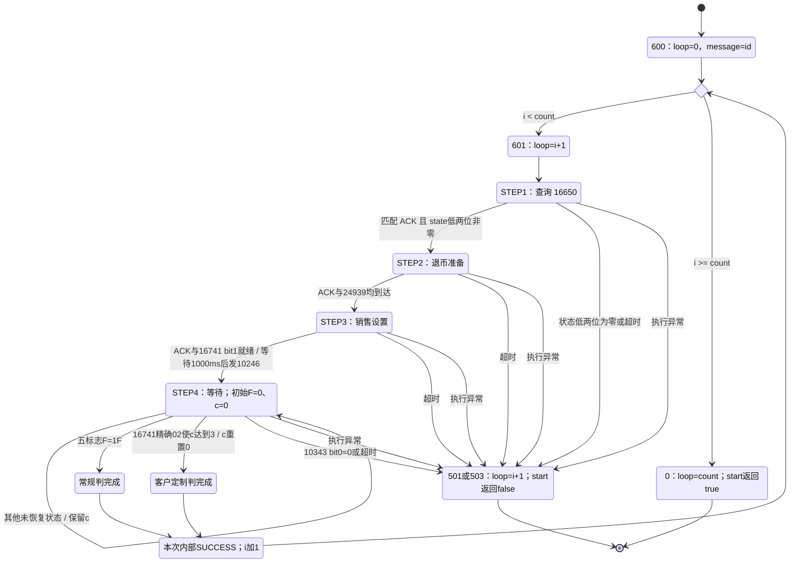

# 详细设计

> 基线：`mj2` / `b8e9ebe`，2026-10-10。[架构](ARCHITECTURE.md) · [操作手册](OPERATIONS.md)

本文描述客户端实际实现。DTO 字段不是服务端完整契约；设备字段不是厂商完整规格。联调时必须同时核对中控版本和设备协议。

## 阅读导航

| 章节 | 内容 / 使用场景 |
| --- | --- |
| 1 | YAML、SQLite 配置、JSON 模型、保存/重启及字符集 |
| 2 | HTTP 客户端、DTO 字段/类型、请求默认值、token 与异常显示 |
| 3 | 页面/方法调用链、自动出药编排、结果归集、库存展开和屏幕映射 |
| 4 | TCP 生命周期、保活、队列、帧/块、请求响应和事件偏移 |
| 5 | 四步出药、常规/客户定制双路径、进展超时及 loop 语义 |
| 6 | 并发/终结边界、保留协议类、手工测试入口 |
| 7 | 可直接跳转的主要源码依据 |

字段表默认记录 **Java 字段名与类型**；JSON 属性名还受到 Lombok getter、Jackson/Fastjson 配置影响。本文的概念示例不用于直接对生产服务发送请求。

## 1. 配置与本地存储

### 1.1 Spring 配置

默认资源为 `src/main/resources/application.yaml`。

| 配置项 | 默认值 / 作用 |
| --- | --- |
| `server.type` | `out`；主窗口有注入但未实际使用，不能据此推断已有完整退药流程 |
| `server.title` | `管制類藥品櫃管理系統`；窗口标题 |
| `spring.datasource.url` | `jdbc:sqlite:data/system.db`，相对进程工作目录 |
| `spring.datasource.type` | `org.sqlite.SQLiteDataSource` |
| `spring.datasource.driver-class-name` | `org.sqlite.JDBC` |
| `spring.jpa.database-platform` | `com.enigmabridge.hibernate.dialect.SQLiteDialect` |
| `spring.jpa.show-sql` | `false` |
| `logging.level.root` | `INFO` |
| `logging.level.com.mmh.vmma` | `TRACE` |
| `logging.file.name` | `logs/vmma.log` |
| `logging.logback.rollingpolicy.max-file-size` | `5MB` |
| `logging.logback.rollingpolicy.max-history` | `90`；滚动历史配置，不是业务审计保留承诺 |

`application-return.yaml` 只有日志和数据库配置，日志分类还是 `com.hma.vmma`。加载此 profile 不会凭空增加退药页面；它也没有覆盖默认 `server.type`。

### 1.2 配置表

`SystemConfig` 是唯一 JPA 实体，`SystemConfigRepository` 继承 `JpaRepository<SystemConfig, String>`。实体声明 `t_SystemConfig`，当前数据库实际表名为 `t_system_config`，由命名策略映射。

当前 `data/system.db` 的表结构如下；原始 `vachar` 拼写照录，不应把这段当成整库迁移脚本：

```sql
CREATE TABLE t_system_config (
    key vachar(100) PRIMARY KEY NOT NULL,
    value BLOB NOT NULL
);
```

`value` 保存 `FastJsonUtils.serialize` 产生的 JSON 字节，不是加密文件。序列化与反序列化使用平台默认字符集，部署环境应保持一致。

`data/create_tables.sql`、其他历史数据库、CSV 和清理脚本属于旧版资料；当前源码没有用这些表实现本地处方/库存管理。不能用该 SQL 初始化当前配置库，也不能把 `delete_result.cmd` 当作本版维护步骤。

### 1.3 JSON 配置模型

| 配置 key | 模型 | 字段 |
| --- | --- | --- |
| `cabinet` | `VMConfiguration` | `customer`、`terminalid`、`portModes[]` |
| `control_center` | `CenterControl` | `address`，即中控基础 URL |

`PortMode.mode`：`0` 串口、`1` TCP Client、`2` TCP Server。TCP 字段为 `address/portNumber`；串口字段为 `name/baudRate/dataBites/parity/startBits/stopBits/flowControl`。`dataBites` 等拼写照源码保留。

下面只是结构示意，不是可直接导入的现场配置：

```json
{
  "customer": "<终端显示客户名称>",
  "terminalid": "<中控登记的终端编号>",
  "portModes": [
    {"mode": 1, "address": "<药柜 IPv4>", "portNumber": "<TCP 端口>"}
  ]
}
```

```json
{"address": "https://<中控主机>/<基础路径>"}
```

配置页保存客户名称和终端编号，不保存 `server.type/server.title`。当前启动遍历端口时复用同一个 TCP 客户端，没有按端口创建独立 Spring 上下文或队列；端口数组不能作为多柜隔离支持的依据。

### 1.4 配置界面与校验

| 界面项 | 默认 / 行为 |
| --- | --- |
| `*用戶名稱`、`*終端編號`、`*中央控管URL` | 无配置时空；星号为必填项 |
| `端口類型` | 默认 `TCP/UDP`，另有 `RS232C(串口)` |
| `新增端口` | 默认关闭，打开后保存才追加端口 |
| `連接方式` | 默认 `TCP/UDP Client`，另有 Server |
| `服務IP`、`連接端口` | 重置为 `127.0.0.1` 和 `20000`；不是现场推荐地址 |
| 串口设置 | COM1、9600、数据位 5、None 校验、停止位 1、None 流控 |
| `保存/刪除/退出` | 持久化、删除选中端口、按初始化状态退出 |

标签包含 UDP，但实际没有 UDP 实现；串口和 TCP Server 也只有初始化日志。正式配置只能使用已确认的 TCP Client 路径。

客户/终端字段以 trim 后非空判断，保存仍使用原文本。新增 TCP Client 要求 IP/端口非空，但 IP 格式报错分支未可靠阻止保存；更新已有端口的网络校验也不完整。端口键入限制为数字，没有完整 `1–65535` 范围校验。

IP 键入过滤存在对首位零、零段和光标位置的限制，不能视为通用 IPv4 编辑器。URL 校验主要要求 URI 可解析且有 host，没有限制 scheme 或检测服务可达性。

### 1.5 保存顺序与生效

「保存」先更新并 `saveAndFlush(cabinet)`，再验证和保存 `control_center`。两份配置不是界面级原子事务，后者验证失败时前者可能已保存；没有明确的整体成功弹窗。

端口表可排序，但更新/删除直接用选中视图行索引原始数组，没有行索引转换；维护时不能在排序后盲目更新/删除。没有保证至少一条连接或禁止重复连接的规则。

保存不重建设备连接，也不热更新 `GlobalData`。初始化失败路径的「退出」提示重启后结束应用；成功初始化路径却调用未注册的功能页，不能当作可靠返回菜单或热重载。正常登录后也没有可达的配置菜单。

### 1.6 配置字段类型与运行态映射

| 模型属性 | Java 类型 | 来源与后续使用 |
| --- | --- | --- |
| `VMConfiguration.customer` | String | 配置页“用戶名稱”；初始化写到 `GlobalData.custoerName`，拼写照源码 |
| `VMConfiguration.terminalid` | String | 配置页终端编号；初始化写到 `GlobalData.terminalId` |
| `VMConfiguration.portModes` | List&lt;PortMode&gt; | getter 在 null 时创建空列表；初始化逐项处理 |
| `PortMode.mode` | int | 0/1/2；只有 TCP Client 有实际连接逻辑 |
| `PortMode.address/portNumber` | String | 网络地址/端口；启动时端口用 `Integer.valueOf()` 转换 |
| `PortMode.name/baudRate/dataBites/parity/startBits/stopBits/flowControl` | String | 串口属性；起始位控件被注释，保存时为空 |
| `CenterControl.address` | String | 配置的基础 URL；初始化写到 `GlobalData.ccBaseUrl` |
| `GlobalData.systemToken` | String | `/system/init` 返回，未存回配置表 |
| `GlobalData.deviceInit` | ResDeviceInit | 保存初始化响应；getter 在 null 时仅创建空响应对象 |

`SystemConfig.key` 是字符串主键，`value` 是 byte[]。该存储层没有另建药品、患者、用户或结果实体；`Cabinet` 的 id/name 和 `SqlEntity` 的历史字段不意味着有对应 JPA 表或完整本地业务数据库。

### 1.7 配置初始化和字符集边界

“数据库文件存在”“配置表存在”“两条配置记录可解析”和“端点可用”是不同条件。缺少配置记录有明确失败分支；数据库/表缺失、损坏或 JSON 无法解析则可能在 Repository/解析调用时抛错，不能把默认 SQLite URL 当成完整自动建库/迁移机制。

`FastJsonUtils.serialize()` 的链是 `JSONObject.toJSONString(obj) → String.getBytes()`；反序列化是 `new String(bytes) → Fastjson.parseObject/parseArray`。两个字符转换均未指定 Charset。

| 编码层 | 当前实现 |
| --- | --- |
| Maven 源文件/资源 | 此前构建日志显示 UTF-8；作用于编译/资源拷贝 |
| YAML 日志编码项 | 配置 `logging.charset.file/console=UTF-8`；不改变 JSON BLOB 转换 |
| 配置 JSON BLOB | 使用运行 JVM 的平台默认字符集 |
| 中控日期 | 字符串格式 `yyyy-MM-dd'T'HH:mm:ss.SSSZ`，不是时间戳秒数 |
| 图片解码 | Base64 解码成字节，再交 ImageIcon；不是配置 BLOB 解码 |

跨 Mac/Windows 迁移带中文的配置，应保持写入和读取字符集一致，并保留可恢复原件。不能在未确认旧库编码时无条件改变 `file.encoding`；ASCII-only 配置恰好可跨编码读取，也不表示以后含中文保存仍无差别。

## 2. 中控接口

### 2.1 HTTP 客户端

所有业务接口均为客户端发出的 HTTP POST，URL 由配置的中控基础地址和固定路径拼接；基础地址末尾是否带 `/` 均有处理。

`RestTemplateConfig` 使用 Apache HttpClient。连接建立与连接池申请超时各 30 秒，读取超时 60 秒，连接池总上限 50。服务器未给出 keep-alive 时使用 20 秒；后台每 10 秒清理过期连接和空闲超过 30 秒的连接。调度线程池大小为 50。

HTTPS 配置使用 `TrustSelfSignedStrategy`；本地网络配置不等于端到端安全保障。接口鉴权字段在 JSON 请求体中，不能假设统一使用 `Authorization` 请求头。

多数请求使用 `clientId`、`datetime`、`token`、`data` 外层结构；登录没有 `token`，行为接口使用 `terminalId`。时间默认格式为 `yyyy-MM-dd'T'HH:mm:ss.SSSZ`。

### 2.2 接口清单与鉴权来源

| 客户端类 | 路径 | 关键请求与返回 |
| --- | --- | --- |
| `RestfulDeviceInit` | `/system/init` | `data.terminalId/termType/ipAddress/macAddress`；返回 `id/token/expireddate` |
| `RestfulLogin` | `/user/login` | `data.loginType/userName/encPassword`；返回用户 token、身份、roles、menuItems |
| `RestfulLogout` | `/user/logout` | 用户 `token`，客户端编号和时间；返回结果与消息 |
| `RestfulProvideQuery` | `/user/provide/query` | 条码、病历/医嘱与可选药品请求；返回待调剂药品及各储位分配 |
| `RestfulProvideResult` | `/user/provide/result` | 条码、病历/医嘱和储位级实际数量/状态；返回药品/储位库存信息 |
| `RestfulTMMedicines` | `/system/tmedicines` | `data.terminalId/medicineId/photo`；返回药品及储位库存 |
| `RestfulActions` | `/user/action` | `data[]` 内的 `ActionId/ActionResult`；返回操作记录结果 |

初始化客户端使用源码固定的初始化鉴权标记；初始化返回 token 后存入 `GlobalData.systemToken`。库存客户端仅在调用方没有设置 token 时补系统 token。登录不依赖该字段；登出、调剂和行为客户端不会统一自动补用户 token，由调用方传入。

通用 `RestfulClient` 返回 `postForEntity`，具体业务客户端使用 `postForObject`。查询、结果与库存接口先收字符串再经 Fastjson 解析；其他客户端直接接收类型对象。

旧 README 提到的 `provide/basic`、`medicine` 和 `IsProvided` 不是当前这些客户端的路径或 DTO 字段。接口契约应以这里的源码与服务端联调结果为准。

### 2.3 登录与菜单模型

`ReqLogin.data` 包含 `loginType`、`userName` 和 `encPassword`。`CODES` 定义账号模式 `id` 和卡号模式 `card`，也保留人脸/指纹标记；常量存在不代表对应按钮已实现。

`ResLogin.data` 的身份字段为 `userId/userName/department/userInfo/introduction/avatar/email`，另有 `token`、字符串数组 `roles` 和数组 `menuItems`。

每个菜单对象含 `appid/icon/title/active/subItems`，每个子菜单含 `appid/icon/title/active/url`。客户端页面和按钮映射仍在本地代码中，并非收到任意 URL 就生成完整页面。

`AESUtils.getSha256` 提供对输入文本与源码固定共享值的 UTF-8 字节计算 SHA-256、再 Base64 编码的工具。但当前员工编号登录把 `encPassword` 设为空，没有调用该摘要路径；不能把工具存在写成当前 UI 实现了密码认证。固定共享值不在文档中列出。

### 2.4 查询与结果模型

`ReqProvideQuery` 外层为 `clientId/datetime/token/data`。`data` 含 `terminalId/chartNo/PhrOrderNo/barcodeNo1/barcodeNo2/medicinedata`；可选请求药品项为 `boxId/medicineId/takeQty`。

`ResProvideQuery.data` 含终端、病历、医嘱、两段条码和药品数组。每个药品项包括：

| 字段组 | 字段及意义 |
| --- | --- |
| 药品与处方 | `medicineId/medicineName/qty/doseUnit/fq/control` |
| 出药请求 | `takeQty/takeUnit` |
| 提示与展示 | `photo/patientName/medNo/scrn/confirmType` |
| 批号与效期 | `lot/expiredDate` |
| 储位分配 | `boxInfo[]`：`boxId/stockQty/takeQty` |

`ReqProvideResult.data` 保留条码、病历/医嘱和终端字段；`medicinedata[]` 按储位记录 `boxId/medicineId/takeQty/status`。状态常量 `CONSTANTS` 为 `0` 成功、`1` 取药异常、`2` 数量不足、`3` 药品信息错误；实际分支如何构造状态见后文业务流程。

`ResProvideResult.data.medicinedata[]` 含 `medicineId/stockQty/isAlarm/boxInfo`。其嵌套储位 DTO 的 `takeQty` 当前是 **boolean**，不是请求中的 double；不能照搬该响应类型作为数量模型。

模型同时保留 `ChartNo/chartNo`、`PhrOrderNo/phrOrderNo`、`BoxId/boxId` 等大小写差异，并混用 Jackson 与 Fastjson。上述字段名照源码描述，不能在未确认序列化结果和服务端契约时直接统一大小写。

### 2.5 库存模型

`ReqTMedicines.data.photo` 控制是否请求图片；`medicineId` 可用于单药品查询。`ResTMedicines` 带 `reccount` 和 `data[]`。

每个返回项含药品 ID、名称、学名、告警阈值 `alarmQty`、告警标记 `isAlarm`、总量 `quantity`、最大总量 `maxQuantity`、单位/途径/厂商/包装/描述/管制标记/批号/效期/图片及其他医院扩展字段。`boxInfo[]` 含 `boxId/maxQuantity/quantity`。

UI 展示时可将一个药品的多个储位展开为多个 `VMMedicine` 行，分别保留药品级总量和储位级数量。这里显示的是中控返回库存，不是客户端直接测量的实时机械库存。

### 2.6 结果码与异常边界

`ResEntity.result` 的成功常量是 `20000`，不是 HTTP 状态 `200`。常见定义如下：

| 结果码 | 源码常量意义 |
| --- | --- |
| `40000` | 缺少参数 |
| `40100/40101` | 未授权 / 无账号 |
| `40102` | 密码与终端编号错误常量共用此值，须看返回消息 |
| `40400/42200` | 接口不存在 / 接口错误 |
| `50008/50000` | token 错误 / 系统错误 |
| `20001/20002/20003/20004` | 唯一性、表、写入和查询/SQL 错误 |

HTTP 失败通常由 RestTemplate 抛出，UI 再处理。没有跨接口自动 token 刷新、统一离线降级或持久化重试队列；收到异常不能假设服务端一定没有处理原请求。

### 2.7 请求默认值、覆盖规则与返回转换

这里的“默认”是具体 `doPost(request)` 做的补值，不等于 DTO 自带值，也不等于 UI 每次使用系统 token。`Optional.ofNullable` 只判断 null，**空字符串仍会保留**。

| 客户端 | clientId / terminalId | datetime | token | 响应转换 |
| --- | --- | --- | --- | --- |
| DeviceInit | 外层 clientId 取请求 data.terminalId，null 才用全局终端 | null 才补当前时间 | 每次设固定初始化标记 | RestTemplate 直接转 ResDeviceInit |
| Login | 外层 clientId 每次设全局终端 | null 才补当前时间 | 请求无 token 属性 | 直接转 ResLogin |
| Logout | 外层 clientId 每次设全局终端 | 每次覆盖为当前时间 | 保留调用方传入值 | 直接转 ResLogout |
| ProvideQuery | 外层 clientId 为 null 才补全局终端 | null 才补当前时间 | 不自动补 | String → Fastjson → ResProvideQuery |
| ProvideResult | 同查询 | null 才补当前时间 | 不自动补 | String → Fastjson → ResProvideResult |
| TMMedicines | 外层 clientId 为 null 才补全局终端 | null 才补当前时间 | null 才补系统 token；常规 UI 显式传用户 token | String → Fastjson → ResTMedicines |
| Actions | 外层是 terminalId，null 才补全局终端，没有 clientId | null 才补当前时间 | 不自动补 | 直接转 ResActions |

`data.terminalId` 不由以上所有客户端统一自动填入；正常 UI 自己设置。基础地址与接口路径只处理一次末尾 `/`，没有按接口自动选择不同服务器、统一业务成功处理或 token 拦截器。

### 2.8 字段类型和不同数量的作用

| 层级 / 字段 | Java 类型 | 实际含义或读取行为 |
| --- | --- | --- |
| 通用 `result/message` | int / String | 中控业务码与原始消息，独立于 HTTP 状态 |
| ReqDeviceInit.data | terminalId/termType/ipAddress/macAddress 均 String | 当前初始化传终端、类型 `"1"`、MAC，IP 为空 |
| ResDeviceInit.data | id/token 为 String，expireddate 为 long | 系统凭证模型；客户端未用到期字段续期，源码未说明时间单位 |
| ReqLogin.data | loginType/userName/encPassword 均 String | 当前员工编号模式为 id，密码为空 |
| ResLogin.data | token/身份资料为 String，roles/menuItems 为 List | 无用户 token 到期属性；列表 getter null 时建空列表 |
| ReqProvideQuery.data.medicinedata[] | boxId/medicineId 为 String，takeQty 为 double | 普通扫码送空数组；保留指定药品请求能力 |
| ResProvideQuery.MedicineData.qty | String | 原处方数量文本，不是设备循环次数 |
| ResProvideQuery.MedicineData.takeQty | double | 药品级计划数量；实际储位任务使用 boxInfo.takeQty |
| ResProvideQuery.BoxInfo | boxId 为 String，stockQty/takeQty 为 double | 储位库存与储位计划数量；设备次数取 takeQty 向上取整 |
| ReqProvideResult.MedicineData | boxId/medicineId 为 String，takeQty 为 double，status 为 int | 按储位回写程序归集数量和成功/异常状态 |
| ResProvideResult.MedicineData | medicineId 为 String，stockQty 为 double，isAlarm 为 boolean | 服务端返回库存结果；不等于 UI 自动按其更新所有页面 |
| ResProvideResult.BoxInfo | BoxId 为 String，StockQty 为 double，takeQty 为 boolean | 与请求数量类型不同；照当前声明记录 |
| ResTMedicines.data | quantity/maxQuantity/alarmQty 为 double，isAlarm 为 boolean，type 为 int | 药品总库存、总最大量和告警信息 |
| ResTMedicines.BoxInfoField | boxId 为 String，quantity/maxQuantity 为 double | 储位现存量与储位最大量 |

`getData()` / 列表 getter 的懒创建会把部分 null 转为空对象/列表，但不会补齐关键标识、储位或数量，也不是完整响应有效性校验。`ResLogin.data`、`ResDeviceInit.data` 没有相同的兜底 getter，调用方会直接读取它们。

### 2.9 概念消息示意与大小写约定

下面只表达数据流，用常见的小驼峰属性形状说明。当前模型有 `PhrOrderNo/ChartNo/Photo/isAlarm` 等声明和 getter 差异，**联调应核对实际序列化与服务端属性名**；不要用示例替代已确认的 wire contract。

普通扫码请求的结构示意：

```json
{
  "clientId": "<终端编号>",
  "datetime": "<当前带时区日期时间>",
  "token": "<当前用户token>",
  "data": {
    "terminalId": "<终端编号>",
    "chartNo": "",
    "phrOrderNo": "",
    "barcodeNo1": "<药袋下方条码>",
    "barcodeNo2": "<药袋上方条码>",
    "medicinedata": []
  }
}
```

字段关系示意，不是患者/处方样本：

```text
ResProvideQuery.data
  ├─ 终端、病历、医嘱、两段条码
  └─ medicinedata[]
      ├─ 药品、处方显示、批号、效期、图片
      └─ boxInfo[]
          ├─ boxId
          ├─ stockQty
          └─ takeQty → ceil → Vendout.count

所有储位终结回调
  → 每储位 medicineId + boxId + takeQty + status
  → ReqProvideResult.data.medicinedata[]
```

同一计划可有多个药品/储位。回写项来自本地 HashMap 遍历，不保证与原计划顺序一致；储位数量为程序结果，不是把查询里的计划数量原样复制。

### 2.10 登录超时、网络超时与屏幕消息

员工登录响应存入 `MainWindow.loginUser`，后续 `getUserToken()` 一直读取它。扫码失败没有替换身份、刷新 token 或自动跳登录；`ERR_TOKEN=50008` 只定义在常量类，没有针对它的独立恢复分支。

| 出现阶段 | 界面表现 / 源码 | 可以确认的边界 |
| --- | --- | --- |
| 员工登录业务失败 | 登录提示区设为红色、显示 resLogin.message；`JPUserLogin.userIDLogin()` | 消息来自中控；不建立新的有效登录响应 |
| 双条码查询业务失败 | 「錯誤」弹窗原样显示 resProvideQuery.message；`JPMKGeneralProvide.getDrugInfo():628–632` | 中控若返回登录超时文本就会显示；不是客户端生成倒计时 |
| 查询失败返回空 | 扫码页顶部「讀取取藥訊息錯誤」；`provideDrug():589–591` | 客户端通用提示，不带确切根因 |
| 结果回写业务失败 | 出药窗口底部黄色“回寫取藥結果錯誤, 原因:” + message；`updateProvidedResult():513–517` | 物理出药流程可能已经结束，不应重取整单 |
| HTTP 异常 | catch 记日志、返回空或显示通用错误 | 30 秒连接/60 秒读取与登录会话有效期没有等价关系 |

重新登录会重新请求 `/user/login` 并保存返回身份，所以旧凭证被拒绝时可能恢复扫码；但当前仓库没有中控服务端有效期规则。客户说“超时后需登出再登入”只能作为线索，需用故障时 result/message 和实际发布版本定位。

## 3. 界面与业务详细流程

### 3.1 初始化与会话

`VmmaApplication` 显示模态 `InitSystem` 后再显示 `MainWindow`。初始化从 `cabinet/control_center` 读取配置，把客户、终端和基础 URL 写到 `GlobalData`，调用 TCP 连接，再注册中控。

注册请求发送终端编号、`termType="1"`（药柜终端）、MAC 地址，IP 字段为空。初始化响应的 token 与完整对象存入全局状态，但没有完整业务成功码校验。TCP 连接等待按每 500ms 计数，超过 120 次设失败码；该返回只退出端口 lambda，后续初始化仍可能继续。

员工编号登录发出 `loginType="id"`、输入编号和空密码字段。中控成功后整个 `ResLogin` 存入 `MainWindow.loginUser`，直接切调剂页；失败则显示服务端消息或记录请求异常。无角色选择、密码框或修改密码流程。

登录页再次显示会清本地身份。调剂页「退出」请求 `/user/logout` 后切登录，即使中控异常也会清本地会话；这不是结束进程。登录页右上角无文字按钮调用 `exitSystem()`，鼠标进入才显示退出图标。

源码内置口令分支不会建立有效 `ResLogin`，后续用户访问可能报错，不能当作维护入口。管理/退出权限检查存在注释代码，但当前核心页面没有完整本地权限保护。`SIGNOUT_TIMEOUT=45` 和计数字段存在，却没有定时计数/达到阈值登出的执行逻辑。

### 3.2 双条码计划查询

调剂页下方条码按 Enter 转上方框；上方 Enter 或「確認」调用 `provideDrug()`，发 `/user/provide/query`。按钮路径要求两个输入非空，上方 Enter 路径只检查上方框，且没有条码格式/长度/校验位检查。

请求使用当前用户 token、终端编号和两段原始条码，病历号/医嘱号为空，没有用户选择的药品数组。中控返回计划后，UI 清空输入并显示 `DlgGeneralProviding`；失败显示原因/读取错误，空药品数组显示「沒有待取藥物列表」。

查询等待动画由普通线程更新标签，HTTP 调用仍可阻塞事件线程。没有“病床→医嘱→药品”选择步骤或独立 QRCode 解析。

### 3.3 自动出药编排

「調劑操作確認」窗口显示后自动调用 `providingMedicine()`，先禁用「確定」，无独立取消按钮，不能通过普通窗口关闭取消动作。

遍历 `medicinedata[]` 再遍历 `boxInfo[]`，以 `medicineId + "-" + boxId` 建结果项，初始状态 `-1`、已取量 `0`。为每个储位提交：

```text
Vendout(id=medicineId-boxId,
        column=Integer.valueOf(boxId),
        count=ceil(box.takeQty),
        callback=当前对话框)
```

`planTakeTimes` 是储位任务数，不是总包数。储位必须是可转换的整数，数量向上取整；并无全计划预校验、零/负数过滤或失败取消剩余任务。

对话框显示药品、单位、双条码、储位、计划量/库存、批号/效期、病历/患者/领药号/处方日期/频次。效期和处方日期经工具尝试转本地时区，转换失败保留原文本。图片更新始终取计划首个药品图片，多药品场景不能只据图片判断当前药品。

`takeQty > stockQty` 有提示，但仅从显示函数返回，不阻止任务入队；它不是可靠的库存安全阻断。

### 3.4 储位结果归集与回传

| 回调 | UI 处理 |
| --- | --- |
| `600` 开始 | 按流程 key 更新药品/储位展示 |
| `601` 进度 | 显示当前尝试包数，不是成功计数 |
| `0` 成功 | 储位状态 `0`、数量 `loop`，包含常规或客户定制规则判完成的次数 |
| `501/503` 等终结失败 | 储位状态 `1`、数量 `loop - 1`，显示设备消息 |

所有储位终结后启用「確定」并 POST `/user/provide/result`，包含返回计划中的病历/医嘱/条码和每个药品/储位的数量、状态。失败项也回传，不是旧 README 所称“仅发送成功药品”。

`loop-1` 只表示之前按当前软件规则判定完成的包数，包含第 5 章客户定制路径；失败当前包是否物理落药仍须核对。回调没有常规/定制路径标记，UI 无法从回调识别成功来源。最后一项提示可能覆盖先前错误，界面没有完整整单成功/部分成功总结。

回写业务失败显示黄色服务端原因，异常提示联系管理员，无本地持久化待办、自动重试或人工重试按钮。「確定」在回写调用前已启用，不能据按钮状态判断服务端已落账。

空 `boxInfo`、非数字储位或回调异常可能使任务计数无法闭合，窗口一直不能正常关闭。页面结果 Map 和任务计数也没有统一同步保护。

### 3.5 告警、库存与详情

进入调剂页查询 `/system/tmedicines`，`photo=false`，仅显示中控 `isAlarm=true` 的药品。可见列为药物编号、药名、警示量、现存总量；最大储量在模型中但隐藏。

进入库存页查询同接口，`photo=true`，将药品按储位展开。可见列为储位号、药名、现存总药量、储位现存量、最大量和药物编号；同药品的总量在每个储位重复。初始顺序为告警优先，再按数值储位号。

选行后「詳情」新建只读 `DlgMKDrugStatus`，展示药品/包装/单位/管制类型/储位数量/最大量/图片等。学名控件存在，但库存转换没有填充该字段；「藥品劑型」实际取 `doseRoute`。详情没有补药、改库存或开门操作。

库存和告警主要在页面显示时查询，翻页/详情返回使用内存列表，没有持续轮询。「即時」不能解读成直接传感器测量。搜索栏高度为零，不能按可见功能写操作步骤；页码输入也没有完整范围保护。

### 3.6 保留但不可常规使用的流程

`DlgBatchProvide` 已有药品数量输入、请求计划、逐储位出药及结果回传。查询用固定批次条码标记和秒级时间，病历/医嘱为空，由中控分配储位。

唯一库存入口「批次取藥」明确隐藏。其小数输入/整数解析、库存阻断、空计划和回写失败处理也不完整；目前不能通过公开按钮执行，更不能仅打开入口就视为生产可用。

`JPFunctions` 的一般/紧急/临时/管理菜单未注册进主窗口。`JPCabinet` 为简单布局占位；图片模板及人脸相关历史库也不是完整业务流程。

### 3.7 方法调用链与事件入口

| 场景 | 当前调用链 | 主要状态/显示变化 |
| --- | --- | --- |
| 进程启动 | `VmmaApplication.main → Spring context → InitSystem.setVisible → windowOpened线程 → initSetting → dispose → MainWindow.setVisible` | 先初始化，后按初始化结果选择登录/配置 |
| 员工登录 | 编号 Enter/确认 → `userIDLogin → RestfulLogin.doPost → setLoginUser → checkOptions(OPTION_MKGENERAL_DRUG)` | 保存登录响应；调剂页显示时读取员工资料并查询告警 |
| 计划查询 | 上方 Enter/确认 → `provideDrug → getDrugInfo → RestfulProvideQuery.doPost` | 同步查询伴随后台点号动画；失败原文弹窗 |
| 显示计划 | `setMedicine(data) → 模态setVisible → componentShown → providingMedicine` | “確定”禁用；开始自动登记并提交储位任务 |
| 设备执行 | `RequestQueue.push(Vendout) → pop.start → Vendout.updateCallback → DlgGeneralProviding.update` | 同队列串行；START 选药品/储位，PROCESS 更新尝试进度 |
| 结果回写 | 所有储位终结 → `okButton.setEnabled(true) → updateProvidedResult → RestfulProvideResult.doPost` | 关闭按钮先启用；中控失败另显示黄色原因 |
| 对话框关闭 | “確定” → 清本次计划并 dispose → 调用方再次切调剂 | 清输入、重查告警，不自动复用上一袋条码 |
| 库存查看 | “即時藥存量” → `checkOptions(OPTION_MKDRUGS_STATUS) → componentShown → getMedicineList → /system/tmedicines` | 获取图片及库存快照并展开储位 |
| 查看详情 | 选行 → “詳情” → 查找 medicineId+boxId 对象 → new `DlgMKDrugStatus` | 新建只读模态详情，返回后重绘列表 |
| 主动登出 | 调剂“退出” → 页面 `logout → /user/logout → checkOptions(OPTION_LOGIN)` | 不论登出请求异常是否成功，本地随后转登录/清身份 |
| 保存配置 | `saveVMConfig → saveAndFlush(cabinet) → saveCCConfig → saveAndFlush(control_center)` | 两次保存，之后重读表；不改变已建立连接 |

这里的调用链是现有页面路径，不代表隐藏功能的调用也可由正常导航到达。页面方法名及确切声明可通过第 7 章源码链接定位。

### 3.8 控件显示与 DTO 字段映射

| 页面 / 区域 | 数据来源 | 显示或行为 |
| --- | --- | --- |
| 调剂页员工信息 | `MainWindow.loginUser.data.userId/userName` | 显示当前员工，不是药袋患者 |
| 调剂页顶部提示 | 固定文案、点号动画、查询状态 | 读取/条码焦点提示；不是倒计时 |
| 调剂药品区 | 当前 MedicineData 的 medicineId/medicineName/doseUnit，当前 BoxInfo 的 boxId/stockQty/takeQty | 标签文本后续也被回调解析为当前药品/储位标识 |
| 调剂批号/效期 | lot/expiredDate | 效期经 LTZDTFormat；不根据它阻断出药 |
| 调剂患者/处方区 | data.chartNo，MedicineData.patientName/medNo/scrn/fq | 病历、患者、领药号、处方日期、频次；不是本地选择输入 |
| 调剂图片 | medicinedata 首项 photo | 任意储位更新仍取首项；无图用外部 nopic.png |
| 调剂底部消息 | ResponseMessage / 中控回写消息 | 绿色进度/成功，黄色失败/回写错误，最后一条可覆盖此前提示 |
| 库存详情“藥品劑型” | VMMedicine.doseRoute | 名称与模型字段用途不同，按源码映射记录 |
| 库存详情“管制類藥” | VMMedicine.type | 直接显示该 int，不在本地转换厂商/医院字典 |
| 库存详情“藥品學名” | scienceName 控件 | 库存展开未填此属性，该路径不保证有值 |

调剂回调除 START 外，还从当前标签冒号后的文字取得 medicineId、boxId 和计划量；识别依赖共享展示状态与任务串行顺序，不是每次回调都带完整独立药品/储位结构。

库存展开的重要赋值关系如下：

```text
一个 ResTMedicines.DataField
  quantity    → 每行 VMMedicine.totalQuantity
  maxQuantity → 每行 VMMedicine.totalMaxQuantity
  isAlarm     → 每行 VMMedicine.isAlarm
  对每个 boxInfo:
    boxId       → VMMedicine.boxId
    quantity    → VMMedicine.boxQuantity
    maxQuantity → VMMedicine.boxMaxQuantity
```

表格“最大量”是储位最大量；药品总量会重复出现在该药品的多储位行。告警是从药品级标记复制，并不是按每个储位重新比较告警阈值。

### 3.9 页面生命周期与公共模板

| 组件 / 事件 | 当前作用 |
| --- | --- |
| MainWindow 卡片切换 | 先显示 PAGE_TMP 再目标页，触发显示/隐藏监听 |
| 登录页显示 | 清本地登录身份和编号，重置提示并聚焦输入框 |
| 调剂页显示/隐藏 | 显示时重查告警；隐藏时清表格与双条码 |
| 库存页显示/隐藏 | 显示重取接口快照；隐藏清表格 |
| 配置页尺寸变化 | 重置端口输入并重读数据库；不只改变控件坐标 |
| 一般出药对话框 | Spring 单例复用，持有当前计划/Map/计数；结束后清理再 dispose |
| 药品详情对话框 | 每次查询详情新建实例，只读展示 |
| JCommonTable | 统一字体/行高/单选，禁编辑并允许自动排序 |
| CommonUtils.setTable | 设列宽；宽度<=0 的列被隐藏但仍留在模型中 |
| JCommonPanel/Label/TextField/按钮 | 样式、背景图片和鼠标效果，不是额外业务验证器 |
| JPKeyboard | Robot 注入当前焦点；Caps Lock 取系统状态，Delete 为 Backspace，Shift 为持续切换 |
| JPMedicinePicTemplate/JPCabinet | 图片辅助/简单布局，不能视作柜门控制或可达业务流程 |

表格排序改变视图索引，但部分告警渲染和配置更新/删除直接使用原始索引，显示与维护时需按手册核对。分页为已取内存列表切片，Go 页码没有完整空值/范围保护；不是服务器分页协议。

### 3.10 时间、图片与工具使用边界

`CommonUtils.LTZDTFormat()` 尝试解析带不同格式偏移的日期、转到终端本地时区，再显示 `yyyy-MM-dd HH:mm:ss`；失败返回原字符串。它既不是患者药品有效性检查，也不会改变服务器记录。

药品图片经 `AESUtils.GenerateImage(String)` 的 `sun.misc.BASE64Decoder` 解码为 byte[]，然后创建 ImageIcon。该函数名不表示图片进行了 AES 解密；其他 AES/摘要工具也不等于当前登录链使用它们。解码失败可返回 null，源码没有统一图片失败通知层。

外部图标按工作目录读取。当前源码引用 `images/close.png`，仓库图片目录未包含它；该情况影响详情返回图标，不是缺少应用入口或 Windows DLL 的同一类问题。

## 4. TCP 连接、队列与协议

### 4.1 实例、初始化与 TCP 生命周期

通信方向是客户端主动连接设备的 TCP 服务。`SignageIFClient`、`RequestQueue`、`ResponseQueue` 均为普通 Spring `@Component`，当前应用共享这些实例，没有每柜子上下文、按端口实例池或设备路由表。

| 对象 | 创建和依赖 | 保存的运行状态 |
| --- | --- | --- |
| `SignageIFClient` | 注入 `ResponseQueue`；`@PostConstruct` 创建一个 `NioSocketConnector` | 默认远端、连接状态、重连间隔 |
| `RequestQueue` | 注入上述客户端和响应队列；初始化创建一个工作线程 | FIFO 流程列表、`started` |
| `ResponseQueue` | 内存 `LinkedList<Message>` | 已接收并完成类解析的响应/事件 |
| `SignageCodecFactory` | codec 过滤器使用；每次获取时创建 encoder/decoder | 不保存药品、储位或业务 id |
| `KeepConnectionFilter` | 客户端初始化创建一个实例 | 固定保活字节、间隔、一个线程引用 |

依据：`SignageIFClient:46–84`、`RequestQueue:25–67`、`ResponseQueue:23–28`、`SignageCodecFactory:15–26`。

通信类不读取 SQLite、配置 JSON 或中控 URL；`InitSystem` 把端口模型的 `address/portNumber` 传给 `connect(host, port)`。多条 TCP Client 配置复用同一连接器，各次调用都会启动线程并修改默认远端；不能据端口数组推断多个独立柜体连接。调用边界见 `InitSystem:209–218`、`SignageIFClient:93–111`。

连接器过滤链依次注册 `logger → codec → keepconnection`，handler 是客户端自身。会话打开后另在首部加入 `reconnection`。出药字节经 encoder 转义，接收原始字节经 cumulative decoder 还原后交给 handler（`SignageIFClient:74–82,213–254`）。

首次连接在普通线程中设置远端，调用 `connect()`，再 `awaitUninterruptibly()` 等待。连接成功后退出该线程；捕获 `RuntimeIoException` 后睡眠并重复。其他类型异常没有同样的首次连接重试分支。

| 参数 / 动作 | 当前实现及单位 |
| --- | --- |
| 连接建立超时 | `setConnectTimeoutMillis(30000)`：30,000 毫秒 |
| 首次失败等待 | 1、2、4、8、16、32 秒，之后保持 32 秒 |
| 会话创建 | `sessionCreated()` 把间隔重置为 1 秒 |
| 断线重连 | `sessionClosed()` 同步循环：先睡眠，再倍增间隔并连接，成功后退出 |
| 空闲参数 | `setIdleTime(BOTH_IDLE, 30000)`：MINA 参数是秒，即 30,000 秒；不是注释所写 30 秒 |
| 收发 socket buffer | 各 1024 字节；编解码 buffer 可自动扩展，不是最大协议帧长 |
| `send()` | 只有 `isActive()` 且受管会话数为 1 才 `session.write()`；否则不发送 |
| 发送确认 | 不等待 `WriteFuture`，无成功/失败返回值；业务仍进入响应等待 |

退避表达式是 `interval >= 30 ? interval : interval * 2`，所以不会精确封顶 30 秒。以上依据：`SignageIFClient:49–54,71–80,154–180,204–249`。

`getStatus()` 优先以连接器活跃返回 CONNECTED，再判 DISPOSING/DISPOSED，最后返回状态字段。它不验证设备状态、保活回复或取药结果。连接异常 handler 主要记日志，没有在该方法中建立业务失败回调（`SignageIFClient:193–201,266–269`）。

### 4.2 固定保活、队列及归属

保活过滤器会话打开即发送，以后每 15 秒发送固定 `IoBuffer`：`02 07 00 01 01 41 11 01 00 00`。这是协议说明，不是设备操作步骤。

| 保活字段 | 固定取值 |
| --- | --- |
| length / BlockCount | 7 / 0 |
| ObjectID / IndexID | `01` / `01`，不使用普通消息的序号生成器 |
| DataID / type | `16657 / 4111`、GET=`01` |
| 回复处理 | 无专用分派、匹配、丢失计数或保活超时关闭策略 |

实际保活不调用 `ReqMessage_16647`，也不是字符串 echo 协议。客户端不主动回写收到的事件作为 echo ACK；协议 ACK 是第 5 章相应命令的入站确认（`KeepConnectionFilter:16,45–67`、`SignageIFClient:292–324`）。

线程在首次打开时捕获 session，重连没有更新该引用。关闭/移除过滤器只对 RUNNABLE 线程调用 interrupt；睡眠中断被打印后继续循环，没有退出条件。重连过滤器的 `sessionClosed()` 未向后转发关闭事件，保活清理也不能假定必然收到该事件（`KeepConnectionFilter:45–75,89–93`、`SignageIFClient:226–253`）。

请求队列保存的是整个 `FlowFactory`，不是单个协议请求；`pop().start(signage, responseQueue)` 同步阻塞唯一工作线程，因此当前共享队列内储位流程串行。`start()` 的 false 返回被忽略，失败不停止后续排队流程。

| 队列操作 | 锁与调度行为 |
| --- | --- |
| `push()` | 公平 `ReentrantLock(true)`，`addLast()`，FIFO |
| `pop()` | 先在锁外判空，再加锁 `removeFirst()`；空时返回 null |
| 响应 `clear()` | 在锁内清空 |
| 请求队列空闲 | 清空响应队列，睡眠 50ms，再检查请求 |
| 流程等待无响应 | Vendout `pop()` 返回 null 后睡眠 100ms |
| 原始列表访问 | `getFlows()/getMessages()/getFirst()` 没有统一锁保护，列表可被外部修改 |
| 持久化 / 容量 | 没有落盘、容量上限、接收时间或 session 元数据 |

空闲清空意味着设备事件不作为持续状态或审计历史保存；新旧流程之间若队列连续非空，也没有自动按业务 id 切分响应。未匹配报文被 Vendout 弹出后丢弃，不回放给其他阶段（`RequestQueue:42–104`、`ResponseQueue:30–68`、`Vendout:143–158`）。

队列加锁段使用成对 `lock()/unlock()`，没有统一 finally；销毁中的列表清空也不经过相同锁。这里的锁不覆盖完整流程执行、回调或所有列表读写。

ACK 只匹配 DataID 与 IndexID；事件只匹配 ID 和少量状态位。没有 ObjectID、货道、本地流程 id、会话代次或接收时间的完整归属判断，重复/迟到报文仍可能影响当前等待。

销毁请求队列只清空流程并设 `started=false`，没有 join 或当前动作取消；该标志不是 volatile。客户端 `Close()`/销毁会 dispose 活跃连接器，未设置禁止重连标志，也未重新创建连接器。不存在统一“停止所有机械动作”的 API（`RequestQueue:39,71–75`、`SignageIFClient:85–91,101–106,183–191`）。

### 4.3 帧、Header 与 Block

以下都是**解转义后**从 0 开始的字节偏移，不是 socket 上转义后的物理位置。`Header.toBytes()` 固定输出 7 字节，`Message.commonBytes()` 在其前添加 STX 和 length。

偏移、长度和次数使用十进制；协议字节/位掩码如 `26`、`03`、`1F` 使用十六进制，消息 ID 表另同时列出十进制与十六进制。

| 偏移 | 宽度 | 字段 / 实际构造与读取 |
| --- | --- | --- |
| `0` | 1 | STX=`02`；encoder 保留首字节，decoder 未另行验证它必须是 STX |
| `1–2` | 2 | length，小端；表示 offset 3 起的 Header + blocks，不含这 3 字节和转义额外字节 |
| `3` | 1 | ObjectID；Header 默认 `01`，普通 Message 构造覆盖为 `CODES.OBJECT_ID=26`，保活固定 `01` |
| `4` | 1 | IndexID；普通请求/响应关联序号，不是医嘱/储位/药品 id |
| `5–6` | 2 | DataID，大端；请求为固定常量，接收从两个 byte 组合 |
| `7` | 1 | 消息类型；enum 与线值映射见下表 |
| `8` | 1 | ItemNo；当前请求均设 `00`，接收照抄，不承担流水关联 |
| `9` | 1 | BlockCount；声明块数，接收类不统一按此动态解析 |
| `10…` | 可变 | 连续 blocks，各自包含 type/count/data |

依据：`Header:16–29,79–82`、`Message:37–60`、`SignageIFClient:288–289`。

| `MESSAGETYPE` | EVENT | GET | SET | SEND | CLEAR | PUSH | NONE |
| --- | --- | --- | --- | --- | --- | --- | --- |
| 线值 | `00` | `01` | `02` | `04` | `08` | `42` | `FF` |

未知线值通过 `Header.getMsgType()` 映射为 NONE；定义 SEND/CLEAR 等枚举不表示现有 UI 已调用这些能力（`Header:31–76`、`MESSAGETYPE:11–12`）。

普通无块帧总长 10，length=7。这里只示意结构：`02 | 07 00 | ObjectID | IndexID | DataID高 低 | type | 00 | 00`。它不包含操作指令选择或发送方法。空字节数组不是这种“无块帧”：encoder 对 null 抛错，对 byte[] 长度小于 10 抛错。

IndexID 在 `Message` 静态变量中共享，按 `indexId > 7F ? 1 : indexId + 1` 推进，实际循环 1…128，再回 1，128 的 byte 为 `80`。请求构造、接收子类隐式调用默认构造器、发送前 `updateIndexId()` 都会推进它；接收类随后覆盖自身 Header 的入站序号。该计数无同步保护（`Message:21,37–46`）。

每块相对自身起点为 `0:type(1) / 1:count(1) / 2…:data`，内部是 `List<Number>`。分配长度按 `2 + count × 宽度`，实际写入遍历整个 data 列表，两者并未强制一致。

| type | `BLOCKDATATYPE` | 每项分配宽度 / 实际输出 |
| --- | --- | --- |
| `01` | BYTE | 1，`Number.byteValue()` |
| `02` | SHORT | 2，先按大端写入；当前 switch 随后继续进入 INT 分支 |
| `04` | INT | 4，大端 |
| `08` | STRING | 1，逐个 Number 输出 byte；不是独立 String 对象 |
| `10` | BCD | 4，调用普通 int 转换，没有十进制 BCD 转换 |

未知原始 type 的 `getType()` 返回 NONE；用 enum NONE 设置 type 则默认 BYTE。count 的保存、长度运算与 `getData(index)` 仍使用有符号 byte。`setData()` 是追加；`getDataAll()` 空列表返回 null，count=1 返回首个 Number，否则返回整个列表。没有按 type/count 的通用块校验（`Block:36–117,120–193`、`BLOCKDATATYPE:11–12`）。

### 4.4 转义、累计解码与长度

encoder 接收未转义 byte[]，保留第一个字节，之后将 `02 → 7D 22`、`7D → 7D 5D`。例如正文片段 `01 02 7D 00` 在线上变为 `01 7D 22 7D 5D 00`；length 仍计原片段的 4 字节，而不是转义后的 6 字节。

请求 `toBytes()` 拼接 Header/Block 后由 encoder 转义；其旧的 `Message.convertTo()` 调用已注释。`Message.convertTo/convertFrom` 本身也定义上述转换，空数组返回 null，但不是当前请求编解码的接线入口（`SignageIFEncoder:18–47`、`Message:63–116`）。

decoder 继承 `CumulativeProtocolDecoder`，输入不足 10 字节先等待；足够时记 mark，扫描至下一个未转义 STX 或当前输入末尾，恢复转义并检查长度。有效帧输出 IoBuffer 并返回 true；长度不符或非法转义会 reset 并返回 false。

**本基线已把 length 的两个字节分别 `& 0xFF` 后组合**：`低字节 + (高字节 << 8)`，再要求 `length > 0` 且 `length + 3 == 解转义后总长`。不能沿用旧版“长度低字节仍有符号”的描述（`SignageIFDecoder:30–84`，修正在 65–66）。

该修正不等于所有字段已改为无符号：DataID 组合、Block count、`CommonUtils.bytesToShortBE/bytesToIntBE` 仍没有统一掩码。尾部恰为 `7D` 的分片会直接读取下一字节；坏帧重同步、块结构最小长度和首字节检查未形成独立校验层。源码没有 ETX、CRC、协议版本或认证字段（`SignageIFDecoder:36–54`、`SignageIFClient:282–289`、`CommonUtils:90–111`）。

### 4.5 消息清单、请求与响应结构

| DataID（十进制 / 十六进制） | 当前实现与用途 |
| --- | --- |
| `10246 / 2806` | PUSH：BYTE 货道号；响应是命令确认，实际出货还需事件 |
| `16650 / 410A` | GET/SET 类：查询或设置销售状态；当前出药只用 GET，返回状态 byte |
| `25089 / 6201` | PUSH 无块，退币准备指示；与 24939 事件配合 |
| `25090 / 6202` | PUSH 四块：状态、货道列表、余额、16 字节卡字段；当前固定状态 `03`、单货道、余额 0、16 个字符 `'0'` |
| `10343 / 2867` | 出货结果事件，当前检验结果 bit0 |
| `10363 / 287B` | 贩卖报告事件，当前流程主要确认到达 |
| `16741 / 4165` | 状态事件，准备检验 bit1；出货检验 bit0，也参与客户定制累计 `02` 判完成路径 |
| `24934 / 6166` | 结算事件，当前流程确认到达，不校验完整结算业务值 |
| `24939 / 616B` | 退币事件，当前准备阶段确认到达 |
| `16647 / 4107` | 保留“最大货道数”GET 类，未实际调用，长度构造也不一致 |
| `16657 / 4111` | 固定保活 ID，无专用消息类或接收分派 |

接收只分派前九个 ID，不按 type 独立区分；其余 ID 丢弃。实例解析完后入共享响应队列。`ResMessage_00000` 只是通用 Header 包装，default 分派使用它的代码被注释，不表示 ID 0 已支持（`SignageIFClient:292–326`）。

请求公共 ItemNo=`00`，ObjectID/IndexID 按 4.3 节构造。下面长度是构造器声明值，数据偏移是未转义帧位置，不提供设备命令操作步骤。

| 请求类 / type | length / 总长 | 块与数据偏移 | 当前调用 / 源码 |
| --- | --- | --- | --- |
| `ReqMessage_10246` / PUSH | 10 / 13 | `10:type=01,11:count=01,12:columnNo` | Vendout 第四步；`ReqMessage_10246:21–50` |
| `ReqMessage_16650` / GET | 7 / 10 | BlockCount=0，无正文 | Vendout 第一步；`ReqMessage_16650:27–34,63–65` |
| 同类 / SET | 14 / 按块声明应为 17 | `10/11=01/01,12:stop`；`13/14=02/01,15–16:自动解除秒数` | 类具备，当前未调用；SHORT 输出限制见 6.2；`ReqMessage_16650:35–57,67–68` |
| `ReqMessage_25089` / PUSH | 7 / 10 | BlockCount=0，无正文 | Vendout 第二步；`ReqMessage_25089:17–36` |
| `ReqMessage_25090` / PUSH | 37 / 单货道时 40 | 四块详见下表 | Vendout 第三步；`ReqMessage_25090:19–92` |
| `ReqMessage_16647` / GET | 声明 10，实际只有 10 字节 | BlockCount=0；声明 length+3 与实际总长不符 | 没有调用、没有专用响应类；`ReqMessage_16647:18–39` |

`ReqMessage_25090` 在当前单货道场景的完整四块如下。该类的 set 方法都追加数据，构造器没有自动填入这些业务值。

| 块 | type/count 偏移及值 | 数据偏移 | Vendout 写入 / 类能力边界 |
| --- | --- | --- | --- |
| `blockStatus` | `10/11=01/01` | `12` | 固定 `03`；源码有已注释状态名称，但没有启用的选项映射 |
| `blockColumns` | `13/14=01/01` | `15` | 一个货道，int 转 byte；类可收数组，空数组写 `FF`，多货道时未调整 length |
| `blockBalance` | `16/17=04/01` | `18–21` | 大端 int，固定 0 |
| `blockCardNo` | `22/23=01/10` | `24–39` | 16 个字符 `'0'`；不是 16 个 NUL byte |

卡字段 setter 要求字符串长度恰为 16，否则追加 16 个零字节；符合时使用平台默认 `getBytes()`，并未独立校验编码后字节数。当前固定数字字符串不携带真实用户卡号。货道输入没有协议级范围验证（`ReqMessage_25090:52–85`、`Vendout:62–75`）。

所有接收类从 `3–9` 复制 ObjectID、IndexID、DataID、type、ItemNo、BlockCount；并不恢复 `Message.length`。不能把其 `toBytes()` 当作已验证的原帧往返序列化。

| 响应类 | 正文读取 | 流程采用的含义 / 源码 |
| --- | --- | --- |
| `ResMessage_10246` | 仅 Header，无正文解析 | 第四步命令 ACK；`ResMessage_10246:20–34` |
| `ResMessage_25089` | 仅 Header | 第二步命令 ACK；`ResMessage_25089:20–33` |
| `ResMessage_25090` | 仅 Header | 第三步命令 ACK；`ResMessage_25090:20–33` |
| `ResMessage_16650` | 仅 type=GET 时读取 `10:type,11:count,12:状态`，需至少 13 字节 | 第一步按状态低两位判定；非 GET 的 getter 只创建空 BYTE 块；`ResMessage_16650:25–49` |
| `ResMessage_00000` | 仅 Header | 保留类，未进入接收 switch；`ResMessage_00000:20–34` |

命令 ACK 不解析独立结果码，也不因 Header BlockCount 非零而动态读取更多块。接收入口仅统一检查总长至少 10；各具体类额外访问的数据位置仍需要报文满足相应结构。

### 4.6 事件数据结构

事件类的 type/count 多数直接照抄报文，不核验是否匹配下面读取宽度。部分类注释复用了其他消息示例，用途以 Vendout 实际消费方式描述，不把注释展开为厂商故障字典。

| 事件类 | 块位置 / 读取位置 | 当前使用 / 源码 |
| --- | --- | --- |
| `EvtMessage_10343` | `10:type,11:count,12:结果`，至少 13 字节 | 注释 1 成功、0 异常；流程实际检查 bit0；`EvtMessage_10343:14–36` |
| `EvtMessage_16741` | `10:type,11:count,12:状态`，至少 13 字节 | STEP3 bit1；STEP4 bit0 与精确值 `02` 的累计计数；`EvtMessage_16741:23–35` |
| `EvtMessage_24939` | `10:type,11:count,12:数据`，至少 13 字节 | 第二步只认退币事件到达，不解释该 byte 字典；`EvtMessage_24939:23–35` |
| `EvtMessage_10363` | `10:type,11:count`；实际循环 `i=12; i<count; i++` 读取 `bytes[i]` | count 被用作绝对结束下标，不是读取 count 项；流程只认报告到达；`EvtMessage_10363:27–44` |
| `EvtMessage_24934` | 固定读取 10 块，最后访问 70，至少 71 字节 | 只认结算事件到达，完整读取见下表；`EvtMessage_24934:26–115` |

`EvtMessage_24934` 的字段位置不依据 BlockCount/type/count 动态推进。这里只列实际代码变量名；未命名 byte 不推断业务含义，金额单位、缩放、标志字典均未由该类定义。

| 块 | type/count 偏移 | 数据偏移 | 当前读取值 |
| --- | --- | --- | --- |
| 0 | `10/11` | `12–13` | 两个未命名 byte |
| 1 | `14/15` | `16–17 / 18–19` | BE short：`cashAmount / cardAmount` |
| 2 | `20/21` | `22–25` | BE int：`id` |
| 3 | `26/27` | `28` | 未命名 byte |
| 4 | `29/30` | `31` | 未命名 byte |
| 5 | `32/33` | `34` | 未命名 byte |
| 6 | `35/36` | `37–40` | BE int：`cardBlance` |
| 7 | `41/42` | `43–46` | BE int：`cardBfBlance` |
| 8 | `47/48` | `49–52` | BE int：`cardAfBlance` |
| 9 | `53/54` | `55–70` | 16 个未命名 byte |

该类用 `getBlock(index)` 提供块访问，`toBytes()` 递归拼接全部块；当前 Vendout 没有消费这些金额/卡字段，也没有把它们直接作为中控结果回传数据（`EvtMessage_24934:118–143`、`Vendout:340–350`）。

## 5. Vendout 状态机与回调

### 5.1 流程对象与每次执行

`FlowFactory` 保存 id、type、count、steps、currentStep、actions、status、callBack；`Action` 保存消息对象与状态。枚举动作类型只有 NONE/VENDOUT/KEEPCONNECTION，状态为 NONE/READY/PROCESSING/FAILED/COMPLETION；保活实际走过滤器，不是 KEEPCONNECTION 流程实现（`FlowFactory:20–38`、`Action:13–15`、两枚举:10–12）。

Vendout 构造四个 READY 动作，整体 READY。id 仅本地识别，column 写入两个请求，count 控制执行次数，`currentStep` 从 0 到 3；同一个请求对象在各次执行中复用，发送前更新 IndexID。类本身没有校验 count 正数、货道范围或与库存的对应关系（`Vendout:37–79,88–113`）。

| 步骤 | 请求与参数 | 进入下一步条件 |
| --- | --- | --- |
| STEP1 / 0 | GET 16650，无块 | 同 DataID/IndexID 回复，状态 `&03 != 0`；低两位都为 0 则 501 失败 |
| STEP2 / 1 | PUSH 25089，无块 | 命令匹配 ACK + 24939 事件，位掩码累计为 `03` |
| STEP3 / 2 | PUSH 25090：`03`、单货道、余额 0、16 字符零 | 匹配 ACK + 16741 bit1=1，位掩码累计为 `03` |
| STEP4 / 3 | 等待 1000ms，再 PUSH 10246：货道 byte | **常规五标志路径或客户定制累计状态路径**，详见 5.2 |

STEP2/3 的两种回复先后不限；事件不检查 IndexID。STEP3 bit1=0 只忽略并继续等待。STEP1/2/3 各次开始都重新发消息、重新计时（`Vendout:122–278`）。



图中的事件处理顺序以实际分支为准：每次 STEP4 循环先检查超时再 pop；定制路径在状态分支内直接结束等待，不再执行循环尾部五标志检查。count<=0 会跳过次数循环而直接发最终成功，类没有单独拒绝此输入（`Vendout:88–113,303–411`）。

### 5.2 STEP4 的两条判完成路径

`resVendoutgCode`（以下简写 F）按 OR 累计五项，常规路径在循环尾检查 `(F & 1F) == 1F`。这些是当前常规路径的条件，**不是所有成功路径都必须具备的条件**。

| 标志 | 入站消息 / 判定 | 采用的数据 |
| --- | --- | --- |
| `01` | 10246 且 IndexID 等于本次请求 | 仅命令确认 |
| `02` | 10363 | 报告到达，不检查正文 |
| `04` | 24934 | 结算到达，不验证金额/结果 |
| `08` | 10343 的结果 bit0=1 | bit0=0 立即 501 失败 |
| `10` | 16741 的状态 bit0=1 | `01/03` 等含 bit0 的状态可置位 |

`0x03` 含 bit0/bit1：它通过 STEP1 和 STEP3，STEP4 则属于常规恢复状态，不是累计 `02` 的特殊值。源码未定义每个高位或全量设备状态字典（`Vendout:160–164,261–268,319–394`）。

客户定制路径使用本次 STEP4 局部 `countVendoutStatus`（以下简写 c）。在 bit0=0 的 16741 分支中，仅 `vmCurrentState == 02` 时 c++；达到 3 后 c=0、`vmSaleSetting` 设 COMPLETION、`runCompleted=true`，continue 回到 while 条件后退出，最终返回内部 SUCCESS（`Vendout:301,373–388,411`）。

| 接收的 16741 状态 | c 的变化 | F / 后续决策 |
| --- | --- | --- |
| 精确 `02`，累计后 c<3 | c++ | 不置恢复位，不重置计时，continue 等待 |
| 精确 `02`，累计后 c>=3 | c++ 后重置为 0 | 直接定制判完成，不检查五标志是否齐全 |
| bit0=0 且不等于 `02`，如 `00/04/06` | 不增加，也不清零 | 继续等待，不置恢复位 |
| bit0=1，如 `01/03` | 不增加，也不清零 | 置 F 的 `10`，再进行常规五标志检查 |
| 非 16741 消息 | 不增加，也不清零 | 按相应 ACK/事件逻辑更新 F，或丢弃 |

因此是**本次 STEP4 的累计三次**，不要求连续；插入其他状态、报告或确认不会清零。例如 `02 → 00 → 02 → 03 → 02`，若中途未超时、未失败且常规条件尚未齐全，仍可触发定制路径。每次新 STEP4 初始化 c=0，不跨包累计。

定制路径不要求已收到 10246 ACK、10363、24934、10343 成功或恢复状态，不重发请求，也不返回 RETRY。该逻辑直接写在 Vendout，没有客户配置开关、设备型号识别或运行时 feature flag；本基线凡执行到该分支都采用同样条件。

源码保留 `RETRYTIMES=2`、RETRY 枚举和外层处理分支，但当前内部没有有效 `return RETRY`；原返回语句已注释。不能沿用“第三次状态异常后重试”或“自动重试两次”的旧描述（`Vendout:32–35,92–109,381–386`）。

### 5.3 进展计时与错误决策

计时使用 `new Date().getTime()`，比较严格大于阈值；不是单独 watchdog。每轮先检查超时，即使队列已有待弹出报文，也先按当前计时决定是否失败。前三步阈值 10,000ms，STEP4 为 30,000ms，不是整包/整单硬期限。

| 阶段 / 进展 | 是否重置 `sendMsgTime` |
| --- | --- |
| 每步请求发出后 | 初始化为当前时间 |
| STEP2 匹配 25089 ACK / 任意 24939 | 每次符合都重置，重复报文也重置 |
| STEP3 匹配 25090 ACK / 16741 bit1=1 | 每次符合都重置，重复就绪事件也重置 |
| STEP4 匹配 10246 ACK | 只在该标志首次置位时重置 |
| STEP4 10363 | 条件 `(F & 01) == 02` 不成立；事件置报告位但不重置 |
| STEP4 24934 / 10343 bit0=1 / 16741 bit0=1 | 各自标志首次置位时重置 |
| STEP4 精确 `02` 或其他未恢复状态 | 不重置；累计 3 次前仍可能先超时 |

依据：`Vendout:132–148,182–211,234–268,297–393`。普通事件不匹配业务货道；五标志或定制累计并未增加独立报文归属机制。

| 当前错误 | 回调 code / message | 流程结果 |
| --- | --- | --- |
| STEP1 状态低两位为 0 | 501 / 藥品櫃當前狀態為不可出貨狀態 | 终止当前 Vendout |
| STEP1/2/3 超时 | 503 / 查詢販賣機狀態、設置退幣動作、設置取貨動作無迴應 | 同上 |
| STEP4 超时 | 503 / 取貨動作無迴應 | 同上，不自动发中止命令 |
| STEP4 10343 bit0=0 | 501 / 販賣機出貨失敗，附状态值 | 同上 |
| 执行中的 Exception | 503 / 系統執行命令報錯 | 同上，含 Thread.sleep 的中断异常 |

当前 Vendout 不产生公共常量 502/504，也没有将软件回调码解释为厂商故障码的转换表。执行异常捕获不恢复 interrupt 标志；回调本身同步调用，线程和异常边界见 6.1。

### 5.4 终结、loop 与结果语义

| 通知 | 发出时机 | `loop` / `message` |
| --- | --- | --- |
| 600 / START | 一次 Vendout 开始 | 0 / 本地 id |
| 601 / PROCESS | 每次出货前，尚未判完成 | `i+1`，从 1 开始 / 空 |
| 内部 SUCCESS | 一次四步流程由常规或定制路径结束 | 不单独发 code=0；外层继续下一次 |
| 501/503 终结失败 | 当前次失败 | `i+1` / 对应提示；立即返回 false |
| 0 / SUCCESS | count 次均被软件判完成后 | count / 空；返回 true |

最终 0 只覆盖该 Vendout，通常是一个储位任务，不等于整张计划或中控回写成功。`ResponseMessage` 仅包含 code/loop/message，没有携带此次常规/定制判完成的路径标记（`Vendout:88–113,415–421`）。

与 3.4 节 UI 的归集衔接：成功采用 loop、储位状态 0；失败采用 loop−1、储位异常状态。若前面的次数由定制路径判完成，它们也被计入成功或失败前累计数量；这些数字是**软件判定次数**，并非另有物理落药测量。当前次超时仍不能单凭 loop 推断实际落药结果。

两条 STEP4 完成路径都修改第三动作 `vmSaleSetting`，不是第四动作 `vmVendout`；整体 status 没有统一设为 COMPLETION，部分失败分支也未统一更新动作状态。因此不能以 `getStatus()/getCurrentStatus()` 替代最终回调（`Vendout:119,160–164,359–363,383–384,402–411`）。

## 6. 并发、错误处理与已知限制

### 6.1 运行与终结边界

| 范围 | 影响及设计边界 |
| --- | --- |
| Swing 线程 | 初始化/动画/设备回调跨线程直接改控件；多处 HTTP/数据库操作来自事件线程，可能卡顿 |
| 共享状态 | 页面、用户、计划计数和结果 Map 缺少统一同步；任务边登记边入队 |
| 身份/权限 | 当前员工编号模式无密码输入，本地管理检查不完整；不可依赖内置口令或自动登出 |
| 设备隔离 | 单客户端/队列复用，无多柜事务归属或每设备连接隔离 |
| 响应关联 | ACK 只比 DataID/IndexID，事件只比 ID/位；迟到/重复事件可能混入当前流程 |
| 帧健壮性 | length 两字节已无符号组合；DataID/块计数/数值转换并非全 unsigned，另有尾部转义分片、坏帧重同步和块长度边界 |
| 未使用协议能力 | SHORT 输出存在 fall-through；16650 SET、可变多货道长度等不能当作已验证能力 |
| 停止与销毁 | 无统一 cancel/abort；重连/保活/请求线程不能保证可靠中止 |
| 结果一致性 | 无物理动作与 HTTP 事务、持久化回写重试或自动补偿 |
| 客户定制完成 | 累计精确 `02` 三次可以直接完成本次，不带路径标记；最终数量包含该路径判完成的次数 |
| 输入与展示 | 库存提示不阻断出药，页码和配置索引处理不完整，图片可能仍为首项 |

Vendout 回调直接在 RequestQueue 工作线程调用，不调度到 Swing EDT。`start()` 中的开始、进度、最终成功回调位于 `vendoutOneLoop()` 的 try/catch 外；若调用方抛错，请求线程没有顶层恢复逻辑。执行步骤的 Exception 会转 503，但错误回调本身同样可能抛错（`RequestQueue:45–67`、`Vendout:88–113,406–421`）。

流程失败只终结当前次数循环，不清空后续储位任务。响应没有来源元数据，状态计数也未区分重复消息；软件结果、显示累计和平台库存更新不是同一个事务。文档不把 code=0 扩展成新的机械确认或平台落账确认。

### 6.2 已实现解析与保留类边界

| 项目 | 当前源码事实 / 位置 |
| --- | --- |
| length 修正 | decoder 两字节各 `&FF`，已经消除该位置的符号扩展；`SignageIFDecoder:65–66` |
| 其他字节转换 | DataID 低 byte 直接相加，BE 数值解析直接移位带符号 byte；不是统一无符号转换器；`SignageIFClient:288–289`、`CommonUtils:90–111` |
| SHORT 块输出 | 写 2 字节后没有 break，继续以 INT 写同一列表；有数据时可能超出按 SHORT 分配的数组；16650 SET 当前未调用；`Block:159–173` |
| 多货道 25090 | setter 可改 count 并追加多项，length 仍固定 37，之后块位置也随数量移动；当前只用一货道；`ReqMessage_25090:37,56–68` |
| 数据追加与 count | 多次 set 不清旧值；列表项数与分配长度不匹配可留零或越界，没有统一验证；`Block:92–109,146–193` |
| 10363 报告 | 只保存 `12 <= i < count` 的数据；当前不解读为完整货道报告；`EvtMessage_10363:37–44` |
| 接收对象再序列化 | 各接收构造器未 setLength，不能据 `toBytes()` 认为与入站帧等价 |
| `Message(byte[])` | 保留但当前具体接收类不走该构造器；未先初始化 Header，DataID 组合表达式也不同；`Message:27–35` |
| 帧与块校验 | 入口只检查至少 10 字节；单数据事件读到 12、24934 读到 70，具体访问前未统一校验声明 type/count；`SignageIFClient:282–326` |

枚举、请求类和字段存在只说明源码具备相应表示能力，不表示管理界面已接线、设备已接受或厂商全部扩展均受支持。当前设备接收支持集合以 4.5 节九个 switch ID 为准。

### 6.3 SocketServer 手工协议观察入口

`src/test/java/com/hma/vmma/SocketServer.java` 是独立 main 服务，不由生产启动链调用。本次只阅读，未运行或建立网络连接。

| 项目 | 实际行为 / 源码 |
| --- | --- |
| 网络角色 | `NioSocketAcceptor` 手工监听 TCP 20000；`SocketServer:27–59` |
| 有效过滤器 | 只有 LoggingFilter；codec 和 KeepAliveFilter 注册均注释；`SocketServer:33–53` |
| 缓冲 / idle | 最终 read buffer=2048，WRITER_IDLE=5 秒；回调只调用父实现；`SocketServer:57–58,125–129` |
| 每会话发送线程 | 打开会话创建普通无限循环线程，首段立即发送，之后每 15 秒轮换；`SocketServer:71–114` |
| 三段固定样例 | 16741 状态 byte=`01`，24934 十块样例，10363 报告样例；对象/序号为 `FF`；`SocketServer:77–87` |
| 收到客户端数据 | 读取 IoBuffer，打印字节；不根据请求生成响应；`SocketServer:139–150` |
| 心跳内部类 | 字符串 request/response 和超时 handler 存在但未接入；不代表当前服务启用 echo 心跳；`SocketServer:175–230` |
| 关闭 / 中断 | 会话关闭只打印；发送线程中断只打印后继续，没有统一停止；`SocketServer:106–122` |
| 自动断言 | 没有 `@Test` 或断言；test 目录中的 main 不会自动验证协议业务 |

它不生成 16650 查询回复、10246/25089/25090 ACK 或 10343 出货结果，也不模拟累计三次 `02` 的客户定制路径；不能视为完整 Vendout 模拟器或上述两条成功路径的自动测试覆盖。

其他测试目录类主要用于布局、图片、键盘和集合实验。`VmmaApplicationTests` 只有空的上下文加载测试，且处于不同顶层包；POM 默认跳过测试。设备动作、异常对账和现场操作必须另外经过批准的联调。

### 6.4 测试目录的实际用途与验收范围

| 类 | 当前入口 / 用途 | 不代表的能力 |
| --- | --- | --- |
| `VmmaApplicationTests` | JUnit `contextLoads()` 空方法，`@SpringBootTest` | 位于 com.hma.vmma，未显式指定主配置；不是完整 Swing/设备/中控测试 |
| `SocketServer` | 手工 TCP 样例服务，详见 6.3 | 不是完整设备或客户定制分支模拟器 |
| `Demo` | main 中的日志、地址、字符串实验；图片布局辅助方法 | 不检查真实调剂结果 |
| `GridBagDemo` | 图片/字节/布局实验，包含 Windows 命令和固定文件路径 | 不应作为生产启动入口或跨平台自动验证 |
| `Keyboard` | AWT Robot 手工按键示例 | 不验证员工授权、条码关联或无人值守环境 |
| `Student` | 随机集合排序实验 | 与药品业务或数据库一致性无关 |

Surefire 在当前 POM 内硬编码 `<skipTests>true</skipTests>`，测试源码编译成功不等于执行了断言；也不能假定只传 `-DskipTests=false` 就覆盖该配置。本文不修改测试配置或增加测试工具。

下列是对未来联调/验收的覆盖建议，不是已经存在的自动测试：当前常规与定制两条单包完成路径、混合状态/重复迟到事件、分片与转义长度、部分任务失败后队列继续、查询身份拒绝、出药后结果回写失败，以及 Windows 11 的字体/焦点/外部资源与配置编码。与真实设备有关的动作只能在批准条件下执行。

## 7. 主要源码依据

| 主题 | 源码 |
| --- | --- |
| 启动 / 初始化 | [VmmaApplication](../src/main/java/com/mmh/vmma/VmmaApplication.java)、[InitSystem](../src/main/java/com/mmh/vmma/ui/dialogs/InitSystem.java) |
| 页面 / 会话 | [MainWindow](../src/main/java/com/mmh/vmma/ui/frames/MainWindow.java)、[JPUserLogin](../src/main/java/com/mmh/vmma/ui/panels/JPUserLogin.java) |
| 配置 | [JPVMConfig](../src/main/java/com/mmh/vmma/ui/panels/JPVMConfig.java)、[SystemConfig](../src/main/java/com/mmh/vmma/jpa/entities/SystemConfig.java) |
| 调剂 / 结果 | [JPMKGeneralProvide](../src/main/java/com/mmh/vmma/ui/panels/JPMKGeneralProvide.java)、[DlgGeneralProviding](../src/main/java/com/mmh/vmma/ui/dialogs/DlgGeneralProviding.java) |
| 库存 / 保留入口 | [JPMKDrugsStatus](../src/main/java/com/mmh/vmma/ui/panels/JPMKDrugsStatus.java)、[DlgBatchProvide](../src/main/java/com/mmh/vmma/ui/dialogs/DlgBatchProvide.java) |
| HTTP 参数 | [HttpClientConfig](../src/main/java/com/mmh/vmma/restful/client/HttpClientConfig.java) |
| HTTP Bean / 连接调度 | [RestTemplateConfig](../src/main/java/com/mmh/vmma/restful/client/RestTemplateConfig.java)：26–43 |
| 初始化 / 登录 / 登出客户端 | [RestfulDeviceInit](../src/main/java/com/mmh/vmma/controlcenter/RestfulDeviceInit.java)、[RestfulLogin](../src/main/java/com/mmh/vmma/controlcenter/RestfulLogin.java)、[RestfulLogout](../src/main/java/com/mmh/vmma/controlcenter/RestfulLogout.java) |
| 计划 / 回写 / 库存 / 行为客户端 | [RestfulProvideQuery](../src/main/java/com/mmh/vmma/controlcenter/RestfulProvideQuery.java)、[RestfulProvideResult](../src/main/java/com/mmh/vmma/controlcenter/RestfulProvideResult.java)、[RestfulTMMedicines](../src/main/java/com/mmh/vmma/controlcenter/RestfulTMMedicines.java)、[RestfulActions](../src/main/java/com/mmh/vmma/controlcenter/RestfulActions.java) |
| 系统状态 / 用户结果码 | [CODES](../src/main/java/com/mmh/vmma/ui/common/CODES.java)、[ResponseCode](../src/main/java/com/mmh/vmma/controlcenter/ResponseCode.java)、[CONSTANTS](../src/main/java/com/mmh/vmma/controlcenter/CONSTANTS.java) |
| 配置 JSON / 时间和图片工具 | [FastJsonUtils](../src/main/java/com/mmh/vmma/utils/FastJsonUtils.java)：19–33；[CommonUtils](../src/main/java/com/mmh/vmma/utils/CommonUtils.java)：34–63、191–245；[AESUtils](../src/main/java/com/mmh/vmma/utils/AESUtils.java)：187–248 |
| TCP 初始化 / 重连 / 分派 | [SignageIFClient](../src/main/java/com/mmh/vmma/mina/socket/signage/SignageIFClient.java)：67–84、93–180、213–253、272–326 |
| 保活 / codec 实例 | [KeepConnectionFilter](../src/main/java/com/mmh/vmma/mina/socket/signage/KeepConnectionFilter.java)：16、45–93；[SignageCodecFactory](../src/main/java/com/mmh/vmma/mina/socket/signage/SignageCodecFactory.java)：15–26 |
| 编码 / 长度修正 | [SignageIFEncoder](../src/main/java/com/mmh/vmma/mina/socket/signage/SignageIFEncoder.java)：18–47；[SignageIFDecoder](../src/main/java/com/mmh/vmma/mina/socket/signage/SignageIFDecoder.java)：24–87，length 掩码 65–66 |
| FIFO / 响应缓存 | [RequestQueue](../src/main/java/com/mmh/vmma/mina/socket/signage/queue/RequestQueue.java)：42–104；[ResponseQueue](../src/main/java/com/mmh/vmma/mina/socket/signage/queue/ResponseQueue.java)：27–68 |
| 流程基类 / 动作 | [FlowFactory](../src/main/java/com/mmh/vmma/mina/socket/signage/flow/FlowFactory.java)：20–38；[Action](../src/main/java/com/mmh/vmma/mina/socket/signage/flow/Action.java)：13–15 |
| 流程枚举 / 回调接口 | [ACTION_TYPE](../src/main/java/com/mmh/vmma/mina/socket/signage/flow/ACTION_TYPE.java)、[ACTION_STATUS](../src/main/java/com/mmh/vmma/mina/socket/signage/flow/ACTION_STATUS.java)；[ISignageCallBack](../src/main/java/com/mmh/vmma/mina/socket/signage/ISignageCallBack.java)：12–13 |
| 出药双路径 / 次数 / 回调 | [Vendout](../src/main/java/com/mmh/vmma/mina/socket/signage/flow/Vendout.java)：88–113、319–411；定制累计 377–385，常规检查 398–403，回调 415–421 |
| 公共消息 / Header | [Message](../src/main/java/com/mmh/vmma/mina/socket/message/signage/Message.java)：20–119；[Header](../src/main/java/com/mmh/vmma/mina/socket/message/signage/Header.java)：16–82；[MESSAGETYPE](../src/main/java/com/mmh/vmma/mina/socket/message/signage/MESSAGETYPE.java) |
| Block / 类型 | [Block](../src/main/java/com/mmh/vmma/mina/socket/message/signage/Block.java)：16–193；[BLOCKDATATYPE](../src/main/java/com/mmh/vmma/mina/socket/message/signage/BLOCKDATATYPE.java) |
| 状态查询 / 保留最大货道请求 | [ReqMessage_16650](../src/main/java/com/mmh/vmma/mina/socket/message/signage/body/request/ReqMessage_16650.java)：27–74；[ReqMessage_16647](../src/main/java/com/mmh/vmma/mina/socket/message/signage/body/request/ReqMessage_16647.java)：18–39 |
| 准备 / 出货请求 | [ReqMessage_25089](../src/main/java/com/mmh/vmma/mina/socket/message/signage/body/request/ReqMessage_25089.java)：17–36；[ReqMessage_25090](../src/main/java/com/mmh/vmma/mina/socket/message/signage/body/request/ReqMessage_25090.java)：19–92；[ReqMessage_10246](../src/main/java/com/mmh/vmma/mina/socket/message/signage/body/request/ReqMessage_10246.java)：21–50 |
| 状态响应 / 通用保留响应 | [ResMessage_16650](../src/main/java/com/mmh/vmma/mina/socket/message/signage/body/response/ResMessage_16650.java)：25–49；[ResMessage_00000](../src/main/java/com/mmh/vmma/mina/socket/message/signage/body/response/ResMessage_00000.java)：20–34 |
| 三种命令确认 | [ResMessage_10246](../src/main/java/com/mmh/vmma/mina/socket/message/signage/body/response/ResMessage_10246.java)、[ResMessage_25089](../src/main/java/com/mmh/vmma/mina/socket/message/signage/body/response/ResMessage_25089.java)、[ResMessage_25090](../src/main/java/com/mmh/vmma/mina/socket/message/signage/body/response/ResMessage_25090.java)：均自 20 行解析 Header |
| 出货 / 状态 / 退币事件 | [EvtMessage_10343](../src/main/java/com/mmh/vmma/mina/socket/message/signage/body/event/EvtMessage_10343.java)：24–36；[EvtMessage_16741](../src/main/java/com/mmh/vmma/mina/socket/message/signage/body/event/EvtMessage_16741.java)：23–35；[EvtMessage_24939](../src/main/java/com/mmh/vmma/mina/socket/message/signage/body/event/EvtMessage_24939.java)：23–35 |
| 报告 / 结算事件 | [EvtMessage_10363](../src/main/java/com/mmh/vmma/mina/socket/message/signage/body/event/EvtMessage_10363.java)：27–44；[EvtMessage_24934](../src/main/java/com/mmh/vmma/mina/socket/message/signage/body/event/EvtMessage_24934.java)：26–143 |
| 数值字节序辅助 | [CommonUtils](../src/main/java/com/mmh/vmma/utils/CommonUtils.java)：65–111 |
| 手工服务入口 | [SocketServer](../src/test/java/com/hma/vmma/SocketServer.java)：27–59、71–150、175–230 |
| 打包 / 默认参数 | [pom.xml](../pom.xml)、[application.yaml](../src/main/resources/application.yaml) |
