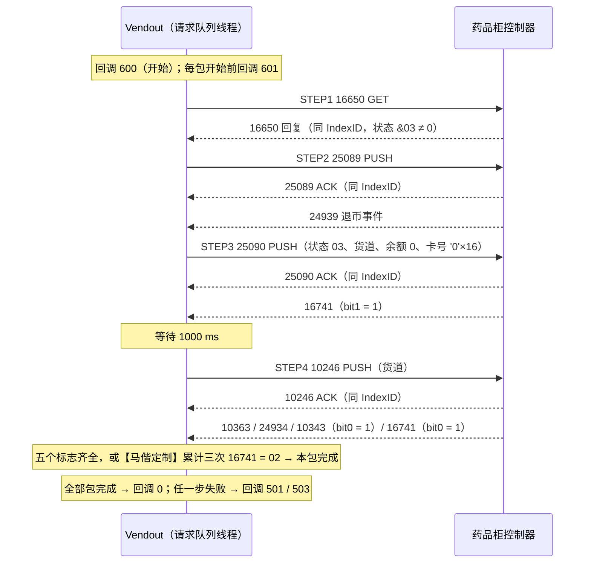

# 药品柜（Signage）通信报文说明

> 基线：`mj2` / `b8e9ebe`（代码），整理日期 2026-11-19。阅读入口：[文档目录](README.md)。

本文是终端与药品柜控制器之间 TCP 报文（源码中称为 “signage”）的字节级参考：传输层参数、帧与转义、Header、Block、每个 DataID 的逐字节布局与十六进制样例，以及出药流程如何消费这些报文。控制器固件与厂商协议规格不在仓库中，本文**只记录当前代码实际构造、解析和判断的语义**；代码不解释的字节、位和取值一律标为“源码未定义”，不补写厂商含义。行为规格见 [cabinet-protocol](../openspec/specs/cabinet-protocol/spec.md) 与 [vendout-flow](../openspec/specs/vendout-flow/spec.md)，类与调用链见 [详细设计](DETAILED_DESIGN.md) 第 4–6 章。

## 阅读导航

| 章节 | 内容 / 使用场景 |
| --- | --- |
| 1 | 角色、状态标记、样例的生成方法、消息目录（先看这里） |
| 2 | 传输层：连接与重连、保活、发送前提、缓冲与空闲参数、日志观察 |
| 3 | 帧格式：未转义偏移、长度字段、转义、解码器接受规则 |
| 4 | Header：ObjectID、IndexID、DataID、消息类型、ItemNo、BlockCount |
| 5 | Block：布局、数据类型宽度与实现差异 |
| 6 | 消息详解：每个 DataID 的方向、布局表、十六进制样例与流程用法 |
| 7 | 一包药的出药交互时序、完成条件、超时与失败码 |
| 8 | 解析与容错限制（与基线发现 F2–F6 对照） |
| 9 | 源码索引 |

## 1. 总览

### 1.1 角色与分层

终端是 **TCP 客户端**，主动连接控制器的 TCP 服务端；控制器不会主动连接终端。进程内只有一个连接器、一个响应队列和一个出药请求队列（见 cabinet-protocol 规格“单一共享连接”）。

| 层 | 终端侧实现 | 本文章节 |
| --- | --- | --- |
| TCP 连接 | MINA 2.1.4 `NioSocketConnector`，由 `SignageIFClient` 创建和重连 | 2 |
| 过滤链 | 会话打开后为 `reconnection → logger → codec → keepconnection`，handler 为 `SignageIFClient` | 2.3 |
| 帧与转义 | 发送 `SignageIFEncoder`（只做转义），接收 `SignageIFDecoder`（累积、切帧、还原转义、校验长度） | 3 |
| 消息对象 | `Message`（STX + length + `Header`）及 `ReqMessage_*`、`ResMessage_*`、`EvtMessage_*` 子类，正文由 `Block` 组成 | 4–6 |
| 分派与队列 | `SignageIFClient.pushResponseMessage()` 按 DataID 构造对象后放入 `ResponseQueue` | 6、8 |
| 业务流程 | `Vendout` 每包四步收发；保活由 `KeepConnectionFilter` 独立发送 | 7 |

### 1.2 状态标记、记数法与样例来源

| 标记 | 含义 |
| --- | --- |
| 在用 | 出药流程或保活实际发送 / 接收并作判断 |
| 保留 | 类、枚举或分支存在，但当前没有调用方或不进入接收分派 |
| 源码未定义 | 字节存在（被构造、照抄或保存），但代码不解释其含义；本文不补写厂商语义 |
| 待现场确认 | 只能由真实控制器、厂商规格或现场联调确认的内容 |

记数法：**偏移、宽度、次数用十进制**，偏移从 0 起算并且都是**未转义（原始）帧**中的位置；报文字节、位掩码用两位大写十六进制（如 `26`、`7D 22`、`&03`）；DataID 同时给出十进制与十六进制。“原始”指 `toBytes()` 输出或解码器还原后的字节，“线上”指 `SignageIFEncoder` 转义后实际写入 socket 的字节。

样例来源（2026-11-19，Oracle JDK `1.8.0_371`，以与 `b8e9ebe` 相同的源码编译；验证程序放在仓库外，未提交，也未连接任何真实控制器）：

| 样例类别 | 生成方法 |
| --- | --- |
| 出站（终端→设备） | 用真实请求类按 `Vendout.initSteps()` 的参数构造，按流程先 `updateIndexId()` 再 `toBytes()` 得到原始字节；再调用真实 `SignageIFEncoder.encode()`（桩 `ProtocolEncoderOutput`）得到线上字节。另以真实 `Vendout.start()` 驱动一个脚本化假客户端，核对四步的实际发送顺序与 IndexID |
| 入站（设备→终端） | **构造样例**：按解析类读取的偏移手工拼字节，经真实 `SignageIFClient.messageReceived()` 分派到真实 `ResMessage_*` / `EvtMessage_*` 构造器并打印解析结果；不是设备抓包 |
| 仓库测试样例 | `src/test/java/com/hma/vmma/SocketServer.java:77–87` 中的三段字节，同样是手写样例，只用于对照解析行为 |
| 解码规则 | 真实 `SignageIFDecoder` + MINA `CumulativeProtocolDecoder`，配合 `DummySession`（TCP 元数据，允许分片），按 MINA 2.1.4 `ProtocolCodecFilter.messageReceived()` 的循环与异常处理方式喂入线上字节 |

### 1.3 消息目录

“代码对 type 的要求”指接收类是否检查 Header 偏移 7 的消息类型；“不检查”时样例中的取值只是构造值。

| DataID（十进制 / 十六进制） | 方向 | 消息类型（线值） | Java 类 | 当前实现的用途 | 使用方 | 状态 |
| --- | --- | --- | --- | --- | --- | --- |
| `16650 / 410A` | 终端→设备 | GET（`01`） | `ReqMessage_16650(GET)` | 查询销售状态，无正文 | Vendout STEP1 | 在用 |
| `16650 / 410A` | 终端→设备 | SET（`02`） | `ReqMessage_16650(SET)` | 注释为“贩卖停止指示 / 自动解除秒数”设定 | 无 | 保留 |
| `16650 / 410A` | 设备→终端 | 只有 GET（`01`）才读正文 | `ResMessage_16650` | 状态字节，STEP1 检验 `&03` | Vendout STEP1 | 在用 |
| `25089 / 6201` | 终端→设备 | PUSH（`42`） | `ReqMessage_25089` | 注释“退币要求指示的通知”，无正文 | Vendout STEP2 | 在用 |
| `25089 / 6201` | 设备→终端 | 不检查 | `ResMessage_25089` | 命令 ACK，只读 Header | Vendout STEP2 | 在用 |
| `24939 / 616B` | 设备→终端 | 不检查 | `EvtMessage_24939` | 退币事件，到达即可 | Vendout STEP2 | 在用 |
| `25090 / 6202` | 终端→设备 | PUSH（`42`） | `ReqMessage_25090` | 注释“下回贩卖指示的通知（个别）”，四块 | Vendout STEP3 | 在用 |
| `25090 / 6202` | 设备→终端 | 不检查 | `ResMessage_25090` | 命令 ACK，只读 Header | Vendout STEP3 | 在用 |
| `16741 / 4165` | 设备→终端 | 不检查 | `EvtMessage_16741` | 状态事件：STEP3 检 bit1；STEP4 检 bit0 与精确值 `02` | Vendout STEP3、STEP4 | 在用 |
| `10246 / 2806` | 终端→设备 | PUSH（`42`） | `ReqMessage_10246` | 注释“选择货道号码信息的通知”，携带货道号 | Vendout STEP4 | 在用 |
| `10246 / 2806` | 设备→终端 | 不检查 | `ResMessage_10246` | 命令 ACK，只读 Header | Vendout STEP4 | 在用 |
| `10363 / 287B` | 设备→终端 | 不检查 | `EvtMessage_10363` | 贩卖报告事件，到达即可 | Vendout STEP4 | 在用 |
| `24934 / 6166` | 设备→终端 | 不检查 | `EvtMessage_24934` | 结算结果事件，到达即可 | Vendout STEP4 | 在用 |
| `10343 / 2867` | 设备→终端 | 不检查 | `EvtMessage_10343` | 出货结果事件，检 bit0 | Vendout STEP4 | 在用 |
| `16657 / 4111` | 终端→设备 | GET（`01`） | 无类；`KeepConnectionFilter` 字节常量 | 固定保活帧 | 保活线程 | 在用（只发送；回复被丢弃） |
| `16647 / 4107` | 终端→设备 | GET（`01`） | `ReqMessage_16647` | 注释“最大货道数的取得”“用於keep alive” | 无 | 保留 |
| 任意 | 设备→终端 | — | `ResMessage_00000` | 通用 Header 包装 | 无（default 分支已注释） | 保留 |

接收端只分派上表中设备→终端的 9 个 DataID（`SignageIFClient:292–324`）；其余 DataID（包括 16657 与 16647 的任何回复）在构造对象前就被丢弃。名称取自类注释或 `Vendout` 分支注释：10363“販賣機報告事件”（`Vendout:327`）、24934“結算結果事件”（`Vendout:340`）、10343“出貨結果事件”（`Vendout:353`）、16741“狀態恢復事件”（`Vendout:372`）、24939“退幣事件”（`Vendout:208`）。`EvtMessage_16741/24939` 的类注释复制自 10246，`EvtMessage_10363/24934` 的类注释复制自 10343，不能据此推断它们的厂商定义。

## 2. 传输层

本章另引用一次**本机回环观察**：真实 `SignageIFClient`（反射调用其 `init()`，走完整 MINA 过滤链）连接同一进程内的测试服务端（本机回环地址、临时端口），服务端只记录收到的原始字节并按脚本回送字节。它不代表控制器的真实行为。

### 2.1 连接、超时与重连

| 项目 | 当前实现 | 来源 |
| --- | --- | --- |
| 远端地址 | `InitSystem` 对 `cabinet` 配置中模式为 `TCP_CLIENT` 的每个端口项调用 `connect(address, portNumber)`；文中示例统一写作 `192.0.2.10:9000`（占位） | `InitSystem:209–218` |
| 建立连接 | 新线程：`setDefaultRemoteAddress()` → `connect()` → `awaitUninterruptibly()`；`getSession().isConnected()` 为真则置 CONNECTED 并结束线程 | `SignageIFClient:93–173` |
| 连接超时 | `setConnectTimeoutMillis(30000)`：30,000 ms | `SignageIFClient:50,71` |
| 首次失败 | 只捕获 `RuntimeIoException`（连接失败时 `getSession()` 抛出）：睡眠当前间隔后倍增再试 | `SignageIFClient:159–167` |
| 退避序列 | 1、2、4、8、16、32、32… 秒；表达式 `interval >= 30 ? interval : interval * 2`，不是精确封顶 30 | `SignageIFClient:166,233` |
| 间隔复位 | `sessionCreated()` 把间隔重置为 1 秒 | `SignageIFClient:204–210` |
| 断线重连 | `sessionOpened()` 在过滤链首加入 `reconnection`；其 `sessionClosed()` 同步循环：先睡眠 → 倍增 → `connect()` → 等待，成功后退出；任何异常记日志后继续 | `SignageIFClient:212–253` |
| 初始化等待 | `InitSystem` 每 500 ms 检查一次是否仍为 CONNECTING，最多 120 次（约 60 s），超出设 `ERR_CONNECT_VM`（5），只退出当前端口 lambda | `InitSystem:219–234` |
| 再次调用 `connect()` | 连接器已活动时先关闭全部会话并 `dispose()` 连接器，再在其上连接；见基线发现 F2 | `SignageIFClient:101–106` |

本机回环观察：服务端关闭会话后约 1.0 s 建立第二个会话；重连循环运行在 MINA 的 `NioProcessor-*` I/O 线程上（线程栈含 `AbstractPollingIoProcessor`）。循环期间 `getStatus()` 仍返回 CONNECTED、`isActive()` 仍为 true，但受管会话数为 0，所以 `send()` 不发送。

待现场确认：由于循环在 I/O 线程上等待，MINA 2.1.4 的 `DefaultIoFuture` 每 5 s 做一次死锁检查，若单次连接等待超过 5 s（例如目标不响应），会抛 `IllegalStateException("DEAD LOCK: …")`；循环捕获后按退避发起下一次连接，而前一次请求仍可能在 30 s 超时内进行。这种情况下的实际重连节奏、是否可能同时得到多个会话（多于 1 个会话时 `send()` 不发送），只做了 MINA 源码静态阅读，未复现。

### 2.2 保活（16657）

| 项目 | 当前实现 | 来源 |
| --- | --- | --- |
| 帧 | `02 07 00 01 01 41 11 01 00 00`；原始与线上相同（首字节后没有 `02`/`7D`） | `KeepConnectionFilter:16` |
| 字段 | STX `02`；length 7；ObjectID `01`；IndexID `01`（固定，不走计数器）；DataID 16657 / `41 11`；type GET `01`；ItemNo `00`；BlockCount `00` | 同上 |
| 发送路径 | 以 `IoBuffer.wrap()` 直接 `session.write()`；MINA `ProtocolCodecFilter.filterWrite()` 对 `IoBuffer` 跳过编码，所以不经过 `SignageIFEncoder`，也没有其 `Send message` 日志 | `KeepConnectionFilter:52` |
| 时机 | 过滤器实例只创建一个线程：首个会话打开时立即发送，之后每 15 s（`KEEP_CONNECTION_INTERVAL`）一次 | `KeepConnectionFilter:45–68`、`SignageIFClient:49,76` |
| 回复处理 | 没有消息类；16657 不在接收 switch 中，回复（若有）被丢弃；不计数、不判超时、不因无回复断线 | `SignageIFClient:320–321` |
| 重连之后 | 线程仍持有首个会话的引用，新会话收不到保活（F3） | `KeepConnectionFilter:46–66` |
| 停止 | 会话关闭或过滤器移除时只对 RUNNABLE 状态的线程 interrupt；睡眠中被中断只打印异常并继续循环 | `KeepConnectionFilter:53–57,71–76,89–94` |

本机回环观察：连接后约 0.01 s 收到第一帧保活，约 15.0 s 后收到第二帧；服务端关闭会话、客户端重连后，在第二个会话上观察 20 s 未收到任何保活。这复现了 F3 的终端侧行为；控制器是否依赖保活、多久未收到会断开，待现场确认。`ReqMessage_16647` 的注释虽写“用於keep alive”，实际保活并不使用它（§6.11）。

### 2.3 发送与接收路径

| 方向 | 路径 | 说明 |
| --- | --- | --- |
| 发送 | `Vendout` → `SignageIFClient.send(byte[])` → `keepconnection` → `codec`（`SignageIFEncoder` 转义为 `IoBuffer`）→ `logger` → `reconnection` → socket | `send()` 只有在 `isActive()` 且 `getManagedSessionCount() == 1` 时才 `session.write()`，否则静默丢弃，无日志、无返回值；不等待 `WriteFuture`（`SignageIFClient:175–181`） |
| 接收 | socket → `reconnection` → `logger` → `codec`（`SignageIFDecoder` 切帧、还原转义）→ `keepconnection` → `SignageIFClient.messageReceived()` → `pushResponseMessage()` → `ResponseQueue` | 解析类构造器抛出的异常由 MINA 过滤链转为 `exceptionCaught`，只记日志，该帧不入队、连接不关闭 |

发送前提的业务后果见 cabinet-protocol 规格“发送前提”：断线期间 Vendout 的请求不会发出，流程照常计时，直到该步骤以 503 超时。本机回环观察：连接建立前调用 `send()`，服务端没有收到任何字节。编码器对 `null` 或不足 10 字节的 `byte[]` 抛 `IllegalArgumentException`（`SignageIFEncoder:20–30`），该异常同样只到 `exceptionCaught`；Vendout 的四种请求都不少于 10 字节，不会触发。

### 2.4 缓冲、空闲参数与共享连接

| 参数 | 值 | 说明 / 来源 |
| --- | --- | --- |
| socket 接收 / 发送缓冲 | 1024 / 1024 字节 | `SignageIFClient:53–54,78–79`；编解码 `IoBuffer` 自动扩展，这不是协议最大帧长（回环中 138 字节线上帧正常解码） |
| 空闲时间 | `setIdleTime(BOTH_IDLE, 30000)` | MINA 的单位是秒，即 30,000 s（回环读回 `getBothIdleTimeInMillis()` = 30,000,000）；注释“空閒時間30秒”与实际不符；handler 未覆写 `sessionIdle()`，空闲事件没有动作（`SignageIFClient:51,80`） |
| 连接与队列实例 | 各一个 | 多个 `TCP_CLIENT` 配置复用同一连接器和队列，不按柜体路由，见 cabinet-protocol 规格“单一共享连接” |

### 2.5 日志中如何观察报文

`application.yaml` 把 `com.mmh.vmma` 设为 TRACE、root 设为 INFO，因此以下输出默认可见：

| 日志 | 级别 | 内容 |
| --- | --- | --- |
| `SignageIFEncoder`：`Send message [...]` | DEBUG | 请求转义后的**线上**字节，完整十六进制（`SignageIFEncoder:46`）；保活不经过此处 |
| `SignageIFDecoder`：`in = [...]` | DEBUG | 每次 `doDecode()` 时累积的**线上**字节（`SignageIFDecoder:26–28`） |
| `SignageIFClient`：`receive message [...]` | INFO | 还原后的**原始**帧，格式 `HeapBuffer[pos=0 lim=13 cap=13: 02 0A 00 …]`，只显示前 16 字节（`SignageIFClient:261`） |
| MINA `LoggingFilter`：`RECEIVED:` / `SENT:` | INFO | 收：转义态缓冲区前 16 字节；发：原始消息对象，请求为 `byte[]` 引用，不含内容 |
| `Vendout`：`發送消息:[...]` | TRACE | Lombok `toString()`：只有 length 与 Header 的十进制值，如 `Message(length=37, header=Header(objId=38, indexId=10, dataID=25090, msgType=PUSH, itemNo=0, blockCount=4))`，不含块内容 |
| `SignageIFClient`：`收到消息錯誤。` | ERROR | 解码后不足 10 字节时打印；解码器已保证至少 10 字节，正常路径不可达 |

## 3. 帧格式

### 3.1 未转义帧布局

| 偏移 | 宽度 | 字段 | 发送时的构造 | 接收时的处理 | 来源 |
| --- | --- | --- | --- | --- | --- |
| `0` | 1 | STX | 固定 `02`（`Message.STX`） | 解码器不检查首字节；未转义的 `02` 只用作“下一帧开始”的边界 | `Message:20,52`；`SignageIFDecoder:36–42` |
| `1–2` | 2 | length，**小端** | `shortToByteArray(length)` 得到大端两字节后，先写低字节再写高字节；值是各请求类构造器中的常量 | 两字节各 `& 0xFF` 后按小端组合，要求 `> 0` 且 `length + 3 ==` 还原后的总长 | `Message:53–55`；`SignageIFDecoder:65–72` |
| `3–9` | 7 | Header | `Header.toBytes()` | 各接收类逐字节照抄 | §4 |
| `10…` | 可变 | Block 序列 | 各请求类按固定顺序拼接 `Block.toBytes()` | 各接收类按固定偏移读取，不按 BlockCount 动态推进 | §5、§6 |

总长 = length + 3。代码中没有 ETX、CRC / 校验和、协议版本或认证字段。最短合法帧是 10 字节的无块帧（length 7）。

### 3.2 长度字段

length = Header 7 字节 + 全部 Block 字节 = 原始总长 − 3。它**不含**前 3 字节（STX 与 length 自身），也**不含**转义增加的字节。例如 STEP3 的 25090 请求原始 40 字节，length 为 37，写作 `25 00`；线上因一个 `02` 被转义而为 41 字节，length 仍是 `25 00`。

发送端的 length 是各类构造器写死的常量（`setLength(...)`），不是按实际内容计算的；因此只有当块内容与常量一致时才自洽。当前 Vendout 使用的四种请求都自洽；不自洽的保留用法见 §6.4（多货道 25090）与 §6.11（16647）。

### 3.3 转义规则

| 方向 | 规则 | 来源 |
| --- | --- | --- |
| 发送 | 保留第 0 字节原样；第 1 字节起 `02 → 7D 22`、`7D → 7D 5D`，其余不变；对 length、IndexID、DataID、type、BlockCount 和数据一视同仁 | `SignageIFEncoder:31–42` |
| 接收 | `7D 22 → 02`、`7D 5D → 7D`；`7D` 后接其他字节视为非法，整段不输出（§3.4） | `SignageIFDecoder:44–57` |

转义实例（均为验证程序输出）：

| 场景 | 原始字节 | 线上字节 |
| --- | --- | --- |
| DataID 低字节为 `02`（STEP3 的 25090，前 9 字节） | `02 25 00 26 0A 62 02 42 00` | `02 25 00 26 0A 62 7D 22 42 00` |
| IndexID 为 `02` 的 16650 GET | `02 07 00 26 02 41 0A 01 00 00` | `02 07 00 26 7D 22 41 0A 01 00 00` |
| IndexID 为 `7D` 的 16650 GET | `02 07 00 26 7D 41 0A 01 00 00` | `02 07 00 26 7D 5D 41 0A 01 00 00` |
| 货道号为 2 的 10246 | `02 0A 00 26 42 28 06 42 00 01 01 01 02` | `02 0A 00 26 42 28 06 42 00 01 01 01 7D 22` |

表中后三行的 IndexID 由反射设定计数器得到，只用于演示转义。编码器也不检查第 0 字节是否为 `02`：以 `7D` 开头的输入会原样保留首字节。`Message.convertTo()` / `convertFrom()` 实现同样的规则，但各请求类中调用它们的语句已注释，不在当前收发路径上（`Message:63–118`）。

### 3.4 解码器的接受规则

`SignageIFDecoder` 继承 MINA `CumulativeProtocolDecoder`：每次 `doDecode()` 返回 true 就输出一帧并继续处理剩余字节；返回 false 时剩余字节保存在会话缓冲中，等下一次读取追加后**从同一位置**重新解析（`SignageIFDecoder:24–88`）。

| 步骤 | 规则 | 源码行 |
| --- | --- | --- |
| 1 | 累积的**线上**字节少于 10 个 → 返回 false 等待（按转义前计数） | 30、87 |
| 2 | `mark()`，第 0 字节不论取值直接复制 | 34–36 |
| 3 | 逐字节扫描：遇未转义 `02` 回退一字节并结束本帧候选；遇 `7D` 读下一字节还原，非 `22`/`5D` 则 `reset()` 返回 false；扫描到当前已到达数据的末尾也结束 | 37–59 |
| 4 | 还原后不足 10 字节 → `reset()` 返回 false | 64、74–77 |
| 5 | `length = (b[1] & FF) + ((b[2] & FF) << 8)`；要求 `length > 0` 且 `length + 3 ==` 还原后总长，否则 `reset()` 返回 false | 65–72 |
| 6 | 输出还原后的帧（`IoBuffer`，position 0），返回 true | 78–84 |

由此产生的行为（线上字节喂给真实解码器的结果；标“回环”的项另经 §2 的本机回环复现）：

| 线上输入 | 结果 |
| --- | --- |
| `02 0A 00 FF FF 41 65 00 00 01 01 01 01`（完整一帧） | 输出 1 帧 |
| 同一次读取中连续两帧 | 依次输出 2 帧（回环） |
| 分两次到达：`02 0A 00 FF FF 41` + `65 00 00 01 01 01 01` | 第一次不足 10 字节等待，第二次输出 1 帧（回环为 6 + 7 字节分两次写） |
| 分两次到达：前 11 字节 + `01 01` | 第一次长度不符等待，第二次输出 1 帧 |
| `02 07 00 26 7D 22 41 0A 01 00`（10 个线上字节，还原后 9 个）+ `00` | 第一次等待，第二次输出 10 字节帧 |
| `FF 0A 00 FF FF 41 65 00 00 01 01 01 01`（首字节不是 `02`） | 照常输出 1 帧，首字节为 `FF` |
| length 为 `86 00` 的 137 字节帧（线上 138 字节） | 输出 1 帧，见 §3.5（回环） |
| 长度不符的帧（如 length `08 00` 而实际 13 字节）后接正常帧 | 不输出；其后再到达的正常帧也不输出——**停滞**（回环） |
| length 为 `00 00` | 停滞 |
| 帧前有非 `02` 前导字节，如 `AA BB 02 0A …` | `AA BB` 被当作一个不足 10 字节的候选帧，停滞 |
| 非法转义，如 `… 01 7D 33 02 0A …` | 停滞 |
| 正文中出现未转义的 `02` | 帧在该处被截断，前段长度不符，停滞 |
| 一次读取恰好以 `7D` 结尾，且会话中没有累积缓冲 | `doDecode()` 读越界抛 `BufferUnderflowException`，这次读到的字节全部丢失；随后到达的 `22` 成为下一候选帧的首字节，停滞（回环） |
| 同上，但此前已有累积缓冲（帧跨越三次读取） | 抛异常后缓冲保留，下一次读到 `22` 时拼接成功并输出（回环） |

“停滞”指解码器每次都从坏数据处 `reset()`，MINA 把新数据不断追加到会话缓冲，该会话后续所有报文都不再输出，直到会话关闭；重连后的新会话使用新的缓冲，回环中第二个会话可以正常解码。这对应基线发现 F6，影响见 §8。

### 3.5 长度低字节 ≥ `0x80` 的示例

构造的 10363 报告帧：count `7D`、125 个数据字节，原始 137 字节，length = 134 = `0x86` → 字段为 `86 00`。

| 形态 | 字节（中间省略的是交替的 `00 01`） | 长度 |
| --- | --- | --- |
| 原始 | `02 86 00 FF FF 28 7B 00 00 01 01 7D 00 01 00 01 … 00 01 00` | 137 |
| 线上 | `02 86 00 FF FF 28 7B 00 00 01 01 7D 5D 00 01 00 01 … 00 01 00` | 138（偏移 11 的 `7D` 被转义） |

当前计算：`(0x86 & 0xFF) + ((0x00 & 0xFF) << 8)` = 134，134 + 3 = 137 = 还原后总长 → 接受，解析为 `EvtMessage_10363`。`b8e9ebe` 之前的代码直接用 `buffer.get(1)`，`(byte)0x86` = −122，命中 `length <= 0` 而拒绝，并按 §3.4 停滞；该修正是 `b8e9ebe` 中 `SignageIFDecoder:65–66` 的两行改动（另见 [架构 §13.2](ARCHITECTURE.md) 与 cabinet-protocol 规格“长度字段按无符号小端解析”）。

## 4. Header

### 4.1 字段总表（偏移 3–9）

| 偏移 | 宽度 | 字段 | 发送时 | 接收时 | 流程是否使用 | 来源 |
| --- | --- | --- | --- | --- | --- | --- |
| `3` | 1 | ObjectID | 普通请求 `26`；保活 `01` | 照抄，不检查 | 否 | `CODES:12`、`Message:39`、`Header:24` |
| `4` | 1 | IndexID | 进程内静态计数器的当前值 | 照抄 | 命令 ACK 匹配 | `Message:21,40–46` |
| `5–6` | 2 | DataID，**大端** | `shortToByteArray(dataID)`，高字节在前 | `(byte)b[6] + ((byte)b[5] << 8)`，低字节按有符号参与运算 | 接收分派、各步骤过滤 | `Header:80–81`、`SignageIFClient:288–289` |
| `7` | 1 | 消息类型 | `setMsgType(MESSAGETYPE)` 映射为线值 | 照抄；只有 `ResMessage_16650` 用它决定是否读正文 | 仅 STEP1 间接使用 | `Header:31–77`、`ResMessage_16650:35` |
| `8` | 1 | ItemNo | 所有请求固定 `00` | 照抄 | 否 | 各请求类 `_ITEM_NO` |
| `9` | 1 | BlockCount | 各类常量：16650 GET `00`、SET `02`，25089 `00`，25090 `04`，10246 `01`，16647 `00` | 照抄，解析时不使用 | 否 | 各请求类 `_BLOCK_COUNT` 与构造器 |

### 4.2 ObjectID

`Header` 字段默认值是 `01`，但所有 `Message` 子类的默认构造器都把它覆盖为 `CODES.OBJECT_ID = (byte) 0x26`，因此 16650、25089、25090、10246、16647 请求都发送 `26`；保活帧是常量，ObjectID 为 `01`。请求类注释中的示例（如 `ReqMessage_25089:15` 的 `02 07 00 01 01 62 01 42 00 00`）写的是 `01`，与实际构造不同，以代码为准。`26` 与 `01` 对控制器的含义源码未定义，待现场确认。接收时不比较 ObjectID；仓库测试样例中的事件为 `FF`。

### 4.3 IndexID：静态计数器与 ACK 匹配

| 项目 | 当前实现 |
| --- | --- |
| 存储 | `Message` 的 `private static int indexId`，所有请求与接收对象共享一个计数器，无锁、非 volatile（`Message:21`） |
| 推进规则 | `indexId = indexId > 0x7F ? 1 : indexId + 1`，序列为 1、2 … 127（`7F`）、128（`80`）、1 …；验证程序从 `7D` 起依次得到 `7E 7F 80 01 02` |
| 谁推进 | ① 每次 `Message()` 默认构造：请求对象构造、**每个入站帧的解析对象构造**（`ResMessage_*`/`EvtMessage_*` 隐式调用父类构造器）；② 每次 `updateIndexId()`，Vendout 在每步发送前调用 |
| 请求的值 | 发送前最后一次 `updateIndexId()` 时的计数值；Vendout 每包复用同一组请求对象，每步重新取号（`Vendout:129,179,231,294`） |
| 接收的值 | 解析对象把偏移 4 的入站字节写回自己的 Header（计数器仍已推进一次） |
| ACK 匹配 | STEP1 的 16650 回复、STEP2/3/4 的 25089/25090/10246 ACK 都要求 `DataID` 相同且 IndexID 字节相等；事件不比较 IndexID（`Vendout:151–158,203,255,320`） |
| 转义 | 取值 `02`、`7D` 时线上分别为 `7D 22`、`7D 5D`（§3.3） |

真实 `Vendout.start()` 在全新 JVM 中对脚本化设备运行（§1.2）时，计数器的变化如下；本文出药样例的 IndexID 均取自这次运行：

| 时刻 | 计数器 | 说明 |
| --- | --- | --- |
| 进程启动 | 0 | |
| `new Vendout(...)` 之后 | 4 | 构造 16650、25089、25090、10246 四个请求各 +1；这些构造时的值随后会被覆盖 |
| STEP1 发送 | 5 | 16650 GET 携带 `05` |
| 解析 16650 回复 | 6 | 回复的偏移 4 为 `05`（回显） |
| STEP2 发送；解析 ACK、24939 | 7；8、9 | 25089 携带 `07` |
| STEP3 发送；解析 ACK、16741 | 10；11、12 | 25090 携带 `0A` |
| STEP4 发送；解析 5 个入站帧 | 13；14–18 | 10246 携带 `0D` |

生产环境中，空闲期间收到的事件也会被解析（推进计数器）后才被清空，因此请求的 IndexID 无法预知，样例值只作说明。接收在 MINA I/O 线程、取号在请求队列线程，二者并发修改同一静态变量，源码没有同步保护。

### 4.4 DataID

发送时为大端：16650 = `0x410A` 写作 `41 0A`。接收时 `SignageIFClient` 与各解析类都用 `short dataId = (byte)bytes[6]; dataId += (byte)bytes[5] << 8;` 组合：

| 偏移 5–6 | 计算结果 | 说明 |
| --- | --- | --- |
| `41 65` | 16741 | 低字节 < `0x80`，结果正确 |
| `28 86` | 10118（`0x2786`） | 低字节 ≥ `0x80` 时比实际值 10374（`0x2886`）小 256（验证程序经 `ResMessage_00000` 得到） |
| `86 06` | −31226 | 高字节 ≥ `0x80` 时为负的 `short`，16 位模式仍是 `0x8606` |

当前分派的 9 个 DataID 低字节为 `06 0A 01 02 67 7B 65 66 6B`，都小于 `0x80`，高字节都小于 `0x80`；而低字节 ≥ `0x80` 的 DataID 计算后低字节不变，不可能与这 9 个值相撞，所以这一有符号运算**不影响当前分派**，只会让未支持 ID 的取值失真。`Message(byte[])` 构造器另有一种组合写法，但它先调用 `getHeader()`（此时为 null）即抛 `NullPointerException`，没有调用方（`Message:27–35`）。

### 4.5 消息类型

| `MESSAGETYPE` | EVENT | GET | SET | SEND | CLEAR | PUSH | NONE |
| --- | --- | --- | --- | --- | --- | --- | --- |
| 线值 | `00` | `01` | `02` | `04` | `08` | `42` | `FF` |
| 当前发送 | — | 16650、16657、16647 | 仅保留的 16650 SET | — | — | 25089、25090、10246 | — |

依据 `Header:16–22,34–77`。未知线值经 `getMsgType()` 映射为 NONE；`Header` 的初始 `msgType = -1` 即 `FF`。SET 的线值 `02` 在线上转义为 `7D 22`。接收侧只有 `ResMessage_16650` 检查类型（必须为 GET 才读正文）；其他接收类和 Vendout 都不看类型，因此 ACK、事件的类型取值源码未定义，本文样例中 ACK 用 `42`、事件用 `00` 只是构造值。

### 4.6 ItemNo 与 BlockCount

ItemNo 在所有请求中为 `00`，接收时照抄、不参与任何判断。BlockCount 只在发送时与实际块数一致；接收类按固定偏移读取，不用 BlockCount 推进。验证程序中，带一个额外块、BlockCount 为 `01` 的 10246 ACK（`02 0A 00 26 0D 28 06 42 00 01 01 01 09`）照样被解析为 ACK，额外块被忽略。

## 5. Block

### 5.1 布局

每个块相对自身起点：`0` type（1 字节）、`1` count（1 字节，有符号 byte）、`2…` 数据。`toBytes()` 按 `2 + count × 宽度` 分配数组，再把内部 `List<Number>` 的**全部**元素依次写入（`Block:120–196`）；分配长度与元素个数之间没有一致性检查。

### 5.2 数据类型

| type 线值 | `BLOCKDATATYPE` | 分配宽度 | 实际输出 | 验证程序输出 |
| --- | --- | --- | --- | --- |
| `01` | BYTE | 1 | `Number.byteValue()` | count 1、[5] → `01 01 05` |
| `02` | SHORT | 2 | 先写 2 字节大端，`case` 末尾无 `break`，继续按 INT 把同一列表再写一遍 4 字节（`Block:159–173`） | count 1、[] → `02 01 00 00`；count 1、[`0x1234`] → `ArrayIndexOutOfBoundsException`；count 3、[`0x1234`] → `02 03 12 34 00 00 12 34` |
| `04` | INT | 4 | 4 字节大端 | count 1、[1000] → `04 01 00 00 03 E8` |
| `08` | STRING | 1 | 逐个元素 `byteValue()`，不是字符串编码 | count 3、[`'A'`,`'B'`,`'C'`] → `08 03 41 42 43` |
| `10` | BCD | 4 | 按普通 int 大端输出，没有十进制 BCD 转换 | count 1、[1234] → `10 01 00 00 04 D2` |
| 其他 | NONE | 0 | `default` 分支仍写元素，有数据即越界 | 原始 type `20`、count 1、[9] → `ArrayIndexOutOfBoundsException` |

`setType(BLOCKDATATYPE.NONE)` 实际写入 `01`（BYTE）；`setType(byte)` 接受任意原始值，未知值的 `getType()` 返回 NONE（`Block:36–78`）。当前 Vendout 的请求只用到 BYTE 与 INT；25090 的卡号块类型是 `01`（BYTE），不是 STRING。

### 5.3 count 与数据列表

| 情况 | 行为 | 验证程序输出 |
| --- | --- | --- |
| 元素少于 count | 剩余位置保持 `00` | BYTE count 3、[5] → `01 03 05 00 00` |
| 元素多于 count | 越界异常，整条消息无法序列化 | BYTE count 1、[5,6] → `ArrayIndexOutOfBoundsException` |
| `setData()` | 只追加，不清空；同一 setter 调两次即“元素多于 count” | 25090 调两次 `setStatus()` → 越界异常 |
| count ≥ `0x80` | 作为负数参与长度运算 | count `81` → `getCount()` = −127，`toBytes()` 抛 `NegativeArraySizeException` |
| `getDataAll()` | 列表为空返回 null；**count 等于 1** 时返回第一个元素；否则返回整个列表 | 入站 count 为 `02` 的 16741 返回 `List`，流程按 byte 强转时抛 `ClassCastException`（§6.5） |

解析类同样不按 type/count 校验读取宽度：它们把偏移处的字节照抄进 `setType()`/`setCount()`，再按自己写死的位置和宽度取数据（§6）。

## 6. 消息详解

本章按 DataID 列出每种消息的未转义布局、十六进制样例和流程用法。出站样例来自 §4.3 那次 `Vendout.start()` 运行（IndexID 取决于运行时计数器，只作说明）；入站样例是按解析类读取的偏移构造的，不是设备抓包。

接收入口只统一检查“至少 10 字节”（`SignageIFClient:282–285`），之后各解析类按写死的偏移读取。报文短于所读位置时，构造器抛 `ArrayIndexOutOfBoundsException`，该帧不入队，等待它的步骤最终超时（§8）。

单字节事件与 16650 回复共用 13 字节布局：

| 偏移 | 宽度 | 字段 | 解析方式 |
| --- | --- | --- | --- |
| `0–9` | 10 | STX、length、Header | 照抄（§3、§4） |
| `10` | 1 | 块 type | 照抄，不校验 |
| `11` | 1 | 块 count | 照抄；不为 `01` 时 `getDataAll()` 返回列表（§5.3） |
| `12` | 1 | 数据字节 | 状态 / 结果值 |

### 6.1 16650（`410A`）销售状态查询 — STEP1

**请求（`ReqMessage_16650(GET)`，在用）**：length 7（`ReqMessage_16650:34`），无正文。

| 偏移 | 宽度 | 字段 | 值 |
| --- | --- | --- | --- |
| `0` | 1 | STX | `02` |
| `1–2` | 2 | length | `07 00` |
| `3` | 1 | ObjectID | `26` |
| `4` | 1 | IndexID | 计数器当前值 |
| `5–6` | 2 | DataID | `41 0A` |
| `7` | 1 | 类型 | `01`（GET） |
| `8` | 1 | ItemNo | `00` |
| `9` | 1 | BlockCount | `00` |

样例（IndexID `05`；原始与线上相同）：`02 07 00 26 05 41 0A 01 00 00`

**回复（`ResMessage_16650`，在用）**：13 字节通用布局；只有偏移 7 为 GET（`01`）时才读取偏移 10–12（`ResMessage_16650:35–39`）。

样例（IndexID 回显 `05`，状态 `03`）：`02 0A 00 26 05 41 0A 01 00 01 01 01 03`

流程用法（`Vendout:143–164`）：STEP1 只接受 DataID 为 16650 且 IndexID 等于本次请求的回复，其他报文弹出后丢弃。`状态 & 03` 为 0 时以 501「藥品櫃當前狀態為不可出貨狀態」终止；否则进入 STEP2。其余各位源码未定义。发出后 10 s 内没有匹配回复（严格大于 10,000 ms），以 503「查詢販賣機狀態無迴應」终止（`Vendout:135–139`）。

| 构造的回复 | 验证结果 |
| --- | --- |
| 状态 `03` | 通过 STEP1 |
| 状态 `00` | 501「藥品櫃當前狀態為不可出貨狀態」 |
| 偏移 7 为 `42` | 不读正文，`getDataAll()` 为 null，强转时抛 `NullPointerException`，被捕获后 503「系統執行命令報錯」 |
| count 为 `02` | `getDataAll()` 返回列表，强转抛 `ClassCastException`，503「系統執行命令報錯」 |
| 只有 10 字节 | 解析抛 `ArrayIndexOutOfBoundsException: 10`，不入队；STEP1 在 10 s 后以 503「查詢販賣機狀態無迴應」终止 |

**SET 变体（保留，无调用方）**：length 14、BlockCount `02`；第一块 BYTE「停止指示」，第二块 SHORT「自动解除秒数」（`ReqMessage_16650:35–57`）。不调用任何 setter 时：

```text
原始：02 0E 00 26 05 41 0A 02 00 02 01 01 00 02 01 00 00
线上：02 0E 00 26 05 41 0A 7D 22 00 7D 22 01 01 00 7D 22 01 00 00
```

调用 `setRlsSeconds(60)` 后序列化抛 `ArrayIndexOutOfBoundsException`（SHORT 分支缺少 `break`，§5.2），所以该类实际无法发送非空秒数。

### 6.2 25089（`6201`）退币准备指示 — STEP2

**请求（`ReqMessage_25089`，在用）**：length 7（`ReqMessage_25089:24`），PUSH，无正文。

样例（IndexID `07`；原始与线上相同）：`02 07 00 26 07 62 01 42 00 00`

**ACK（`ResMessage_25089`，在用）**：只照抄 Header，不解析正文，也不检查类型。样例：`02 07 00 26 07 62 01 42 00 00`

流程用法（`Vendout:187–220`）：需要同时收到 IndexID 匹配的 25089 ACK 和任意 24939 事件，顺序不限。**每收到一个**符合条件的报文都重新计时；10 s 无进展以 503「設置退幣動作無迴應」终止。

### 6.3 24939（`616B`）退币事件 — STEP2

`EvtMessage_24939`（在用）：13 字节通用布局，偏移 12 的数据字节源码未定义，流程不解释。

样例：`02 0A 00 FF FF 61 6B 00 00 01 01 01 00`

流程用法：只看是否到达（`Vendout:209–212`），不比较 IndexID 和数据值。

### 6.4 25090（`6202`）下回贩卖设置 — STEP3

**请求（`ReqMessage_25090`，在用）**：length 37（`ReqMessage_25090:37`）、BlockCount `04`，单货道时原始 40 字节。

| 偏移 | 宽度 | 字段 | Vendout 写入的值（`Vendout:62–75`） |
| --- | --- | --- | --- |
| `0–9` | 10 | STX、length、Header | `02 25 00 26 <IndexID> 62 02 42 00 04` |
| `10–12` | 3 | `blockStatus`：type `01`、count `01`、数据 | `03`（含义源码未定义，源码中有已注释的状态名） |
| `13–15` | 3 | `blockColumns`：type `01`、count `01`、数据 | 货道号，`int` 转 byte（样例 `05`）；没有范围校验 |
| `16–21` | 6 | `blockBalance`：type `04`、count `01`、4 字节大端 | `00 00 00 00` |
| `22–39` | 18 | `blockCardNo`：type `01`、count `10`（16）、16 字节 | 16 个字符 `'0'` 即 `30`×16，不是 `00` |

样例（IndexID `0A`，货道 5）：

```text
原始：02 25 00 26 0A 62 02 42 00 04 01 01 03 01 01 05 04 01 00 00 00 00 01 10 30 30 30 30 30 30 30 30 30 30 30 30 30 30 30 30
线上：02 25 00 26 0A 62 7D 22 42 00 04 01 01 03 01 01 05 04 01 00 00 00 00 01 10 30 30 30 30 30 30 30 30 30 30 30 30 30 30 30 30
```

DataID 低字节 `02` 被转义，因此线上为 41 字节。卡号由平台默认编码的 `getBytes()` 产生；数字字符在常见编码中都是 `30`，验证运行时 `file.encoding=UTF-8`。

**多货道（保留）**：`setColumns(new int[]{5, 6})` 会追加数据，但 length 仍为常量 37。原始帧实际 41 字节，37 + 3 ≠ 41，接收端若按本项目解码器的规则检查长度就会拒收：

```text
原始：02 25 00 26 0A 62 02 42 00 04 01 01 03 01 02 05 06 04 01 00 00 00 00 01 10 30 … 30
```

**ACK（`ResMessage_25090`，在用）**：只照抄 Header。

```text
原始：02 07 00 26 0A 62 02 42 00 00
线上：02 07 00 26 0A 62 7D 22 42 00 00
```

流程用法（`Vendout:224–278`）：需要 IndexID 匹配的 25090 ACK，以及 bit1 为 1 的 16741 状态事件，顺序不限；bit1 为 0 的 16741 被忽略并继续等待。每收到一个符合条件的报文都重新计时，10 s 无进展以 503「設置取貨動作無迴應」终止。STEP3 完成后先睡眠 1000 ms，再发送 STEP4（`Vendout:286`）。

### 6.5 16741（`4165`）状态事件 — STEP3、STEP4

`EvtMessage_16741`（在用）：13 字节通用布局，偏移 12 为状态字节（`EvtMessage_16741:23–35`）。`Vendout` 的注释称它为“狀態恢復事件”，各位的厂商含义源码未定义。

```text
状态 03 原始 = 线上：02 0A 00 FF FF 41 65 00 00 01 01 01 03
状态 02 原始：      02 0A 00 FF FF 41 65 00 00 01 01 01 02
状态 02 线上：      02 0A 00 FF FF 41 65 00 00 01 01 01 7D 22
```

| 状态 | bit0（`&01`） | bit1（`&02`） | STEP3 | STEP4 |
| --- | --- | --- | --- | --- |
| `00` | 0 | 0 | 忽略，继续等待 | 未恢复，继续等待；不计数、不重新计时 |
| `01` | 1 | 0 | 忽略，继续等待 | 置“状态恢复”标志（`10`），首次到达时重新计时 |
| `02` | 0 | 1 | 视为就绪 | 未恢复；【马偕定制】累计计数 +1，本包第 3 次时直接判完成；不重新计时 |
| `03` | 1 | 1 | 视为就绪 | 置“状态恢复”标志；不计入定制计数 |
| 其他 | — | — | bit1 为 1 即就绪 | bit0 为 1 即置恢复标志；bit0 为 0 时继续等待，只有恰好为 `02` 才计数 |

依据：STEP3 `Vendout:261–268`，STEP4 `Vendout:373–394`。状态 `02` 在 STEP3 中被视为就绪，在 STEP4 中却被视为“未恢复”并参与定制计数，两处判断用的是不同的位。count 不为 `01` 时，流程强转抛 `ClassCastException`，以 503「系統執行命令報錯」终止（§5.3）；不足 13 字节时解析抛异常，该帧被丢弃。

### 6.6 10246（`2806`）出货命令 — STEP4

**请求（`ReqMessage_10246`，在用）**：length 10（`ReqMessage_10246:30`），PUSH，BlockCount `01`，一个 BYTE 块携带货道号。

| 偏移 | 宽度 | 字段 | 值 |
| --- | --- | --- | --- |
| `0–9` | 10 | STX、length、Header | `02 0A 00 26 <IndexID> 28 06 42 00 01` |
| `10–11` | 2 | type `01`、count `01` | `01 01` |
| `12` | 1 | 货道号 | `(byte) column`；不校验范围，大于 127 为负数，大于 255 截断 |

样例（IndexID `0D`，货道 5；原始与线上相同）：`02 0A 00 26 0D 28 06 42 00 01 01 01 05`。货道号为 2 时末字节在线上为 `7D 22`（§3.3）。

**ACK（`ResMessage_10246`，在用）**：只照抄 Header，附带的额外块会被忽略（§4.6）。样例：`02 07 00 26 0D 28 06 42 00 00`

流程用法（`Vendout:280–323`）：先睡眠 1000 ms，再发送请求。IndexID 匹配的 ACK 置标志 `01`，只在首次到达时重新计时。ACK 只表示命令被确认，是否出货还要看 §6.7–6.9 与 §6.5 的事件（§7）。

### 6.7 10363（`287B`）贩卖报告 — STEP4

`EvtMessage_10363`（在用）：读取偏移 10 的 type 和偏移 11 的 count，然后执行 `for (i = 12; i < count; i++)` 逐字节追加（`EvtMessage_10363:27–44`）。这里 count 被当作**帧内绝对结束下标**，而不是数据项数：

| count | 实际读取 |
| --- | --- |
| `38`（56） | 偏移 12–55，共 44 项 |
| `05` | 不读取，`getDataAll()` 为 null |
| `7D`（125） | 偏移 12–124，共 113 项 |
| 大于帧长 | 越界抛异常，该帧被丢弃 |

各数据字节的含义源码未定义。仓库测试程序中的样例（`SocketServer.java:77–87`，68 字节）：

```text
02 41 00 FF FF 28 7B 00 00 01 01 38 00 00 00 00 00 00 01 01 01 01 00 00 00 00 00 00 01 01 01 01
00 00 00 00 00 00 01 01 01 01 00 00 00 10 00 00 01 01 01 01 00 00 00 00 00 00 01 01 01 01 00 00 00 00 00 00
```

流程用法（`Vendout:328–339`）：只要到达就置标志 `02`，**不重新计时**。重新计时的条件写成 `(F & 0x01) == 0x02`，永远不成立（基线发现 F4）。

### 6.8 24934（`6166`）结算结果 — STEP4

`EvtMessage_24934`（在用）：按固定偏移读取 10 个块，不使用 BlockCount、type 或 count 推进位置；最后访问偏移 70，**帧必须至少 71 字节**（`EvtMessage_24934:26–115`）。

| 块 | type/count 偏移 | 数据偏移 | 读取方式 | 代码中的变量名 |
| --- | --- | --- | --- | --- |
| 0 | `10/11` | `12–13` | 2 个 byte | 未命名 |
| 1 | `14/15` | `16–17`、`18–19` | 2 个大端 short | `cashAmount`、`cardAmount` |
| 2 | `20/21` | `22–25` | 大端 int | `id` |
| 3 | `26/27` | `28` | byte | 未命名 |
| 4 | `29/30` | `31` | byte | 未命名 |
| 5 | `32/33` | `34` | byte | 未命名 |
| 6 | `35/36` | `37–40` | 大端 int | `cardBlance` |
| 7 | `41/42` | `43–46` | 大端 int | `cardBfBlance` |
| 8 | `47/48` | `49–52` | 大端 int | `cardAfBlance` |
| 9 | `53/54` | `55–70` | 16 个 byte | 未命名 |

金额单位、缩放、各标志字节的含义源码未定义。构造样例（原始，71 字节；块 1 依次为 100、200，块 2 为 500，块 6 为 1000，块 7 为 255，块 8 为 65536）：

```text
02 44 00 FF FF 61 66 00 00 0A 01 02 11 12 02 02 00 64 00 C8 04 01 00 00 01 F4 01 01 13 01 01 14
01 01 15 04 01 00 00 03 E8 04 01 00 00 00 FF 04 01 00 01 00 00 01 10 41 42 43 44 45 46 47 48 49
4A 4B 4C 4D 4E 4F 50
```

真实解析结果显示，多字节值按**有符号 byte** 组合：

| 字段 | 线上值 | 应为 | 实际解析 |
| --- | --- | --- | --- |
| 块 1 第 2 项（short） | `00 C8` | 200 | −56 |
| 块 2（int） | `00 00 01 F4` | 500 | 244 |
| 块 6（int） | `00 00 03 E8` | 1000 | 744 |
| 块 7（int） | `00 00 00 FF` | 255 | −1 |
| 块 8（int） | `00 01 00 00` | 65536 | 65536（任一字节都小于 `0x80` 时正确） |

当前 `Vendout` 不读取这些字段，所以对出药没有影响；以后若要使用金额或余额，必须先修正字节转换（§8）。

流程用法（`Vendout:341–351`）：到达即置标志 `04`，首次到达时重新计时，不校验内容。若控制器发出的 24934 短于 71 字节，解析会失败并丢弃该帧，常规五标志路径就永远凑不齐，只能经【马偕定制】路径完成或超时。控制器实际帧长待现场确认；仓库测试样例为 71 字节。

### 6.9 10343（`2867`）出货结果 — STEP4

`EvtMessage_10343`（在用）：13 字节通用布局，偏移 12 为结果字节；类注释写“1 成功、0 异常”（`EvtMessage_10343:14–36`）。

```text
成功（01）：02 0A 00 FF FF 28 67 00 00 01 01 01 01
失败（00）：02 0A 00 FF FF 28 67 00 00 01 01 01 00
```

流程用法（`Vendout:354–370`）：bit0 为 1 时置标志 `08`，首次到达时重新计时；bit0 为 0 时立即以 501「販賣機出貨失敗，狀態為: [n].」终止，其中 n 是有符号十进制值（模拟运行显示「販賣機出貨失敗，狀態為: [0].」）。只检查 bit0，例如 `03` 也按成功处理；其他位源码未定义。

### 6.10 16657（`4111`）保活

帧为常量 `02 07 00 01 01 41 11 01 00 00`，由 `KeepConnectionFilter` 直接写入会话，不经过编码器；控制器的回复不在接收分派中，会被丢弃。发送时机与重连后的行为见 §2.2。

### 6.11 16647（`4107`）最大货道数（保留）

`ReqMessage_16647` 没有调用方，也没有对应的响应类（`ReqMessage_16647:18–39`）。构造器声明 length 10，但不写任何块，BlockCount 为 `00`，原始只有 10 字节：

```text
原始 = 线上（IndexID 05）：02 0A 00 26 05 41 07 01 00 00
```

声明长度意味着帧长 13 字节，与实际的 10 字节不符；接收端若按本项目解码器的规则检查长度就会拒收。其类注释写着“用於keep alive”，但实际保活用的是 16657（§2.2）。控制器对它的任何回复都会被丢弃。

### 6.12 其他保留结构

| 结构 | 现状 |
| --- | --- |
| `ResMessage_00000` | 通用 Header 包装；接收 switch 中使用它的 default 分支已注释，不会被实例化（`SignageIFClient:320–323`） |
| `Message(byte[])` 构造器 | 先调用 `getHeader()`（此时为 null），抛 `NullPointerException`；没有调用方（`Message:27–35`） |
| 入站对象的 `toBytes()` | 解析时不恢复 length。例如 16741 对象重新序列化为 `02 00 00 FF FF 41 65 00 00 01 01 01 03`，不能当作与入站帧等价的往返序列化 |

## 7. 出药交互时序

本章只给出报文层面的视图；完成条件、超时和回调的规范描述以 [vendout-flow 规格](../openspec/specs/vendout-flow/spec.md) 和[详细设计 §5](DETAILED_DESIGN.md) 为准。

### 7.1 一包药的收发



每一步内，确认和事件的到达顺序不限。下表是真实 `Vendout.start()` 驱动脚本化设备、货道 5、1 包、常规路径的一次完整运行（入站报文为构造样例）：

| 步骤 | 方向 | 线上字节 |
| --- | --- | --- |
| STEP1 | 终端→设备 | `02 07 00 26 05 41 0A 01 00 00` |
| | 设备→终端 | `02 0A 00 26 05 41 0A 01 00 01 01 01 03` |
| STEP2 | 终端→设备 | `02 07 00 26 07 62 01 42 00 00` |
| | 设备→终端 | `02 07 00 26 07 62 01 42 00 00`（ACK）、`02 0A 00 FF FF 61 6B 00 00 01 01 01 00`（24939） |
| STEP3 | 终端→设备 | `02 25 00 26 0A 62 7D 22 42 00 04 01 01 03 01 01 05 04 01 00 00 00 00 01 10` + `30`×16 |
| | 设备→终端 | `02 07 00 26 0A 62 7D 22 42 00 00`（ACK）、`02 0A 00 FF FF 41 65 00 00 01 01 01 03`（16741） |
| 等待 | — | 1000 ms |
| STEP4 | 终端→设备 | `02 0A 00 26 0D 28 06 42 00 01 01 01 05` |
| | 设备→终端 | `02 07 00 26 0D 28 06 42 00 00`（ACK）、10363（§6.7 的 68 字节样例）、24934（71 字节）、`02 0A 00 FF FF 28 67 00 00 01 01 01 01`（10343）、`02 0A 00 FF FF 41 65 00 00 01 01 01 01`（16741） |
| 结果 | — | 回调 `0`，loop = 1，`start()` 返回 true |

### 7.2 STEP4 的两条完成路径

| 路径 | 条件 | 依据 |
| --- | --- | --- |
| 常规 | 五个标志都已置位（`F & 1F == 1F`）：`01` 10246 ACK、`02` 10363、`04` 24934、`08` 10343 bit0 = 1、`10` 16741 bit0 = 1 | `Vendout:316–398` |
| 【马偕定制】 | 本包 STEP4 中累计第 3 次收到状态恰好为 `02` 的 16741，不要求连续，也不要求五个标志 | `Vendout:373–388`；来源 `b8e9ebe` |

定制路径的模拟运行：STEP4 收到 ACK 后，16741 依次为 `02`（线上 `7D 22`）、`00`、`02`、`03`、`02`；第三个 `02` 到达时本包判定完成，回调 `0`。两条路径的回调完全相同，调用方无法区分（vendout-flow 规格“【马偕定制】STEP4 累计三次状态 0x02 判完成”）。

### 7.3 超时与失败

| 情况 | 阈值 / 条件 | 回调 code / message |
| --- | --- | --- |
| STEP1 无匹配回复 | 10 s | 503 /「查詢販賣機狀態無迴應」 |
| STEP1 状态低两位为 0 | — | 501 /「藥品櫃當前狀態為不可出貨狀態」 |
| STEP2 无进展 | 10 s | 503 /「設置退幣動作無迴應」 |
| STEP3 无进展 | 10 s | 503 /「設置取貨動作無迴應」 |
| STEP4 无进展 | 30 s（只在各标志首次到达时重新计时；`02`、10363 不重新计时） | 503 /「取貨動作無迴應」 |
| STEP4 10343 bit0 = 0 | — | 501 /「販賣機出貨失敗，狀態為: [n].」 |
| 执行中出现异常（如 count 不为 1 导致 `ClassCastException`、类型非 GET 导致 `NullPointerException`） | — | 503 /「系統執行命令報錯」 |

失败只终止当前任务（储位），不发送中止命令，也不重试；队列中的其他任务照常执行。超时判断用 `new Date()` 差值严格大于阈值（`Vendout:135、187、239、304`）。

### 7.4 已验证的场景

以下均为真实 `Vendout.start()` 驱动脚本化设备的结果，不是对真实控制器的测试：

| 场景 | 关键输入 | 回调结果 |
| --- | --- | --- |
| 常规路径 | §7.1 表中的报文 | 600、601/1、0/1 |
| 定制路径 | STEP4 中 16741：`02 00 02 03 02` | 600、601/1、0/1 |
| 出货失败 | STEP4 中 10343 = `00` | 600、601/1、501/1「販賣機出貨失敗，狀態為: [0].」 |
| 状态不可出货 | STEP1 回复状态 `00` | 600、601/1、501/1「藥品櫃當前狀態為不可出貨狀態」 |
| 回复 count 为 2 | STEP1 回复（原始）`02 0B 00 26 3F 41 0A 01 00 01 01 02 03 03` | 600、601/1、503/1「系統執行命令報錯」 |
| 回复类型为 PUSH | STEP1 回复 `02 0A 00 26 45 41 0A 42 00 01 01 01 03` | 600、601/1、503/1「系統執行命令報錯」 |

## 8. 解析与容错限制

下表汇总本文各节发现的限制。“发现”列对应 [adopt-openspec-baseline 设计文档](../openspec/changes/archive/2026-11-19-adopt-openspec-baseline/design.md)“基线梳理中的发现”中的编号；详细设计第 4.4 节和第 6.1–6.2 节有相应描述。

| # | 限制 | 证据 | 影响 | 发现 | 状态 |
| --- | --- | --- | --- | --- | --- |
| 1 | 帧中没有 ETX、CRC、版本或认证字段 | §3.1 | 完整性只靠 TCP；协议不能暴露在不可信网络 | — | 设计如此 |
| 2 | 坏帧停滞：长度不符、length 为 0、非法转义、帧前有非 `02` 字节、正文含未转义 `02`，都会让解码器反复从同一位置复位 | §3.4，回环复现 | 该会话之后的所有报文都不再输出，出药步骤全部超时，直到会话关闭 | F6 | 已复现（回环） |
| 3 | 一次读取恰好以 `7D` 结尾且没有累积缓冲时，`doDecode()` 抛 `BufferUnderflowException`，这次读到的字节丢失，随后进入停滞 | §3.4，回环复现 | 同上 | F6 | 已复现（回环） |
| 4 | 接收侧数值转换按有符号 byte 计算：DataID 低字节、大端 short/int（如 24934）、count ≥ `0x80` | §4.4、§5.3、§6.8 | 当前 9 个 DataID 的分派不受影响；24934 字段值失真，但流程不读取；`b8e9ebe` 只修正了 length 两字节 | — | 已验证（解析类） |
| 5 | 解析类按固定偏移读取，不校验 type/count；报文短于所读位置就被丢弃（16650/16741/10343/24939 需 13 字节，24934 需 71 字节） | §6 | 对应步骤最终超时；24934 若较短，常规路径永远凑不齐五个标志 | — | 控制器实际帧长待现场确认 |
| 6 | 回复的 count 不为 1，或 16650 回复类型不是 GET，流程强转时抛异常 | §6.1、§6.5、§7.4 | 以 503「系統執行命令報錯」终止当前任务 | — | 已验证（模拟） |
| 7 | ACK 只比较 DataID 和 IndexID；事件只看 DataID 和状态位，不比较货道、任务或会话；连续任务之间不清空响应队列 | §4.3、§6 | 迟到或重复的事件可能被计入当前包 | — | 静态确认 |
| 8 | IndexID 是无同步保护的进程级静态计数器，接收线程和请求线程并发修改 | §4.3 | 序号不可预知；理论上存在并发更新竞争 | — | 静态确认 |
| 9 | 请求队列空闲时每 50 ms 清空响应队列 | [vendout-flow 规格](../openspec/specs/vendout-flow/spec.md)“出药任务串行排队执行” | 出药流程之外收到的事件不保存，也不形成审计记录 | — | 静态确认 |
| 10 | 重连后周期保活仍写往首个会话 | §2.2，回环复现 | 新会话收不到保活；控制器是否因此断线待现场确认 | F3 | 已复现（回环） |
| 11 | 连接器已活动时再次 `connect()` 会关闭并 `dispose` 连接器 | §2.1 | 配置多组端口时，连接可能永久不可用 | F2 | 静态确认 |
| 12 | 空闲参数 `setIdleTime(BOTH_IDLE, 30000)` 的单位是秒 | §2.4 | 实为约 8.3 小时，且没有空闲处理逻辑 | — | 已验证 |
| 13 | STEP4 中 10363 不重新计时 | §6.7 | 贩卖报告不会延长 30 s 等待 | F4 | 静态确认 |
| 14 | 保留结构不可用或不自洽：16650 SET 设置秒数时抛异常；多货道 25090 与 16647 的声明长度和实际帧长不符；`Message(byte[])` 抛 `NullPointerException`；入站对象 `toBytes()` 不恢复 length | §6.1、§6.4、§6.11、§6.12 | 启用这些能力前必须修改代码，并与控制器联调 | — | 已验证（构造） |

“已复现（回环）”指 §2 所述的本机回环观察，“已验证（模拟）”指 §7.4 的脚本化设备运行，“已验证（构造）”与“已验证（解析类）”指直接调用真实类的验证程序。这些都不等于在真实控制器上复现。

## 9. 源码索引

路径相对 `src/main/java/com/mmh/vmma/`。

| 主题 | 文件 | 关键位置 |
| --- | --- | --- |
| 连接、重连、发送、接收分派 | `mina/socket/signage/SignageIFClient.java` | 常量 `:49–54`；初始化与过滤链 `:67–84`；`connect()` `:93–173`；`send()` `:175–181`；会话事件与重连 `:204–253`；`messageReceived()` `:258`；`pushResponseMessage()` `:272–326` |
| 编码（转义） | `mina/socket/signage/SignageIFEncoder.java` | `encode()` `:18–48` |
| 解码（切帧、还原、长度检查） | `mina/socket/signage/SignageIFDecoder.java` | `doDecode()` `:24–88`，length 修正 `:65–66` |
| 编解码工厂 | `mina/socket/signage/SignageCodecFactory.java` | `:15–26` |
| 保活 | `mina/socket/signage/KeepConnectionFilter.java` | 帧常量 `:16`；线程 `:45–68`；关闭 `:71–76` |
| 帧与 Header | `mina/socket/message/signage/Message.java`、`Header.java` | `Message:20–60`（STX、IndexID、`commonBytes()`）；`Header:16–82` |
| 块与数据类型 | `mina/socket/message/signage/Block.java`、`BLOCKDATATYPE.java`、`MESSAGETYPE.java` | `Block:36–196` |
| 请求 | `body/request/ReqMessage_16650.java`、`_25089`、`_25090`、`_10246`、`_16647` | 各类构造器中的 `setLength()`：`16650:34、37`，`25089:24`，`25090:37`，`10246:30`，`16647:26` |
| 命令回复 | `body/response/ResMessage_16650.java`、`_25089`、`_25090`、`_10246`、`_00000` | `ResMessage_16650:25–49` |
| 事件 | `body/event/EvtMessage_16741.java`、`_10343`、`_24939`、`_10363`、`_24934` | `16741:23–35`；`10343:14–36`；`24939:23–35`；`10363:27–44`；`24934:26–143` |
| 出药流程 | `mina/socket/signage/flow/Vendout.java` | `initSteps()` `:51–80`；`start()` `:88–113`；STEP1 `:123–167`；STEP2 `:173–221`；STEP3 `:225–278`；STEP4 `:283–411` |
| 请求 / 响应队列 | `mina/socket/signage/queue/RequestQueue.java`、`ResponseQueue.java` | `RequestQueue:42–67` |
| 常量 | `ui/common/CODES.java` | `OBJECT_ID` `:12`；回调码 `:14–27` |
| 连接调用方 | `ui/dialogs/InitSystem.java` | `:209–234` |
| 仓库内手写样例 | `src/test/java/com/hma/vmma/SocketServer.java` | `:77–87` |
